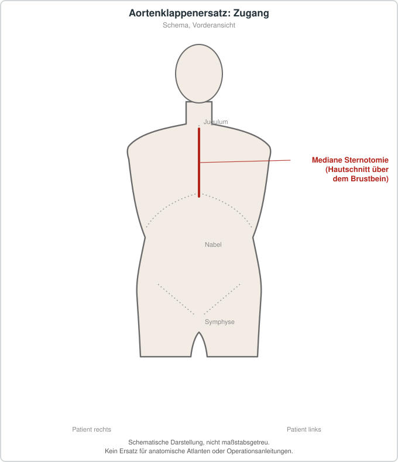

# Chirurgischer Aortenklappenersatz

## Übersicht

Der chirurgische Aortenklappenersatz ist ein operatives Verfahren, bei dem eine erkrankte Aortenklappe durch eine Klappenprothese ersetzt wird.[1][2] Er wird als Vergleichsverfahren zur kathetergestützten Aortenklappenimplantation (TAVI bzw. TAVR) betrachtet.[3][2] Neben der konventionellen Vollsternotomie werden auch minimalinvasive Zugänge wie die Mini-Sternotomie und die Mini-Thorakotomie beschrieben.[4] Die Wahl zwischen beiden Verfahren wird im Herzteam getroffen und sollte gemeinsam mit den Patientinnen und Patienten besprochen werden.[5][2]

## Indikationen und Kontraindikationen

Der Aortenklappenersatz kommt bei Patientinnen und Patienten mit schwerer Aortenstenose infrage, für die grundsätzlich sowohl ein chirurgisches als auch ein kathetergestütztes Vorgehen möglich ist.[2] Die Zulassung der TAVR für die symptomatische schwere Aortenstenose erfolgte laut einer Übersichtsarbeit nicht allein auf Basis des chirurgischen Risikolevels.[5] Randomisierte Daten zu beiden Verfahren liegen auch für Patientinnen und Patienten mit niedrigem chirurgischem Risiko vor.[3] Die Entscheidung hängt laut einer systematischen Übersicht von mehreren Faktoren ab, darunter die klinische Einschätzung des Herzteams und die Präferenzen der Patientinnen und Patienten.[2]

## Vorbereitung

Die Vorbereitung umfasst die Beurteilung im Herzteam, dessen Einschätzung bei der Entscheidung zwischen TAVR und Chirurgie eine zentrale Rolle spielt.[5] Die Definitionen des chirurgischen Risikos unterscheiden sich zwischen den Studien erheblich, weshalb die Risikoeinschätzung im Einzelfall kritisch zu betrachten ist.[2] Vorausgegangene Herzoperationen stellen eine eigene Ausgangssituation dar, die in Metaanalysen gesondert untersucht wurde.[6] Bei der Prothesenplanung ist das Verhältnis zwischen der effektiven Öffnungsfläche der Prothese und der Körpergröße des Patienten relevant, da eine Prothesen-Patienten-Fehlpassung mit der Sterblichkeit nach chirurgischem Klappenersatz in Zusammenhang gebracht wird.[7] Die Messmethoden und Grenzwerte für diese Fehlpassung variieren zwischen Studien, und eine Standardisierung wird diskutiert.[7]

## Ablauf Schritt für Schritt

1. Im Herzteam wird entschieden, ob ein chirurgischer Klappenersatz oder ein kathetergestütztes Verfahren erfolgt, wobei die Empfehlung des Herzteams ein Kriterium darstellt.[5][2]
2. Der operative Zugang wird festgelegt: Als Referenz gilt die Vollsternotomie, alternativ stehen die Mini-Sternotomie und die Mini-Thorakotomie zur Verfügung.[4]
3. Die Prothese wird ausgewählt, wobei neben konventionellen Prothesen auch sogenannte Sutureless-Prothesen eingesetzt werden können.[1]
4. Die Prothesengröße wird im Verhältnis zur Körpergröße geplant, um eine Prothesen-Patienten-Fehlpassung zu vermeiden.[7]
5. Der Klappenersatz wird über den gewählten Zugang durchgeführt, und im postoperativen Verlauf wird der Rhythmus überwacht, da ein Schrittmacher erforderlich werden kann.[4][1]
6. Bei Klappenprothesen wird die Indikation zur Antikoagulation geprüft, da eine orale Antikoagulation mit einer geringeren Rate an subklinischen Klappenthrombosen assoziiert war.[8]

## Nachsorge

Ein Teil der Nachsorge betrifft die Früherkennung subklinischer Klappenthrombosen, die in der Literatur mittels Multidetektor-Computertomographie beschrieben werden.[8] Bei Gewebeklappen ist eine orale Antikoagulation mit einer niedrigeren Inzidenz dieser Thrombosen assoziiert, wobei die Relevanz für neurologische Ereignisse in einer Metaanalyse nicht nachgewiesen wurde.[8] Nach einem chirurgischen Klappenersatz, bei dem ein permanenter Schrittmacher implantiert wurde, zeigte sich in einer Metaanalyse ein erhöhtes Langzeitmortalitätsrisiko, weshalb eine langfristige Verlaufsbeobachtung sinnvoll erscheint.[1] Da die meisten Patientinnen und Patienten in den Studien noch nicht fünf Jahre nachbeobachtet wurden, sind weitere Langzeitdaten erforderlich.[3]

## Komplikationen

Zu den Komplikationen zählen Blutungen, Schlaganfall, akute Nierenschädigung, Schrittmacherimplantation, paravalvuläre Leckagen und subklinische Klappenthrombosen.[4][8] In einer Netzwerkmetaanalyse war die Mini-Sternotomie im Vergleich zur Vollsternotomie mit niedrigeren Raten an Schlaganfall und akuter Nierenschädigung verbunden, während die Mini-Thorakotomie häufiger mit paravalvulären Leckagen und schweren Blutungen einherging.[4] Subklinische Klappenthrombosen wurden nach TAVR häufiger nachgewiesen als nach chirurgischem Klappenersatz, ohne dass dies mit einem erhöhten Risiko neurologischer Ereignisse verbunden war.[8] Eine Schrittmacherimplantation nach chirurgischem Klappenersatz wurde am häufigsten bei einem postoperativen kompletten AV-Block indiziert.[1]

## Ergebnisse und Prognose

Bei Patientinnen und Patienten mit niedrigem chirurgischem Risiko zeigte eine aktualisierte Metaanalyse nach fünf Jahren eine geringere Hazard-Rate für Tod jeder Ursache nach TAVR gegenüber SAVR, bei vergleichbaren Schlaganfallraten.[3] Eine ältere systematische Übersicht mit randomisierten Studien fand dagegen keinen signifikanten Unterschied in der Gesamtmortalität nach fünf Jahren.[2] Eine weitere Netzwerkmetaanalyse beschrieb, dass der anfängliche Mortalitätsvorteil der TAVI gegenüber der konventionellen Chirurgie im Zeitverlauf abnahm, wobei für die transfemorale TAVI ein konsistenter Vorteil gefunden wurde.[9] Die Befunde hängen somit stark von Nachbeobachtungsdauer und Patientenkollektiv ab.[3][9] Bei Patientinnen und Patienten mit früheren Herzoperationen zeigte sich in einer Metaanalyse kein Unterschied in der 30-Tage- oder 1-Jahres-Mortalität zwischen TAVR und SAVR, während die transapikale TAVR bei Hochrisikopatienten mit einer höheren Langzeitmortalität assoziiert war.[6] Für die Mini-Sternotomie wurde in einer Netzwerkmetaanalyse eine niedrigere 30-Tage-Mortalität im Vergleich zur Vollsternotomie berichtet.[4] Die Autoren einer weiteren Übersicht sehen die minimalinvasiven Verfahren als geeignete Vergleichsbasis für künftige Studien an.[4][9] Eine Schrittmacherrate ist nach TAVR allgemein niedriger als nach chirurgischem Ersatz, und die Assoziation einer Prothesen-Patienten-Fehlpassung mit der Mortalität ist für die chirurgische Klappe besser belegt als für die TAVR.[7]

## Informationen für Patientinnen und Patienten

Vor dem Eingriff ist eine Aufklärung über die verfügbaren Verfahren vorgesehen, die die Präferenzen der Patientinnen und Patienten einbezieht.[2] Das Verfahren wird zunehmend auch bei jüngeren Patientinnen und Patienten eingesetzt, für die die Datenlage begrenzt ist.[5][3] Die Auswahl des Vorgehens sollte daher auf die Datenlage und die individuelle Situation Bezug nehmen.[5][2] Für die Langzeitperspektive sind weitere randomisierte Studien und längere Nachbeobachtungen notwendig.[3]

## Schematische Darstellung

## Literatur

1. Servito M, Khoury W, Payne D et al.. Long-term impact of permanent cardiac pacing after surgical aortic valve replacement: systematic review and meta-analysis. Expert Rev Cardiovasc Ther. 2022;20:81-86. PMID: 35081844. DOI: 10.1080/14779072.2022.2031981. https://pubmed.ncbi.nlm.nih.gov/35081844/
2. Swift SL, Puehler T, Misso K et al.. Transcatheter aortic valve implantation versus surgical aortic valve replacement in patients with severe aortic stenosis: a systematic review and meta-analysis. BMJ Open. 2021;11:e054222. PMID: 34873012. DOI: 10.1136/bmjopen-2021-054222. https://pubmed.ncbi.nlm.nih.gov/34873012/
3. Reddy RK, Howard JP, Mack MJ et al.. Transcatheter vs Surgical Aortic Valve Replacement in Lower-Risk Patients: An Updated Meta-Analysis of Randomized Controlled Trials. J Am Coll Cardiol. 2025;85:926-940. PMID: 40044297. DOI: 10.1016/j.jacc.2024.12.031. https://pubmed.ncbi.nlm.nih.gov/40044297/
4. Awad AK, Ahmed A, Mathew DM et al.. Minimally invasive, surgical, and transcatheter aortic valve replacement: A network meta-analysis. J Cardiol. 2024;83:177-183. PMID: 37611742. DOI: 10.1016/j.jjcc.2023.08.010. https://pubmed.ncbi.nlm.nih.gov/37611742/
5. Atkins MD, Reardon MJ. What did the transcatheter aortic valve replacement-surgical aortic valve replacement (TAVR-SAVR) trials tell us?. Ann Cardiothorac Surg. 2024;13:206-210. PMID: 38841082. DOI: 10.21037/acs-2023-aae-0152. https://pubmed.ncbi.nlm.nih.gov/38841082/
6. Li YM, Tsauo JY, Jia KY et al.. Transcatheter and Surgical Aortic Valve Replacement in Patients With Previous Cardiac Surgery: A Meta-Analysis. Front Cardiovasc Med. 2020;7:612155. PMID: 33644123. DOI: 10.3389/fcvm.2020.612155. https://pubmed.ncbi.nlm.nih.gov/33644123/
7. Hahn RT, Pibarot P. Prosthesis-patient mismatch in transcatheter and surgical aortic valve replacement. Ann Cardiothorac Surg. 2024;13:211-223. PMID: 38841078. DOI: 10.21037/acs-2023-aae-0166. https://pubmed.ncbi.nlm.nih.gov/38841078/
8. Moscarelli M, Prestera R, Pernice V et al.. Subclinical Leaflet Thrombosis Following Surgical and Transcatheter Aortic Valve Replacement: A Meta-Analysis. Am J Cardiol. 2023;204:171-177. PMID: 37544140. DOI: 10.1016/j.amjcard.2023.07.089. https://pubmed.ncbi.nlm.nih.gov/37544140/
9. Fong KY, Yap JJL, Chan YH et al.. Network Meta-Analysis Comparing Transcatheter, Minimally Invasive, and Conventional Surgical Aortic Valve Replacement. Am J Cardiol. 2023;195:45-56. PMID: 37011554. DOI: 10.1016/j.amjcard.2023.02.017. https://pubmed.ncbi.nlm.nih.gov/37011554/
