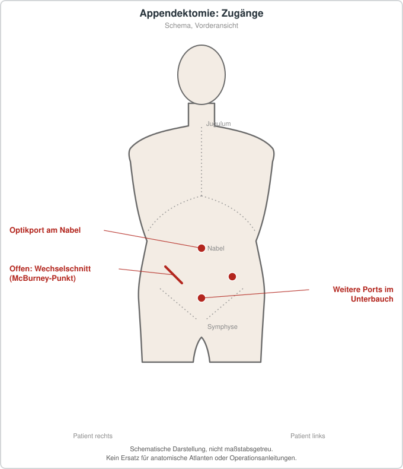

# Appendektomie

## Übersicht

Appendektomie ist die operative Entfernung des Wurmfortsatzes (Appendix vermiformis).[1] Sie wird vor allem bei akuter Appendizitis durchgeführt.[1] Die akute Appendizitis zählt weltweit zu den häufigsten chirurgischen Notfallerkrankungen.[2] Die Appendektomie gilt als Standardtherapie der akuten Appendizitis und kann offen oder laparoskopisch erfolgen.[3] In der Versorgung steht sie neben der antibiotischen Behandlung unkomplizierter Verläufe, für die die Datenlage zum direkten Vergleich weiterhin begrenzt ist.[2][3] Sie gilt als Rückzugsraum für die Biodiversität der Darmflora, und ihre Entfernung wird mit Veränderungen der Darmmikrobiota in Verbindung gebracht.[4] Ob sich daraus klinisch relevante Langzeitfolgen ergeben, ist noch nicht abschließend geklärt.[5][4]

## Epidemiologie und Einordnung

Die akute Appendizitis ist die häufigste Ursache eines akuten entzündlichen Abdomens.[6] Die Inzidenz wird mit etwa 1 Fall pro 1000 Personen und Jahr angegeben.[6] Für die Lebenszeitprävalenz werden etwa 7 bis 8 Prozent genannt.[3] Männer haben nach Angaben einer Übersichtsarbeit ein etwas höheres Lebenszeitrisiko für eine Appendizitis als Frauen, Frauen dagegen ein deutlich höheres Lebenszeitrisiko für eine Appendektomie.[6] Die größte Gefährdung für eine Appendektomie besteht laut dieser Quelle bei Mädchen im Alter von 12 bis 16 Jahren.[6] Komplexe Formen gelten als rascher fortschreitend in Richtung Perforation oder Abszess.[3] Die Einordnung in diese Kategorien ist für die Wahl des Vorgehens relevant, da komplizierte Verläufe mit einer höheren Rate postoperativer Komplikationen einhergehen.[1]

## Indikationen und Kontraindikationen

Die Appendektomie ist die etablierte Behandlung der akuten Appendizitis.[6] Dabei zeigte sich über alle Studien hinweg, dass sich die Erfolgsraten beider Optionen nicht signifikant unterschieden, mit einer Ausnahme: Antibiotika führten zu weniger Fehltagen am Arbeitsplatz.[3] Eine Cochrane-Übersicht schließt daraus, dass die Erfolgsdefinitionen in den Studien heterogen waren und überwiegend auf der Symptomremission beruhten, nicht auf dem langfristigen Auftreten von Rezidiven oder einem späteren Operationsbedarf.[2] Gegen eine alleinige antibiotische Behandlung spricht nach dieser Übersicht, dass sie mit Rezidiven und einem späteren Operationsbedarf verbunden sein kann.[2] In der randomisierten CODA-Studie wurde die Nichtunterlegenheit der Antibiotika gegenüber der Appendektomie im Hinblick auf den 30-Tage-Gesundheitsstatus berichtet.[3] Gleichzeitig benötigte nahezu ein Drittel der antibiotisch behandelten Patientinnen und Patienten innerhalb von 90 Tagen doch eine Appendektomie.[3] Bei komplizierter Appendizitis, also bei gangränösen oder perforierten Verläufen, ist das Risiko für postoperative Komplikationen erhöht.[1] Eine Übersicht zu laparoskopischen Eingriffen nach Appendektomie berichtet, dass die Komplikationsrate bei komplizierten Appendizitiden deutlich steigt.[7] In einer Vergleichsübersicht wurden Kinder, Schwangere und immunsupprimierte Personen ausgeschlossen, sodass deren Ergebnisse nicht ohne Weiteres übertragbar sind.[3] Eine Metaanalyse zu Appendektomien durch Assistenzchirurgen umfasste ebenfalls ein breites Spektrum an Studien, ohne dass sich daraus eine Kontraindikation für ein bestimmtes Setting ableiten lässt.[8]

## Vorbereitung

Die Diagnose einer akuten Appendizitis stützt sich nach den eingeschlossenen Studien meist auf klinische Beurteilung und Bildgebung.[2] Typische Befunde sind eine Wanderung des initial periumbilikalen Schmerzes in den rechten Unterbauch, Loslassschmerz, Fieber, Übelkeit oder Erbrechen.[3] Im Labor zeigen sich häufig eine Verschiebung der Leukozytenformel und ein Anstieg des C-reaktiven Proteins.[3] Zur Verifizierung werden sonografische, computertomografische oder kernspintomografische Untersuchungen des Abdomens eingesetzt.[3] Ergänzend werden Blutbild und Bildgebung als Grundlage der Diagnostik genannt.[6] Die geschätzte Rate negativer Appendektomien lag bei 13 Prozent, bei großer Variation zwischen einzelnen Studien.[9] Die Leitlinienempfehlung, auch normale Appendizes bei operativer Exploration zu entfernen, wird in dieser Übersicht ausdrücklich erwähnt.[9] Die Verfahren zur präoperativen Einschätzung, etwa Bildgebung oder Scores, wurden in dieser Übersicht als mögliche Einflussgrößen auf die Rate negativer Appendektomien untersucht.[9] Die Zuordnung zu Operateuren mit unterschiedlicher Erfahrung wurde in einer Metaanalyse verglichen; die Ergebnisse dazu werden im Abschnitt zu den Ergebnissen dargestellt.[8]

## Ablauf Schritt für Schritt

1. Die Wahl des Zugangs erfolgt laparoskopisch oder offen; in den eingeschlossenen Studien zum Vergleich mit Antibiotika wurde überwiegend laparoskopisch operiert, teils auch überwiegend offen.[2] Der laparoskopische Zugang gilt in der Standardtherapie als üblich.[3]
2. Nach Darstellung der Appendix wird das Stadium der Entzündung beurteilt, da phlegmonöse, gangränöse und perforierte Befunde unterschiedliche Verläufe haben.[1]
3. Die Appendix wird entfernt, und der Appendixstumpf wird verschlossen. Die Verschlusstechnik mit Metallclip oder Endoloop variiert zwischen Chirurginnen und Chirurgen.[6]
4. Bei Peritonitis oder Abszessbildung wird die Bauchhöhle gespült; die laparoskopische Spülung und Drainage war in einer Übersicht das am häufigsten eingesetzte Verfahren bei Re-Eingriffen.[7]
5. Ob eine Drainage in den Bauchraum eingelegt wird, ist bei komplizierter Appendizitis umstritten. Unterschieden werden offene und geschlossene Drainagen.[1]
6. Postoperativ wurden in den eingeschlossenen Studien zur Drainage alle Teilnehmenden mit Antibiotika behandelt, und die Studien verwendeten überwiegend Breitspektrum-Regime.[1][2]
7. Der Zeitpunkt der Drainageentfernung ist ein eigenständig untersuchter Parameter in der Literatur.[1]

## Nachsorge

Die Verweildauer im Krankenhaus betrug in einer Übersicht zu laparoskopischen Re-Eingriffen im Mittel etwa fünf Tage, wobei es sich um Patientinnen und Patienten mit postoperativen Komplikationen handelte.[7] In einer Metaanalyse zur Verweildauer nach Appendektomie durch Assistenzchirurgen zeigte sich eine geringfügig kürzere Verweildauer, allerdings mit statistischer Heterogenität zwischen den Studien.[8] Für die Rückkehr an den Arbeitsplatz ist relevant, dass antibiotische Behandlungen in Studien mit weniger Fehltagen verbunden waren.[3]

## Komplikationen

Als am meisten gefürchtete Komplikation gilt der intraabdominelle Abszess.[7] Der intraabdominelle Abszess war in der Metaanalyse zu Drainagen das primäre kritische Outcome; Wundinfektionen, Morbidität, Mortalität und Krankenhausaufenthalt wurden als wichtige Nebenoutcomes erfasst.[1] In einer Übersicht zu laparoskopischen Eingriffen bei frühen postoperativen Komplikationen zeigte sich, dass die häufigsten Eingriffe Spülungen und Drainagen bei generalisierter Peritonitis oder Abszessen waren.[7] Seltenere Komplikationen waren Adhäsionen mit Dünndarmverschluss, eine unbemerkte Dünndarmläsion oder ein Stumpfleck.[7] Bei 7,8 Prozent der Eingriffe musste auf ein offenes Vorgehen konvertiert werden, und etwa 12,9 Prozent der Betroffenen benötigten eine zusätzliche Intervention.[7] Beim Vergleich von Metallclip und Endoloop zum Stumpfverschluss unterschieden sich Wiedereingriffs-, Wiederaufnahme- und Wundinfektionsraten nicht signifikant.[6] Für die Komplikationen bei Operationen durch Assistenzchirurgen zeigte sich in einer Metaanalyse kein Unterschied in der Mortalität und bei Gesamt- oder Major-Komplikationen.[8] Ein früher Rezidiv- oder Operationsbedarf bei antibiotisch behandelten Patientinnen und Patienten ist ebenfalls eine relevante Komplikation des konservativen Ansatzes.[2][3]

## Ergebnisse und Prognose

Laparoskopische Appendektomie führte in einer Übersichtsarbeit gegenüber offener Appendektomie zu weniger Schmerzen, geringeren Wundinfektionsraten und kürzerem Krankenhausaufenthalt.[3] Eine Metaanalyse zur Qualität der Verfahren kommt zu dem Schluss, dass eine Appendektomie durch Assistenzchirurgen die Sicherheit für Patientinnen und Patienten nicht beeinträchtigt; sie betont jedoch die Notwendigkeit weiterer randomisierter Studien mit standardisierten Endpunkten.[8] Dieser Zusammenhang war in europäischen Populationen nicht signifikant, während er in amerikanischen und asiatischen Populationen auftrat.[5] Die Autorinnen und Autoren betonen, dass weitere hochwertige Studien zur klinischen Entscheidungsfindung notwendig sind.[5] Eine Übersicht zur Darmmikrobiota fasst die Evidenz zu Dysbiose und Erkrankungen zusammen, ohne dass sich daraus eine verlässliche klinische Konsequenz ableiten lässt.[4] Eine Metaanalyse fand keine erhöhte Rate schwerer Verläufe oder Rezidive bei Patientinnen und Patienten mit früherer Appendektomie, wohl aber eine erhöhte Rate an Kolektomien in dieser Gruppe.[10] Die Ergebnisse basieren auf einer begrenzten Zahl von Studien und sollten prospektiv überprüft werden.[10] Die Autorinnen und Autoren der Cochrane-Übersicht stufen alle eingeschlossenen Studien mit einem insgesamt hohen Verzerrungsrisiko ein, sodass die Schlussfolgerungen zur Routinedrainage nur eingeschränkt belastbar sind.[1]

## Informationen für Patientinnen und Patienten

Akute Bauchschmerzen, die vom Nabel in den rechten Unterbauch wandern, können mit Fieber, Übelkeit und Erbrechen einhergehen und sollten zeitnah ärztlich abgeklärt werden.[3] Der Schmerz kann im Verlauf zunehmen und sich durch Bewegung verstärken.[6] Ob eine Operation notwendig ist, lässt sich aus einzelnen Symptomen nicht zuverlässig ableiten; die Entscheidung stützt sich auf Untersuchung und Bildgebung.[2][3] Bei unkomplizierten Verläufen können Antibiotika eine Alternative zur Operation sein, wobei ein Teil der Betroffenen dennoch später operiert werden muss.[2][3] Nach einer Appendektomie kann es zu Wundinfektionen oder intraabdominellen Infektionen kommen, insbesondere bei komplizierten Verläufen.[1][7]

## Schematische Darstellung

## Literatur

1. Tang Y, Liu J, Bai G et al.. Abdominal drainage to prevent intraperitoneal abscess after appendectomy for complicated appendicitis. Cochrane Database Syst Rev. 2025;4:CD010168. PMID: 40214287. DOI: 10.1002/14651858.CD010168.pub5. https://pubmed.ncbi.nlm.nih.gov/40214287/
2. Doleman B, Fonnes S, Lund JN et al.. Appendectomy versus antibiotic treatment for acute appendicitis. Cochrane Database Syst Rev. 2024;4:CD015038. PMID: 38682788. DOI: 10.1002/14651858.CD015038.pub2. https://pubmed.ncbi.nlm.nih.gov/38682788/
3. Köhler F, Hendricks A, Kastner C et al.. Laparoscopic appendectomy versus antibiotic treatment for acute appendicitis-a systematic review. Int J Colorectal Dis. 2021;36:2283-2286. PMID: 33852068. DOI: 10.1007/s00384-021-03927-5. https://pubmed.ncbi.nlm.nih.gov/33852068/
4. Babakhanov AT, Dzhumabekov AT, Zhao AV et al.. Impact of Appendectomy on Gut Microbiota. Surg Infect (Larchmt). 2021;22:651-661. PMID: 33523761. DOI: 10.1089/sur.2020.422. https://pubmed.ncbi.nlm.nih.gov/33523761/
5. Liu Z, Ma X, Zhu C et al.. Risk of colorectal cancer after appendectomy: A systematic review and meta-analysis. J Gastroenterol Hepatol. 2023;38:350-358. PMID: 36637673. DOI: 10.1111/jgh.16108. https://pubmed.ncbi.nlm.nih.gov/36637673/
6. Almeida DS, Medina LHA, Coelho ER et al.. Endoloop Versus Metallic Clip for Stump Closure in Laparoscopic Appendectomy: A Systematic Review and Meta-Analysis. Cureus. 2025;17:e77471. PMID: 39958036. DOI: 10.7759/cureus.77471. https://pubmed.ncbi.nlm.nih.gov/39958036/
7. Weber G, Bras Harriott C, Casas MA et al.. Laparoscopic approach for the treatment of acute complications after appendectomy: a systematic review. Minerva Surg. 2023;78:433-438. PMID: 36789906. DOI: 10.23736/S2724-5691.22.09835-5. https://pubmed.ncbi.nlm.nih.gov/36789906/
8. Anyomih TT, Jennings T, Mehta A et al.. Systematic review and meta-analysis comparing perioperative outcomes of emergency appendectomy performed by trainee vs trained surgeon. Am J Surg. 2023;225:168-179. PMID: 35927089. DOI: 10.1016/j.amjsurg.2022.07.006. https://pubmed.ncbi.nlm.nih.gov/35927089/
9. Henriksen SR, Christophersen C, Rosenberg J et al.. Varying negative appendectomy rates after laparoscopic appendectomy: a systematic review and meta-analysis. Langenbecks Arch Surg. 2023;408:205. PMID: 37219616. DOI: 10.1007/s00423-023-02935-z. https://pubmed.ncbi.nlm.nih.gov/37219616/
10. Naga YSE, Dhindsa BS, Bapaye J et al.. A Systematic Review and Meta-Analysis: A Prior Appendectomy Does Not Increase the Risk of Severe Clostridioides difficile Infection or Recurrence. Dig Dis Sci. 2023;68:3714-3720. PMID: 37402978. DOI: 10.1007/s10620-023-07998-y. https://pubmed.ncbi.nlm.nih.gov/37402978/
