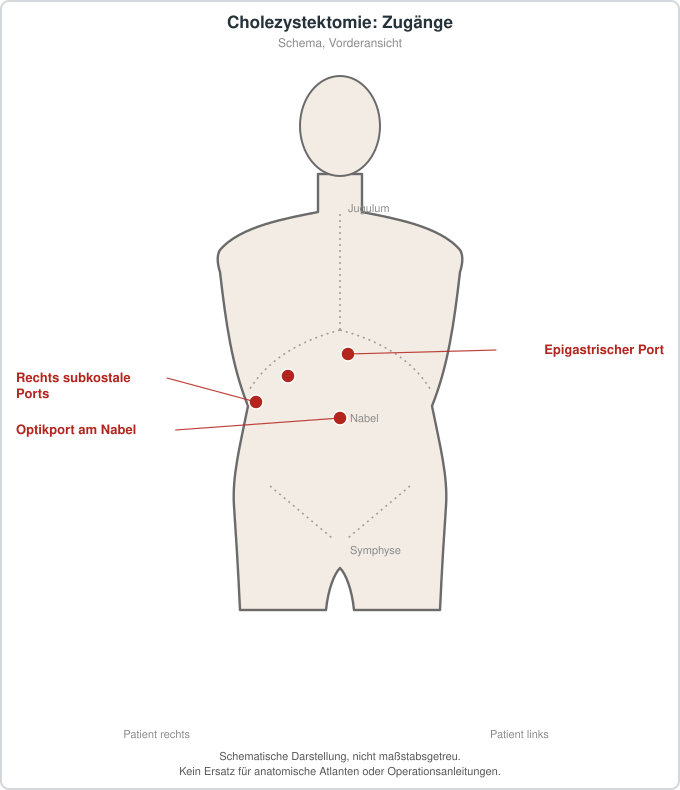

# Cholezystektomie

## Übersicht

Die laparoskopische Cholezystektomie ist nach den vorliegenden Leitlinien der Standardeingriff zur Behandlung einer symptomatischen Cholelithiasis oder einer akuten Cholezystitis bei Patientinnen und Patienten ohne spezifische Kontraindikationen.[1] Sie zählt zu den am häufigsten durchgeführten chirurgischen Eingriffen in Europa und weltweit.[1] Im Vergleich zur offenen Operation zeigte eine aktuelle Metaanalyse für die laparoskopische Technik eine geringere Mortalität, weniger Komplikationen und eine kürzere Krankenhausverweildauer.[2] Eine roboterassistierte Cholezystektomie zeigte in dieser Auswertung keinen klinischen Vorteil gegenüber der laparoskopischen Methode.[2] Die Vermeidung und Behandlung von Gallengangsverletzungen gilt als zentraler Sicherheitsaspekt des Eingriffs.[1][3] Gallengangsverletzungen werden in den Quellen als seltene, aber schwerwiegende Komplikation beschrieben.[1] Ihre Häufigkeit wird in einer Leitlinie mit 0,4 bis 1,5 % angegeben.[3]

## Indikationen und Kontraindikationen

Die laparoskopische Cholezystektomie wird bei symptomatischer Gallensteinerkrankung und bei akuter Cholezystitis eingesetzt, sofern keine spezifischen Gegenanzeigen vorliegen.[1] Bei Kindern waren Cholelithiasis und Cholezystitis die häufigsten Indikationen, gefolgt von der biliären Dyskinesie.[4] Für Patientinnen und Patienten mit akuter Cholezystitis empfiehlt die WSES-Leitlinie eine laparoskopische Cholezystektomie möglichst innerhalb von 48 Stunden, spätestens jedoch innerhalb von zehn Tagen nach Symptombeginn.[3] Bei Hochrisikopatientinnen und -patienten, die initial mit einer perkutanen Cholezystostomie behandelt wurden, zeigte eine Metaanalyse zwischen einer frühen Intervall-Cholezystektomie (unter 30 Tagen) und einer späteren (ab 30 Tagen) keine signifikanten Unterschiede in Konversionsrate, 90-Tage-Morbidität oder 90-Tage-Mortalität.[5] Die Autoren betonen, dass Patientenfaktoren, klinische Erfahrung und Klinikausstattung möglicherweise bedeutsamere Einflussgrößen sind.[5] Bei Patientinnen und Patienten mit Leberzirrhose ist die laparoskopische Cholezystektomie in den meisten Fällen sicher, die Komplikationsraten liegen jedoch deutlich über denen der Allgemeinbevölkerung.[6] Als Risikokonstellationen mit erhöhtem Bedarf an präoperativer Abklärung nennt die WSES-Leitlinie unter anderem die skleroatrophische Cholezystitis und das Mirizzi-Syndrom.[3] Frailty kann nach einer Metaanalyse als präoperativer Prädiktor für Mortalität und Morbidität nach Cholezystektomie dienen.[7] Die Autoren schlagen vor, Frailty-Assessments in die präoperative Beurteilung einzubeziehen, unter anderem bei der Entscheidung zwischen chirurgischem und konservativem Vorgehen sowie zwischen offenem und laparoskopischem Zugang.[7]

## Vorbereitung

Bei Patientinnen und Patienten mit Risikokonstellationen wie der skleroatrophischen Cholezystitis oder dem Mirizzi-Syndrom ist vor der Cholezystektomie eine ausführliche präoperative Abklärung vorgesehen, um Risiken und Nutzen abzuwägen.[3] Eine Leitlinie empfiehlt, bei entsprechenden Konstellationen den Eingriff an erfahrene Chirurginnen und Chirurgen oder an ein multidisziplinäres hepatobiliäres Team zu überweisen.[8] Dieselbe Empfehlung gilt für Patientinnen und Patienten mit bestätigter oder vermuteter Gallengangsverletzung.[8] Die Behandlung nach einem Schema für beschleunigte Genesung (ERAS) umfasst prä-, intra- und postoperative Maßnahmen, die die Erholung fördern und die Krankenhausverweildauer verkürzen sollen.[9] In einer systematischen Übersicht waren ERAS-Protokolle bei laparoskopischer Cholezystektomie mit geringeren postoperativen Schmerz-, Übelkeits- und Erbrechensraten verbunden, ohne statistisch signifikant erhöhtes Komplikationsrisiko.[9] Die Autoren halten jedoch weitere Studien für erforderlich, um einen Konsens zum perioperativen Protokoll zu etablieren.[9] Für die präoperative Beurteilung ist eine Frailty-Einschätzung, insbesondere bei älteren Patientinnen und Patienten, als zusätzliches Instrument beschrieben.[7]

## Ablauf Schritt für Schritt

1. Die Operation erfolgt laparoskopisch, wobei eine Dreiport-Technik als empfohlene technische Vorgehensweise beschrieben wird.[10]
2. Das Pneumoperitoneum wird mit niedrigem Druck angelegt, was als empfohlener Aspekt der Operationstechnik gilt.[10]
3. Die Gallenblase wird präpariert, wobei das Ziel ist, die Anatomie des Calot-Dreiecks („critical view of safety“, CVS) mit allen drei Komponenten darzustellen; dies gilt als empfohlener Ansatz zur Minimierung des Verletzungsrisikos.[1][3]
4. Bei unklarer Anatomie oder Verdacht auf eine Gallengangsverletzung wird eine intraoperative Gallenwegsbildgebung eingesetzt; hierfür sprach sich eine Leitlinie mit starker Empfehlung aus.[8]
5. Die intraoperative Cholangiographie dient der Erkennung von Gallengangsanatomie und Choledocholithiasis, eine routinemäßige Anwendung zur Senkung der Verletzungsrate wird jedoch nicht empfohlen.[1][11]
6. Ist das CVS bei einer schwierigen Cholezystektomie nicht erreichbar, sollte nach den Leitlinienempfehlungen eine Rettungsstrategie wie die subtotale Cholezystektomie in Betracht gezogen werden.[3][12]
7. Eine Konversion zur offenen Operation kann erwogen werden, wenn der Eingriff laparoskopisch nicht durchführbar ist; eine Evidenz, die Konversion als Strategie zur Verringerung des Verletzungsrisikos zu nutzen, existiert nach dieser Leitlinie jedoch nicht.[3]
8. Die Gallenblase wird über den Nabelport entnommen, was in den Empfehlungen als technischer Bestandteil beschrieben wird.[10]
9. Das Pneumoperitoneum wird aktiv abgesaugt und die Bauchhöhle mit Kochsalzlösung gespült.[10]
10. Eine routinemäßige Drainage wird nach den PROSPECT-Empfehlungen nicht empfohlen, da hierfür keine Evidenz für verbesserte Schmerzwerte vorliegt.[10]

Die subtotale Cholezystektomie wurde in einer Metaanalyse bei schwer entzündeten Gallenblasen mit der totalen verglichen: Sie senkte das Risiko für eine Verletzung des Ductus choledochus, erhöhte aber das Risiko für Gallenlecks, postoperative ERCP, intraabdominelle Flüssigkeitsansammlungen und Reoperationen.[12] Die Autoren bezeichnen sie als vertretbare Alternative, die jedoch Kenntnis beider Verfahren voraussetzt.[12]

## Nachsorge

Nach laparoskopischer Cholezystektomie können erhebliche postoperative Schmerzen auftreten, die schwer zu behandeln sind.[10] Die PROSPECT-Empfehlungen sehen eine multimodale Analgesie vor, bei der Paracetamol mit NSAR oder COX-2-Hemmern kombiniert wird, ergänzt um intraoperatives Dexamethason, eine Wundinfiltration an den Trokarstellen oder eine intraperitoneale Lokalanästhetika-Instillation; Opioide dienen der Rescue-Analgesie.[10] Regionale Verfahren wie der Erector-spinae-Plane-Block oder der Transversus-abdominis-Plane-Block werden als Zweitlinienoption bei erhöhtem Schmerzrisiko beschrieben.[10] Bei Verdacht auf eine Gallengangsverletzung nach dem Eingriff sollte eine zeitnahe Diagnostik erfolgen, da eine späte Diagnose zu verzögerter oder unangemessener Behandlung führen kann.[3] Eine Leitlinie betont, dass die Beurteilung von Behandlungsergebnissen langfristig erfolgen sollte, da späte Komplikationen wie Gallenwegsstrikturen, rezidivierende Cholangitis oder sekundäre biliäre Zirrhose auftreten können.[3]

## Komplikationen

Eine Leitlinie beschreibt sie als seltene, aber schwerwiegende Komplikation, für die aufgrund geringer Ereignishäufigkeit wenig prospektive Evidenz existiert.[1] Eine andere Leitlinie bezeichnet sie als häufigste ernsthafte Komplikation der laparoskopischen Cholezystektomie.[8][13] Einig sind sich die Quellen darin, dass eine Verletzung ein Risiko für Morbidität, Mortalität und Lebensqualität darstellt.[3] Bei einer festgestellten Gallengangsverletzung werden die frühzeitige Diagnose, eine präzise Klassifikation und eine standardisierte Behandlung als entscheidend beschrieben.[3] Eine Metaanalyse gibt für Kinder eine Gallengangsverletzung von 0,4 % als Hauptkomplikation an, wobei die Gesamtkomplikationsrate bei 3,4 % lag.[4] Als weitere Komplikationen nach Cholezystektomie wurden Blutungen beschrieben.[4] Bei Patientinnen und Patienten mit Leberzirrhose berichtete eine Metaanalyse für die postoperative Leberdekompensation, Gallenlecks, Wundinfektionen, Pneumonien und thromboembolische Ereignisse Raten, die über denen der Allgemeinbevölkerung liegen.[6] Die Autoren empfehlen weitere Anstrengungen zur Senkung von Gallenlecks, Leberdekompensation und Mortalität.[6] Strikturen der Anastomose treten nach einem Literaturüberblick mit Häufigkeiten zwischen 4,1 % und 69 % auf, wobei die meisten Studien 10 bis 20 % berichten.[3] Eine biliäre Zirrhose nach Behandlung wird mit 2,4 bis 10,9 % angegeben.[3] Assoziierte Faktoren für schlechtere Ergebnisse sind unter anderem eine begleitende Gefäßverletzung, Sepsis oder Peritonitis sowie postoperative Gallenlecks.[3] Eine Leitlinie empfiehlt bei bestätigter oder vermuteter Gallengangsverletzung die Überweisung an erfahrene Chirurginnen und Chirurgen oder an ein multidisziplinäres hepatobiliäres Team.[8]

## Ergebnisse und Prognose

Die Behandlung von Gallengangsverletzungen gilt in den Fallserien überwiegend als erfolgreich, wobei die Evidenz überwiegend aus Fallserien stammt.[3] In einer Serie mit 31 Patientinnen und Patienten traten bei 32,3 % späte postoperative Komplikationen wie Stenosen und Cholangitiden auf; eine Langzeitbeobachtung von 24 Patienten zeigte nur in einem Fall eine biliäre Zirrhose.[3] Die Autoren der WSES-Leitlinie bezeichnen die Langzeitergebnisse damit insgesamt als zufriedenstellend.[3] Hinsichtlich des Zeitpunkts der definitiven Reparatur einer Gallengangsverletzung empfiehlt eine aktuelle Leitlinie unter geringer Evidenzsicherheit eine verzögerte Reparation (mehr als sechs Wochen) gegenüber einer frühen (weniger als sechs Wochen).[14] Eine Metaanalyse fand dagegen, dass frühe Reparaturen mit höheren Raten an Reoperation, Stenose und Mortalität assoziiert waren als späte.[15] Beide Quellen weisen auf eine sehr geringe bis geringe Evidenzsicherheit hin.[14][15] Für die Wahl des Zugangs zur Reparatur (minimalinvasiv oder offen) sowie für die Wahl zwischen Hepatojejunostomie und Hepaticoduodenostomie fand eine Leitlinie nur eine bedingte Empfehlung auf Basis sehr niedriger Evidenz.[14] Eine Metaanalyse fand bei minimalinvasiver und offener Reparatur ähnliche Ergebnisse und bei Hepatojejunostomie und Hepaticoduodenostomie vergleichbare Ergebnisse.[15] Operative Verfahren waren in dieser Auswertung bei größeren Verletzungen den nichtoperativen Verfahren überlegen.[15] Die Mortalität durch Gallengangsverletzungen wird mit 1,8 bis 4,6 % angegeben, und es gibt Hinweise auf eine erhöhte Sterblichkeit nach 20 Jahren im Vergleich zur erwarteten altersadjustierten Sterberate.[3] Gallengangsverletzungen gehen außerdem mit einer Beeinträchtigung der gesundheitsbezogenen Lebensqualität einher, die auch Jahre nach der Behandlung berichtet wird.[3] Zur intraoperativen Cholangiographie zeigte eine Metaanalyse mit 14 Studien keine signifikanten Unterschiede bei der Detektion von Choledocholithiasis, verpassten Steinen oder Gallengangsverletzungsraten zwischen selektivem und routinemäßigem Einsatz.[11] Die Autoren betonen eine heterogene Studienlage, die größere, robustere Studien erforderlich macht.[11]

## Informationen für Patientinnen und Patienten

Nach laparoskopischer Cholezystektomie können Schmerzen auftreten, die ärztlich behandelt werden können.[10] Eine Gallengangsverletzung ist eine seltene, aber ernsthafte Komplikation des Eingriffs.[1] Bei anhaltenden Beschwerden nach der Operation sollte daher zeitnah ärztlich abgeklärt werden, da eine frühzeitige Diagnose und Behandlung die Ergebnisse verbessern können.[3] Die laparoskopische Operation gilt in den Leitlinien als Standardverfahren.[1]

## Schematische Darstellung

## Literatur

1. Eikermann M, Siegel R, Broeders I et al.. Prevention and treatment of bile duct injuries during laparoscopic cholecystectomy: the clinical practice guidelines of the European Association for Endoscopic Surgery (EAES). Surg Endosc. 2012;26:3003-39. PMID: 23052493. DOI: 10.1007/s00464-012-2511-1. https://pubmed.ncbi.nlm.nih.gov/23052493/
2. Delpino FM, Tustumi F, Siqueira MM et al.. Comparison between open, laparoscopic, and robotic cholecystectomy: a systematic review and meta-analysis. Am J Surg. 2026;257:116972. PMID: 42056779. DOI: 10.1016/j.amjsurg.2026.116972. https://pubmed.ncbi.nlm.nih.gov/42056779/
3. de'Angelis N, Catena F, Memeo R et al.. 2020 WSES guidelines for the detection and management of bile duct injury during cholecystectomy. World J Emerg Surg. 2021;16:30. PMID: 34112197. DOI: 10.1186/s13017-021-00369-w. https://pubmed.ncbi.nlm.nih.gov/34112197/
4. Mattson A, Sinha A, Njere I et al.. Laparoscopic cholecystectomy in children: A systematic review and meta-analysis. Surgeon. 2023;21:e133-e141. PMID: 36243605. DOI: 10.1016/j.surge.2022.09.003. https://pubmed.ncbi.nlm.nih.gov/36243605/
5. Kourounis G, Rooke ZC, McGuigan M et al.. Systematic review and meta-analysis of early vs late interval laparoscopic cholecystectomy following percutaneous cholecystostomy. HPB (Oxford). 2022;24:1405-1415. PMID: 35469743. DOI: 10.1016/j.hpb.2022.03.016. https://pubmed.ncbi.nlm.nih.gov/35469743/
6. Wiseman V, Moore J, McKeown S et al.. Post-operative morbidity and mortality of laparoscopic cholecystectomy in patients with cirrhosis: a systematic review and meta-analysis. HPB (Oxford). 2025;27:1131-1141. PMID: 40579274. DOI: 10.1016/j.hpb.2025.06.002. https://pubmed.ncbi.nlm.nih.gov/40579274/
7. Niknami M, Tahmasbi H, Firouzabadi SR et al.. Frailty as a predictor of mortality and morbidity after cholecystectomy: A systematic review and meta-analysis of cohort studies. Langenbecks Arch Surg. 2024;409:352. PMID: 39557689. DOI: 10.1007/s00423-024-03537-z. https://pubmed.ncbi.nlm.nih.gov/39557689/
8. Brunt LM, Deziel DJ, Telem DA et al.. Safe Cholecystectomy Multi-society Practice Guideline and State of the Art Consensus Conference on Prevention of Bile Duct Injury During Cholecystectomy. Ann Surg. 2020;272:3-23. PMID: 32404658. DOI: 10.1097/SLA.0000000000003791. https://pubmed.ncbi.nlm.nih.gov/32404658/
9. Istrate AM, Serban D, Doran H et al.. Enhanced Recovery After Surgery in Laparoscopic Cholecystectomy - A Systematic Review. Chirurgia (Bucur). 2024;119:318-329. PMID: 38982910. DOI: 10.21614/chirurgia.2024.v.119.i.3.p.318. https://pubmed.ncbi.nlm.nih.gov/38982910/
10. Bourgeois C, Oyaert L, Van de Velde M et al.. Pain management after laparoscopic cholecystectomy: A systematic review and procedure-specific postoperative pain management (PROSPECT) recommendations. Eur J Anaesthesiol. 2024;41:841-855. PMID: 39129451. DOI: 10.1097/EJA.0000000000002047. https://pubmed.ncbi.nlm.nih.gov/39129451/
11. Hall C, Amatya S, Shanmugasundaram R et al.. Intraoperative Cholangiography in Laparoscopic Cholecystectomy: A Systematic Review and Meta-Analysis. JSLS. 2023;27. PMID: 36923161. DOI: 10.4293/JSLS.2022.00093. https://pubmed.ncbi.nlm.nih.gov/36923161/
12. Koo SS, Krishnan RJ, Ishikawa K et al.. Subtotal vs total cholecystectomy for difficult gallbladders: A systematic review and meta-analysis. Am J Surg. 2024;229:145-150. PMID: 38168604. DOI: 10.1016/j.amjsurg.2023.12.022. https://pubmed.ncbi.nlm.nih.gov/38168604/
13. Brunt LM, Deziel DJ, Telem DA et al.. Safe cholecystectomy multi-society practice guideline and state-of-the-art consensus conference on prevention of bile duct injury during cholecystectomy. Surg Endosc. 2020;34:2827-2855. PMID: 32399938. DOI: 10.1007/s00464-020-07568-7. https://pubmed.ncbi.nlm.nih.gov/32399938/
14. Calabrese EC, Slater BJ, Awad Z et al.. SAGES-AHPBA 2025 guideline for the surgical management of bile duct injury following cholecystectomy. Surg Endosc. 2026;40:1-17. PMID: 41266841. DOI: 10.1007/s00464-025-12352-6. https://pubmed.ncbi.nlm.nih.gov/41266841/
15. Esparham A, Calabrese EC, Ganescu O et al.. SAGES-AHPBA 2025: a systematic review and meta-analysis on the surgical management of bile duct injury following cholecystectomy. Surg Endosc. 2025;39:7905-7925. PMID: 41193912. DOI: 10.1007/s00464-025-12357-1. https://pubmed.ncbi.nlm.nih.gov/41193912/
