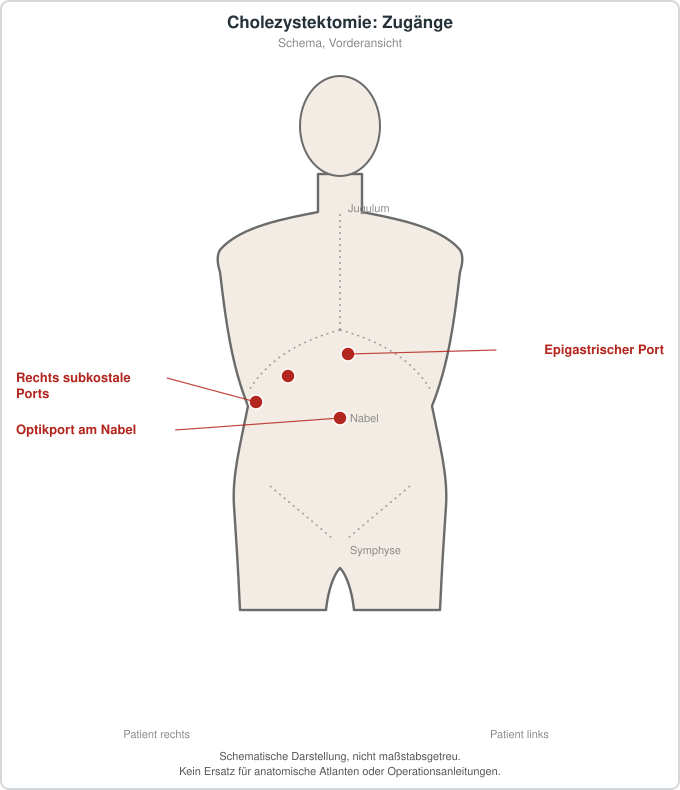

# Cholezystektomie

## Übersicht

Die Cholezystektomie bezeichnet die operative Entfernung der Gallenblase. Sie wird insbesondere bei symptomatischer Gallensteinerkrankung, bei akuter Cholezystitis oder in weiteren sorgfältig zu bewertenden Konstellationen erwogen. Die laparoskopische Cholezystektomie ist ein häufig eingesetztes Verfahren; die Vermeidung und Behandlung von Gallengangsverletzungen ist ein zentraler Sicherheitsaspekt.[1]

## Epidemiologie und Einordnung

Gallensteine sind häufig, aber nicht jeder Nachweis in der Bildgebung begründet einen Eingriff. Die Operationsentscheidung orientiert sich an Beschwerden, Komplikationen und dem individuellen Risiko.

## Diagnostik, Indikationsrahmen und Vorbereitung

Indikation, Zeitpunkt und Zugangsweg sind abhängig von Beschwerden, Entzündungs- und Komplikationszeichen, Bildgebung, möglicher Choledocholithiasis, Operationsrisiko und Behandlungszielen. Bei Verdacht auf Gallengangssteine oder biliäre Obstruktion kann zusätzliche Diagnostik beziehungsweise ein interdisziplinäres Vorgehen erforderlich sein. Nicht jede zufällig festgestellte Cholezystolithiasis ist automatisch operationsbedürftig.

## Therapie, Sicherheit und Nachsorge

Der Eingriff gehört in geeignete chirurgische Strukturen. Relevante Risiken sind unter anderem Blutung, Infektion, Galleleck, Verletzung von Gallenwegen oder Nachbarorganen, thromboembolische und anästhesiologische Komplikationen. Postoperativ richten sich Beobachtung, Schmerztherapie, Mobilisation und weitere Diagnostik nach Verlauf und lokalen Standards. Anhaltende Schmerzen, Fieber, Ikterus oder Kreislaufbeschwerden nach einem Eingriff benötigen zeitnahe ärztliche Beurteilung.

## Patienteninformation

Die Entfernung der Gallenblase ist eine individuelle Entscheidung nach ärztlicher Abklärung. Dieser Text ersetzt weder die Aufklärung vor einer Operation noch eine Beratung zu Alternativen und persönlichen Risiken.

## Schematische Darstellung

*Laparoskopisch (Standard): Optikport am Nabel, ein epigastrischer und zwei rechts subkostale Ports (Anordnung variiert). Der offene Zugang (rechtsseitiger Rippenbogenrandschnitt) ist nicht dargestellt. Schematische Darstellung, nicht maßstabsgetreu. Kein Ersatz für anatomische Atlanten oder Operationsanleitungen.*
## Literatur

1. Eikermann M, et al. *Prevention and treatment of bile duct injuries during laparoscopic cholecystectomy: EAES clinical practice guidelines.* Surg Endosc. 2012;26:3003-3039. PMID: 23052493. https://pubmed.ncbi.nlm.nih.gov/23052493/
