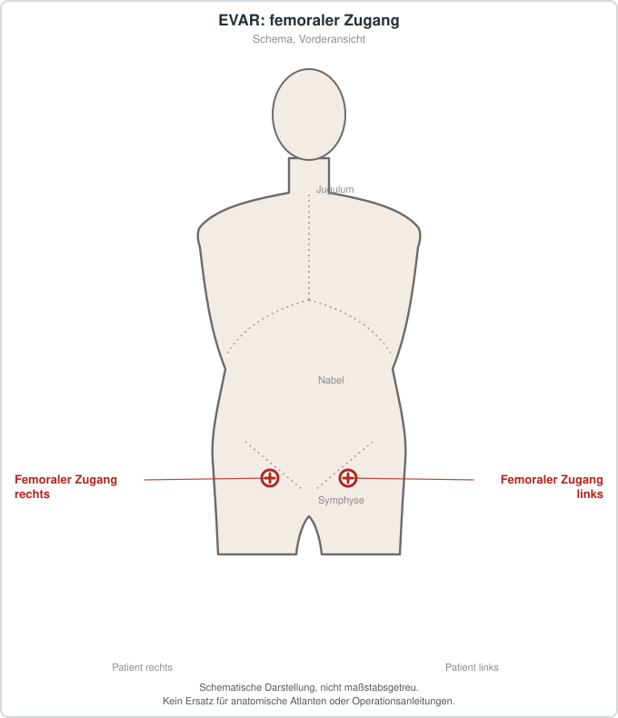

# Endovaskuläre Aortenaneurysmareparatur (EVAR)

## Übersicht

Die endovaskuläre Aortenaneurysmareparatur (EVAR) ist ein minimalinvasives Verfahren zur Behandlung von Aneurysmen der Aorta abdominalis, bei dem ein Stentgraft über die Gefäße eingebracht wird, anstatt das Aneurysma offen chirurgisch zu ersetzen.[1][2] Minimalinvasive Verfahren gelten für nicht rupturierte Aneurysmen als sinnvolle Alternative zur offenen Reparatur.[2] Die Zahl endovaskulärer Reparaturen hat weltweit inzwischen die Zahl offener Aneurysmaoperationen überholt.[1] Die European Society for Vascular Surgery hat 2024 Leitlinien für Aneurysmen der Bauch- und Beckenarterien vorgelegt, die die Vorgängerversionen von 2011 und 2019 ablösen.[3] Sie enthalten Empfehlungen zur Diagnostik, Überwachung, offenen und endovaskulären Reparatur sowie zur Behandlung rupturierter und komplexer Aneurysmen.[3]

## Indikationen und Kontraindikationen

Die Leitlinie unterscheidet zwischen kleinen Aneurysmen, bei denen zunächst Überwachung und kardiovaskuläre Risikoreduktion im Vordergrund stehen, und Aneurysmen mit Reparaturindikation.[3] Für elektive Eingriffe gehören eine Abschätzung des operativen Risikos und der Vergleich offener und endovaskulärer Verfahren zu den Leitlinienthemen.[3] Auch bei rupturierten oder symptomatischen Aneurysmen werden endovaskuläre Reparaturen behandelt, einschließlich perioperativer Maßnahmen wie permissiver Hypotension und des Einsatzes eines Okklusionsballons.[3] Bei juxtarenalen oder pararenalen Aneurysmen wird die endovaskuläre Behandlung häufiger gewählt als die offene Operation, vor allem weil sie die perioperative Mortalität und Morbidität senkt.[4] Für solche komplexen Anatomien stehen angepasste oder konfektionierte fenestrierte Stentgrafts zur Verfügung.[4] Ein Off-the-shelf-System wie der p-Branch kann laut einer Metaanalyse vertretbar und sicher sein, insbesondere in Notfallsituationen.[4] In einer Metaanalyse mit Meta-Regression war dies bei sorgfältiger Planung und Technik nicht mit schlechteren Ergebnissen hinsichtlich Extremitätenperfusion, Reinterventionen oder Mortalität verbunden.[5] Die Autoren formulieren dies als Hinweis, dass moderne bifurkierte Endografts bei entsprechender Planung auch bei engen distalen Anatomien eingesetzt werden können.[5] Bei Patientinnen und Patienten unter therapeutischer Antikoagulation zeigte eine systematische Übersicht schlechtere Verläufe nach EVAR, mit erhöhter Sterblichkeit, Endoleck-Rate und Reinterventionsrate.[6] Die Evidenzsicherheit für Mortalität und Reinterventionen wurde als sehr niedrig eingestuft.[6] Die Autoren empfehlen, die Antikoagulation bei der Entscheidungsfindung, der Aufklärung und den Überwachungsstrategien zu berücksichtigen.[6]

## Vorbereitung

Zur Vorbereitung gehören nach der Leitlinie eine Beurteilung des operativen Risikos sowie eine gemeinsame Entscheidungsfindung mit unterstützenden Informationen für Patientinnen und Patienten.[3] Die Leitlinie behandelt zudem Qualitätsstandards der Versorgung, einschließlich Operationsvolumen und Weiterbildung des Teams.[3] Für den Behandlungserfolg sind Aortenhals, Durchmesser und Form der distalen Bifurkation von Bedeutung, weshalb eine sorgfältige Planung als Voraussetzung für gute Ergebnisse beschrieben wird.[5] Auch Veränderungen des proximalen Aortenhalses nach dem Eingriff werden als relevant beschrieben, was die präoperative Einschätzung der Halsmorphologie unterstreicht.[7] Die Antikoagulation sollte bereits in der Vorbereitung berücksichtigt werden, da sie mit einer ungünstigeren Prognose verbunden ist und in die Aufklärung einfließen soll.[6]

## Ablauf Schritt für Schritt

1. Präoperative Planung anhand der Anatomie von Aortenhals und Bifurkation sowie Auswahl eines geeigneten Stentgraft-Systems.[5][7]
2. Bei juxtarenalen oder pararenalen Aneurysmen Einsatz fenestrierter oder verzweigter Systeme, deren Seitenarme auf Nierenarterien und Arteria mesenterica superior ausgerichtet werden.[4]
3. Bei rupturierten Aneurysmen zusätzlich perioperative Maßnahmen wie permissive Hypotension und gegebenenfalls ein Aortenokklusionsballon.[3]
4. Kontrolle des technischen Erfolgs; die Erfolgsrate wird als Kennzahl der Qualitätsbewertung erfasst.[1][8]

## Nachsorge

Nach EVAR ist eine strukturierte Nachsorge vorgesehen, die die Leitlinie als Teil der Langzeitbetreuung behandelt, einschließlich Nachsorgeroutinen und der Überwachung auf Endoleck.[3] Bei Patientinnen und Patienten unter Antikoagulation wird eine intensivierte Überwachung empfohlen.[6] Die Schrumpfung des Aneurysmasacks nach EVAR gilt in einer Metaanalyse als prognostischer Marker mit Assoziation zu besseren Verläufen.[9] Die Autoren weisen jedoch darauf hin, dass die Definitionen der Schrumpfung zwischen den Studien stark variieren, weshalb eine standardisierte Erfassung erforderlich ist.[9] Eine Erweiterung des proximalen Aortenhalses tritt nach EVAR häufig auf und ist mit Typ-Ia-Endoleck, Stentgraft-Migration und Reinterventionen assoziiert.[7] Für die Nachsorge bedeutet dies, dass die Halsveränderungen im Verlauf beobachtet werden sollten.[7]

## Komplikationen

Ein Endoleck ist die häufigste Komplikation nach EVAR, wobei in einer Serie der Typ II mit 17,4 Prozent am häufigsten war.[1] Frühe Typ-Ia-Endolecks traten in 1,5 Prozent auf, späte in 1,7 Prozent.[1] Eine Stentgraft-Migration wurde in einer Serie bei 1,7 Prozent beschrieben.[1] Die thrombotische Okklusion des Stentgrafts oder der Beinschenkel wurde als möglicher Schwachpunkt des Anaconda-Systems beschrieben, mit einem Anteil von 7,6 Prozent in der untersuchten Population.[1] Die Autoren nennen die erhöhte Rate an Stentgraft-Thrombosen als wichtigsten Befund.[1] Eine Aneurysmaerweiterung am Aortenhals ging in einer Metaanalyse mit einem erhöhten Risiko für Typ-Ia-Endoleck und Stentgraft-Migration einher; die kombinierte Rate aus Ruptur und Reintervention unterschied sich nicht signifikant.[7] Reinterventionen sind bei Patientinnen und Patienten unter Antikoagulation häufiger.[6] Bei fenestrierten oder Off-the-shelf-Systemen wurden renale Komplikationen beschrieben, darunter ein mittelfristiges Nierenversagen in 6 Prozent und ein Nierenninfarkt in 3 Prozent der Fälle.[4] Nach einer Semi-Konversion bei gescheiterter EVAR sind die frühen und mittelfristigen Risiken für Komplikationen, Reinterventionen, Rupturen und Infektionen laut Metaanalyse nicht vernachlässigbar.[10] Bei rupturierten Aneurysmen zählen laut Leitlinie das abdominelle Kompartmentsyndrom und die kolonische Ischämie zu den frühen Komplikationen.[3] Auch die Stentgraft-Infektion gehört zu den im Langzeitverlauf behandelten Themen.[3]

## Ergebnisse und Prognose

In einer Metaanalyse chinesischer Studien betrug die gepoolte technische Erfolgsrate 95 Prozent, die 30-Tage-Mortalität 2 Prozent und die Mortalität im Nachbeobachtungszeitraum 5 Prozent.[8] Die Autoren bewerten die mittelfristigen Ergebnisse als ermutigend und sehen die Notwendigkeit längerfristiger Daten.[8] In einer Übersicht zu einem spezifischen Stentgraft-System lagen die 30-Tage-Mortalität bei 1,3 Prozent und die Zwei-Jahres-Überlebensrate bei 91,4 Prozent.[1] Eine Schrumpfung des Aneurysmasacks war in einer Metaanalyse mit einer geringeren Gesamtmortalität sowie geringeren Endoleck- und Reinterventionsraten verbunden.[9] Die Autoren betonen jedoch, dass diese Assoziationen durch prospektive Studien bestätigt werden müssen.[9] Eine ungünstige Prognose zeigte sich bei Patientinnen und Patienten unter Antikoagulation, wobei die Evidenz hierzu als niedrig bis sehr niedrig eingestuft wurde.[6] Im Vergleich zur laparoskopischen Aneurysmareparatur waren die Mortalitätsraten vergleichbar, jedoch waren laparoskopische Verfahren, insbesondere die totale Laparoskopie, seltener erfolgreich hinsichtlich Konversionen und 30-Tage-Reinterventionen.[2] Nach gescheiterter EVAR zeigte sich in einer Metaanalyse für die offene Konversion in den ersten 30 Tagen eine höhere Komplikationsrate, im Verlauf jedoch weniger Reinterventionen und ein besseres Überleben als nach fenestrierter oder verzweigter endovaskulärer Reparatur.[11] Die Autoren bewerten die Ergebnisse beider Vorgehensweisen in der elektiven Situation als zufriedenstellend, wobei die Evidenzsicherheit überwiegend gering oder sehr gering war.[11]

## Informationen für Patientinnen und Patienten

Die Leitlinie betont die gemeinsame Entscheidungsfindung zwischen ärztlichem Team und Patientin oder Patient, unterstützt durch verständliche Informationsmaterialien.[3] Für Menschen unter Antikoagulation wird empfohlen, über die höhere Rate an Misserfolgen nach EVAR informiert zu werden und dass eine intensivierte Nachsorge sinnvoll sein kann.[6]

## Schematische Darstellung

## Literatur

1. Abatzis-Papadopoulos M, Tigkiropoulos K, Nikas S et al.. Endograft Anaconda in Endovascular Aneurysm Repair: A Systematic Review of Literature and Meta-Analysis. Ann Vasc Surg. 2024;104:93-109. PMID: 37468059. DOI: 10.1016/j.avsg.2023.06.029. https://pubmed.ncbi.nlm.nih.gov/37468059/
2. Duric B, Hadjihannas I, Sugumaran S et al.. Laparoscopy versus endovascular aneurysm repair for abdominal aortic aneurysm: A systematic review. Catheter Cardiovasc Interv. 2024;104:300-317. PMID: 38924318. DOI: 10.1002/ccd.31123. https://pubmed.ncbi.nlm.nih.gov/38924318/
3. Wanhainen A, Van Herzeele I, Bastos Goncalves F et al.. Editor's Choice -- European Society for Vascular Surgery (ESVS) 2024 Clinical Practice Guidelines on the Management of Abdominal Aorto-Iliac Artery Aneurysms. Eur J Vasc Endovasc Surg. 2024;67:192-331. PMID: 38307694. DOI: 10.1016/j.ejvs.2023.11.002. https://pubmed.ncbi.nlm.nih.gov/38307694/
4. Wu H, Zhang L, Li M et al.. Systematic Review and Meta-Analysis of Published Studies on Endovascular Repair of Abdominal Aortic Aneurysm With the p-Branch. Front Surg. 2022;9:879682. PMID: 35574550. DOI: 10.3389/fsurg.2022.879682. https://pubmed.ncbi.nlm.nih.gov/35574550/
5. D'Oria M, Mastrorilli D, Logiacco AM et al.. Systematic Review, Meta-analysis and Meta-regression on the Prognostic Impact of Narrow Aortic Bifurcation on Outcomes of Endovascular Aneurysm Repair. J Vasc Interv Radiol. 2026;37:108982. PMID: 42508757. DOI: 10.1016/j.jvir.2026.108982. https://pubmed.ncbi.nlm.nih.gov/42508757/
6. Kontopodis N, Galanakis N, Ioannou CV et al.. Systematic Review and Meta-Analysis of the Effect of Anticoagulation on Outcomes After Endovascular Aneurysm Repair. J Endovasc Ther. 2025;32:1339-1350. PMID: 38031419. DOI: 10.1177/15266028231214761. https://pubmed.ncbi.nlm.nih.gov/38031419/
7. Chatzelas DA, Loutradis CN, Pitoulias AG et al.. A systematic review and meta-analysis of proximal aortic neck dilatation after endovascular abdominal aortic aneurysm repair. J Vasc Surg. 2023;77:941-956.e1. PMID: 35948244. DOI: 10.1016/j.jvs.2022.07.182. https://pubmed.ncbi.nlm.nih.gov/35948244/
8. Li Y, He C, Zhang H et al.. Endovascular Repair for Abdominal Aortic Aneurysm in Mainland China: A Systematic Review and Meta-Analysis. Ann Vasc Surg. 2023;89:338-352. PMID: 36343863. DOI: 10.1016/j.avsg.2022.09.058. https://pubmed.ncbi.nlm.nih.gov/36343863/
9. Sica S, D'Oria M, Bernardi M et al.. Systematic review and meta-analysis on the incidence and prognosis of sac regression after endovascular aneurysm repair. J Cardiovasc Surg (Torino). 2026;67:190-198. PMID: 41925699. DOI: 10.23736/S0021-9509.25.13366-1. https://pubmed.ncbi.nlm.nih.gov/41925699/
10. Esposito D, Onida S, Turner B et al.. Systematic review and meta-analysis of outcomes after semi-conversion with graft preservation for failed endovascular aneurysm repair. J Vasc Surg. 2024;79:973-981.e4. PMID: 37619915. DOI: 10.1016/j.jvs.2023.08.113. https://pubmed.ncbi.nlm.nih.gov/37619915/
11. Esposito D, Rawashdeh M, Onida S et al.. Systematic Review and Meta-Analysis of Elective Open Conversion versus Fenestrated and Branched Endovascular Repair for Previous Non-Infected Failed Endovascular Aneurysm Repair. Eur J Vasc Endovasc Surg. 2024;67:393-405. PMID: 37748552. DOI: 10.1016/j.ejvs.2023.09.036. https://pubmed.ncbi.nlm.nih.gov/37748552/
