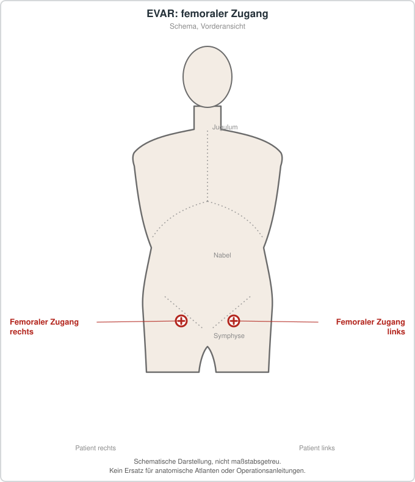

# Endovaskuläre Aortenaneurysmareparatur (EVAR)
## Übersicht
EVAR ist ein endovaskuläres Verfahren zur Behandlung ausgewählter infrarenaler aortoiliakaler Aneurysmen. Eignung, Prothesenwahl und Nachsorge hängen insbesondere von Anatomie, Beschwerden, Rupturrisiko, Komorbiditäten und langfristiger Kontrollfähigkeit ab.[1]
## Epidemiologie und Einordnung
Die ESVS-Leitlinie behandelt offene und endovaskuläre Versorgung einschließlich Indikation, Komplikationen und Langzeitkontrollen.[1]
## Diagnostik, Planung und Therapie
Eine detaillierte Gefäßbildgebung und gefäßchirurgische Planung sind Voraussetzung. Relevante Risiken sind Blutung, Ischämie, Nierenfunktionsstörung, Endoleak, Migration und Reintervention. Dieser Artikel enthält keine Durchführungsschritte.
## Patienteninformation
EVAR erfordert regelmäßige Nachsorge; die Alternative einer offenen Operation oder Beobachtung wird individuell besprochen.
## Schematische Darstellung

*Üblich ist der Zugang über beide Leisten (Punktion oder Freilegung der A. femoralis communis). Schematische Darstellung, nicht maßstabsgetreu. Kein Ersatz für anatomische Atlanten oder Operationsanleitungen.*
## Literatur
1. Wanhainen A, et al. *ESVS 2024 Clinical Practice Guidelines on Abdominal Aorto-Iliac Artery Aneurysms.* Eur J Vasc Endovasc Surg. 2024;67:192-331. PMID: 38307694. https://pubmed.ncbi.nlm.nih.gov/38307694/
