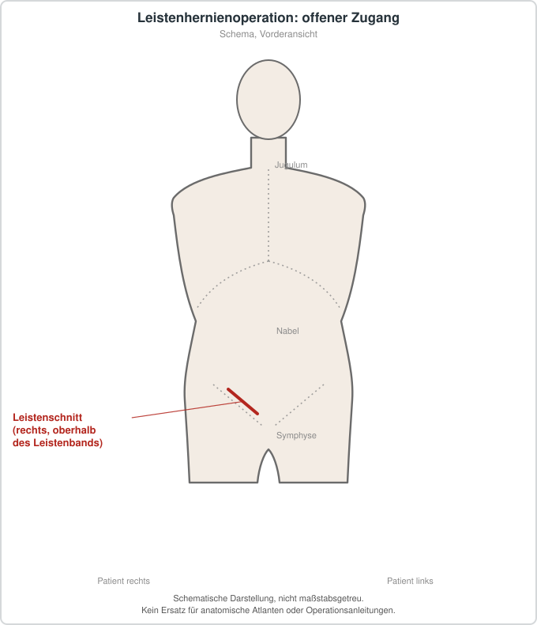

# Hernienoperation bei Leistenhernie

## Übersicht

Die Hernienoperation bei Leistenhernie ist der chirurgische Eingriff zur Behandlung eines Bruchs im Leistenbereich, bei dem Darmanteile durch die Bauchmuskulatur austreten.[1] Leistenhernienreparaturen gehören zu den häufigsten Operationen weltweit, wobei jährlich mehr als 20 Millionen Eingriffe angegeben werden.[2] Für die Vereinigten Staaten wird eine Zahl von mehr als 700.000 Reparaturen pro Jahr genannt.[3] Männer sind deutlich häufiger betroffen als Frauen.[1] Die Operation dient der Linderung von Beschwerden sowie der Vorbeugung von Einklemmung und Einengung des Darms.[3] Eingriffe werden überwiegend elektiv durchgeführt.[3] Die aktualisierte HerniaSurge-Leitlinie richtet sich an Allgemein- und Bauchwandchirurginnen und -chirurgen, die erwachsene Patientinnen und Patienten mit Leistenhernien behandeln, und fasst den verfügbaren Evidenzstand in Statements und Empfehlungen zusammen.[2]

## Indikationen und Kontraindikationen

Bei fehlenden Beschwerden kann zunächst ein abwartendes Vorgehen, das sogenannte Watchful Waiting, gewählt werden.[1] Dieses Vorgehen wird als vertretbare Option beschrieben, da das Risiko lebensbedrohlicher Komplikationen durch Leistenhernien gering ist.[3] Bestehen Beschwerden fort oder verschlechtern sie sich, ist in der Regel eine Operation erforderlich.[1] Das Ziel der Operation ist die Behandlung der Beschwerden und die Verhinderung von Obstruktion oder Strangulation.[3] Für ältere Menschen, insbesondere ab 65 Jahren, wird in der Literatur ein erhöhtes Sterblichkeitsrisiko nach dem Eingriff berichtet.[3] Daher stellt sich bei dieser Gruppe die Frage, ob und wann eine Reparatur sinnvoll ist.[3] Die Gebrechlichkeit (Frailty) wird als wichtiger Faktor für die Behandlungsplanung hervorgehoben.[3]

## Vorbereitung

Die Auswahl zwischen offenem und laparoskopischem Vorgehen wird in vergleichenden Übersichtsarbeiten als Abwägung von Vor- und Nachteilen dargestellt.[4][1] Eine eindeutige Überlegenheit einer Methode ist nicht für alle Zielgrößen belegt.[1] Während der Lernphase kann die Rate an Konversionen zur offenen Operation, postoperativen Komplikationen und Rezidiven erhöht sein.[5] Für diese Phase wird eine Supervision als sinnvoll angesehen.[5]

## Ablauf Schritt für Schritt

1. Bei offenem Vorgehen erfolgt der Zugang über einen Leistenschnitt. Die Lichtenstein-Technik wurde in den Studien, die in einer Übersichtsarbeit eingeschlossen waren, in 74 Prozent der Fälle verwendet und gilt in einer anderen Übersichtsarbeit als Goldstandard.[6][7]
2. Beim laparoskopischen Vorgehen wird entweder die transabdominelle präperitoneale Technik (TAPP) oder die total extraperitoneale Technik (TEP) angewandt. Bei TAPP wird die Bauchhöhle eröffnet, um das Netz zu platzieren, bei TEP erfolgt der gesamte Eingriff außerhalb des Bauchfells.[1]
3. Bei beiden laparoskopischen Verfahren wird ein Netz vor dem Bauchfell der Bauchwand platziert.[1]
4. Ob das Netz fixiert werden soll, ist umstritten. In einer Metaanalyse war Nichtfixation mit geringerem Schmerz nach 24 Stunden und nach sechs Monaten, einer kürzeren Operationszeit und weniger Harnverhalt verbunden, bei vergleichbarer Rezidivrate bei Bruchpforten unter 4 cm.[8]
5. Bei offenem Vorgehen werden die Nerven im Leistenbereich häufig identifiziert, und zwar der Ilioinguinalnerv in 82 Prozent der Fälle. Die überwiegende Mehrheit der Studien verwendete eine nervenschonende Strategie.[6]
6. Bei TAPP ermöglicht der Zugang über die Bauchhöhle die Inspektion der Gegenseite.[1]

## Nachsorge

Die meisten in einer Metaanalyse ausgewerteten Studien berichteten kurzfristige Ergebnisse innerhalb des 30. postoperativen Tages, nur wenige hatten eine Nachbeobachtung von mindestens einem Jahr.[9] Chronische Schmerzen wurden in den Studien mit unterschiedlichen Nachbeobachtungszeiten erfasst, sodass die Ergebnisse nur eingeschränkt vergleichbar sind.[6] Für die langfristige Nachsorge fehlen daher belastbare Daten zu mehreren Endpunkten.[9]

## Komplikationen

Zu den dokumentierten Komplikationen gehören Seromen und Hämatome.[9] Bei laparoskopischen Eingriffen wird ein statistisch signifikant erhöhtes Risiko für Samenstrangseromen beschrieben.[10] Der offene Zugang zeigte in derselben Auswertung Vorteile bei Serom-Komplikationen und Hodenschmerzen.[10] Eine Verbesserung der sexuellen Funktion durch den laparoskopischen Zugang ist nicht belegt.[10] Eine Nichtfixation des Netzes ging in einer Metaanalyse mit einem geringeren Auftreten von Harnverhalt einher.[8] Die Rezidivrate war zwischen fixierter und nicht fixierter Netzversorgung vergleichbar.[8] Chronische postoperative Schmerzen treten in den ausgewerteten Studien mit großer Spannbreite auf: 3 bis 41 Prozent nach drei Monaten und 2 bis 22 Prozent nach zwölf Monaten.[6] Die Rolle der Nervenidentifikation bei der Entstehung chronischer Schmerzen ist nicht abschließend geklärt.[6] Bei TAPP wird im Vergleich zu TEP ein höheres Risiko für viszerale Verletzungen beschrieben.[1]

## Ergebnisse und Prognose

Die aktualisierte HerniaSurge-Leitlinie umfasst 39 neue Statements und 32 Empfehlungen, davon 16 starke Empfehlungen.[2] Sie basiert auf einer GRADE-Bewertung der Literatur bis April 2022 und auf einem modifizierten Delphi-Verfahren zur Konsensbildung.[2] Bei einseitigen Eingriffen war die Operationszeit mit robotischer Technik länger, die Kosten waren höher.[9] Die geschätzte Zahl der Fälle bis zur chirurgischen Kompetenz nahm in der Auswertung jährlich ab, für 2020 wurde ein Wert von 32,5 Fällen prognostiziert.[5] Eine Übersichtsarbeit hebt Netzverfahren als Goldstandard hervor und beschreibt zugleich anhaltende Kontroversen über die Vor- und Nachteile nicht netzbasierter Verfahren.[7]

## Informationen für Patientinnen und Patienten

Leistenhernien können zunächst beobachtet werden, wenn keine Beschwerden bestehen.[1] Halten Beschwerden an oder nehmen sie zu, wird in der Regel eine Operation empfohlen.[1] Die Operation dient unter anderem dazu, eine Einklemmung oder Einengung des Darms zu verhindern.[3] Beide Verfahren verwenden ein Netz zur Verstärkung der Bauchwand.[1] Nach einer Operation können über längere Zeit Schmerzen im Leistenbereich bestehen bleiben.[6]

## Schematische Darstellung

## Literatur

1. Andresen K, Rosenberg J. Transabdominal pre-peritoneal (TAPP) versus totally extraperitoneal (TEP) laparoscopic techniques for inguinal hernia repair. Cochrane Database Syst Rev. 2024;7:CD004703. PMID: 38963034. DOI: 10.1002/14651858.CD004703.pub3. https://pubmed.ncbi.nlm.nih.gov/38963034/
2. Stabilini C, van Veenendaal N, Aasvang E et al.. Update of the international HerniaSurge guidelines for groin hernia management. BJS Open. 2023;7. PMID: 37862616. DOI: 10.1093/bjsopen/zrad080. https://pubmed.ncbi.nlm.nih.gov/37862616/
3. Perez AJ, Campbell S. Inguinal Hernia Repair in Older Persons. J Am Med Dir Assoc. 2022;23:563-567. PMID: 35259338. DOI: 10.1016/j.jamda.2022.02.008. https://pubmed.ncbi.nlm.nih.gov/35259338/
4. Ukhanov AP, Zakharov DV, Zhilin SA et al.. [Laparoscopic preperitoneal and Lichtenstein inguinal hernia repair. What method is preferable?]. Khirurgiia (Mosk). 2024:110-118. PMID: 39268744. DOI: 10.17116/hirurgia2024091110. https://pubmed.ncbi.nlm.nih.gov/39268744/
5. Sivakumar J, Chen Q, Hii MW et al.. Learning curve of laparoscopic inguinal hernia repair: systematic review, meta-analysis, and meta-regression. Surg Endosc. 2023;37:2453-2475. PMID: 36416945. DOI: 10.1007/s00464-022-09760-3. https://pubmed.ncbi.nlm.nih.gov/36416945/
6. Moseholm VB, Baker JJ, Rosenberg J et al.. Nerve identification during open inguinal hernia repair: a systematic review and meta-analyses. Langenbecks Arch Surg. 2023;408:417. PMID: 37874414. DOI: 10.1007/s00423-023-03154-2. https://pubmed.ncbi.nlm.nih.gov/37874414/
7. Sapiyeva ST, Abatov NT, Aliyakparov MT et al.. Non-mesh inguinal hernia repair: Review. Asian J Surg. 2024;47:4669-4673. PMID: 38960759. DOI: 10.1016/j.asjsur.2024.06.055. https://pubmed.ncbi.nlm.nih.gov/38960759/
8. Lv Y, Yang B, Hao G et al.. Mesh Fixation Versus Nonfixation in Laparoscopic Inguinal Hernia Repair: A Systematic Review and Meta-Analysis. Am Surg. 2024;90:111-121. PMID: 37496144. DOI: 10.1177/00031348231192066. https://pubmed.ncbi.nlm.nih.gov/37496144/
9. Solaini L, Cavaliere D, Avanzolini A et al.. Robotic versus laparoscopic inguinal hernia repair: an updated systematic review and meta-analysis. J Robot Surg. 2022;16:775-781. PMID: 34609697. DOI: 10.1007/s11701-021-01312-6. https://pubmed.ncbi.nlm.nih.gov/34609697/
10. Supsamutchai C, Wattanapreechanon P, Saengsri S et al.. Sexual dysfunction between laparoscopic and open inguinal hernia repair: a systematic review and meta-analysis. Langenbecks Arch Surg. 2023;408:277. PMID: 37450061. DOI: 10.1007/s00423-023-03006-z. https://pubmed.ncbi.nlm.nih.gov/37450061/
