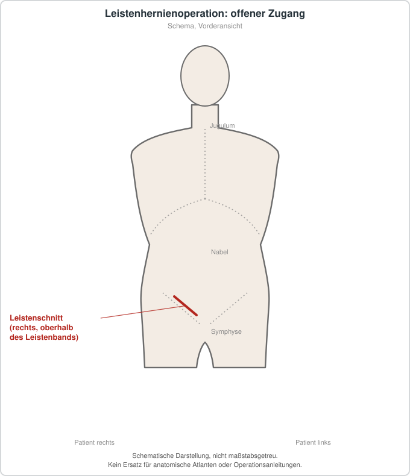

# Hernienoperation bei Leistenhernie

## Übersicht

Eine Hernienoperation bei Leistenhernie dient der Behandlung eines Bruchs in der Leistenregion. Ziel ist die Behandlung von Beschwerden, die Vermeidung oder Behandlung von Komplikationen und gegebenenfalls die Stabilisierung der Bauchwand. Die aktualisierte HerniaSurge-Leitlinie fasst evidenzbasierte Aussagen und Empfehlungen für Erwachsene mit Leistenhernien zusammen.[1]

## Epidemiologie und Einordnung

Leistenhernien gehören zu den häufigen chirurgischen Erkrankungen. Geschlecht, Hernientyp, Beschwerden und Komplikationsrisiko sind bei der Einordnung bedeutsam.[1]

## Diagnostik, Indikationsrahmen und Vorbereitung

Dringlichkeit und Operationsindikation hängen unter anderem von Beschwerden, Einklemmungszeichen, Hernientyp, Allgemeinzustand, Rezidivsituation und den Präferenzen der betroffenen Person ab. Eine akute schmerzhafte, nicht reponible Schwellung mit Übelkeit, Erbrechen oder Allgemeinverschlechterung kann ein Notfall sein. Die Auswahl eines offenen oder laparoendoskopischen Verfahrens sowie einer Netz- oder Nahtversorgung erfolgt individuell und unter Berücksichtigung von Expertise und Risiken.

## Therapie, Sicherheit und Nachsorge

Mögliche Komplikationen umfassen Blutung, Hämatom, Serom, Infektion, Verletzung von Strukturen im Leistenbereich, Rezidiv und chronische postoperative Schmerzen. Besonderheiten bei Frauen und bei möglicher Femoralhernie verdienen eine sorgfältige diagnostische und operative Planung.[1] Die detaillierte Technik ist nicht Gegenstand dieses Artikels.

## Patienteninformation

Eine neue oder schmerzhafte Leistenwölbung sollte ärztlich untersucht werden. Bei starken Schmerzen, einer nicht zurückdrückbaren Schwellung, Erbrechen oder Kreislaufproblemen ist eine dringliche Abklärung erforderlich.

## Schematische Darstellung

*Offen: Leistenschnitt oberhalb und parallel zum Leistenband. Laparoskopische Verfahren (TAPP, TEP) nutzen Ports im Unterbauch und sind nicht dargestellt. Schematische Darstellung, nicht maßstabsgetreu. Kein Ersatz für anatomische Atlanten oder Operationsanleitungen.*
## Literatur

1. Stabilini C, et al. *Update of the international HerniaSurge guidelines for groin hernia management.* BJS Open. 2023;7:zrad080. PMID: 37862616. https://pubmed.ncbi.nlm.nih.gov/37862616/
