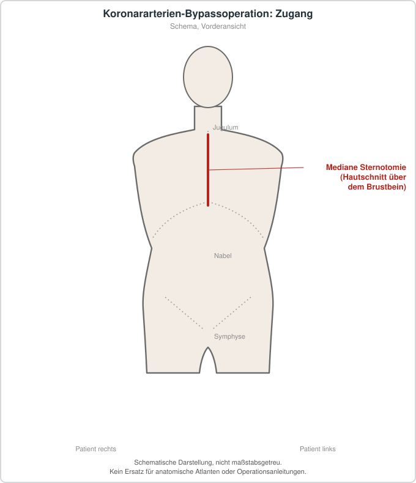

# Koronararterien-Bypassoperation

## Übersicht

Die Koronararterien-Bypassoperation (CABG) ist ein Verfahren zur chirurgischen Revaskularisation bei ausgewählten Formen der koronaren Herzkrankheit. Dabei wird die Blutversorgung hinter relevanten Engstellen über Gefäßtransplantate umgeleitet. Die Entscheidung zwischen medikamentöser Therapie, perkutaner Koronarintervention und Bypassoperation gehört in ein interdisziplinäres Heart-Team und berücksichtigt Anatomie, Beschwerden, Ischämienachweis, Komorbiditäten, Funktion des Herzens und persönliche Ziele.

## Epidemiologie und Einordnung

CABG ist ein etabliertes herzchirurgisches Verfahren, aber keine pauschale Standardtherapie für jede koronare Stenose. Die Auswahl und Nachbehandlung der verwendeten Gefäßtransplantate wird in einem aktuellen ESC/EACTS-Konsensus behandelt.[1]

## Diagnostik, Planung und Therapie

Vor dem Eingriff werden koronarangiographische und klinische Befunde, operative Risiken sowie Alternativen bewertet. Der Artikel enthält keine Operationsschritte. Mögliche Risiken umfassen Blutung, Myokardinfarkt, Schlaganfall, Rhythmusstörungen, Nierenfunktionsstörung, Infektionen, Wundkomplikationen und anästhesiologische Komplikationen. Die Nachsorge umfasst kardiologische Sekundärprävention, Rehabilitation und individuelle Kontrollen.

## Patienteninformation

Eine Bypassoperation ist eine größere Herzoperation. Nutzen, Alternativen und persönliche Risiken müssen vorab in einem Herzteam besprochen werden.

## Schematische Darstellung

*Üblicher Zugang bei offener Herzoperation ist die mediane Sternotomie. Schematische Darstellung, nicht maßstabsgetreu. Kein Ersatz für anatomische Atlanten oder Operationsanleitungen.*
## Literatur

1. Sandner S, et al. *Intra-operative and post-operative management of conduits for coronary artery bypass grafting.* Eur J Cardiothorac Surg. 2024;66:ezae400. PMID: 39656609. https://pubmed.ncbi.nlm.nih.gov/39656609/
