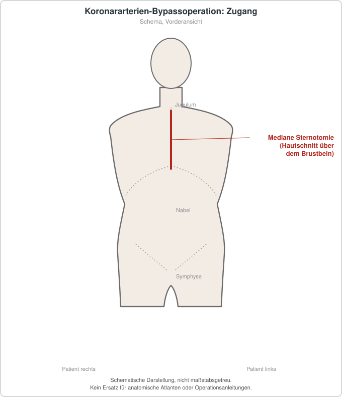

# Koronararterien-Bypassoperation

## Übersicht

Die Koronararterien-Bypassoperation ist ein herzchirurgisches Verfahren zur Revaskularisation des Herzmuskels bei koronarer Herzkrankheit, bei dem Gefäßtransplantate die Blutversorgung hinter Stenosen wiederherstellen.[1] Sie gilt als etabliertes Verfahren für Patientinnen und Patienten mit Hauptstamm- oder Dreigefäßerkrankung.[1] Als Transplantate kommen vor allem Arterien, insbesondere die Arteria thoracica interna, die Arteria radialis und die Arteria gastroepiploica dextra, sowie die Vena saphena magna in Betracht.[2][3] Schäden am Endothel während der Entnahme und Lagerung können eine akute Thrombose und einen frühen Transplantatverschluss begünstigen, während Spätverschlüsse vor allem bei Venentransplantaten durch fortschreitende Atherosklerose entstehen.[4] Die Auswahl der Transplantate ist deshalb ein zentraler Bestandteil der Planung.[4][2] Der Einsatz arterieller Transplantate sollte Teil dieser Diskussion sein, in der Zielgefäße, Anzahl und Art der Transplantate festgelegt werden.[2] Ein individualisiertes Vorgehen, das Befunde und Funktion des Herzens berücksichtigt, wird auch in aktuellen Übersichtsarbeiten betont.[5]

## Indikationen und Kontraindikationen

Die Bypassoperation wird bei Patientinnen und Patienten mit Hauptstamm- oder Dreigefäßerkrankung als Standardtherapie betrachtet.[1] Bei Hauptstammstenosen wurden die Bypassoperation und die perkutane Koronarintervention (PCI) mit medikamentenfreisetzenden Stents in Individualdatenanalysen randomisierter Studien verglichen.[6] Beide Verfahren wurden in den eingeschlossenen Studien bei Patientinnen und Patienten mit Hauptstammerkrankung als grundsätzlich geeignet angesehen.[7] Für die Bypassung des Ramus interventricularis anterior (LAD) wird die linke Arteria thoracica interna als Transplantat empfohlen, wenn eine Bypassung dieses Gefäßes indiziert ist.[2] Als Ergänzung kann ein zweites arterielles Transplantat bei geeigneten Patientinnen und Patienten erwogen werden.[2] Eine Arteria radialis ist sinnvoll, wenn Zielgefäße mit schweren Stenosen überbrückt werden.[2] Bei eingeschränkter linksventrikulärer Funktion ist das perioperative Risiko erhöht, insbesondere durch die Entwicklung eines postkardiotomischen Schocks.[5] Eine präoperative Optimierung mit pharmakologischer oder mechanischer Unterstützung ist bei diesen Patientinnen und Patienten erforderlich, vor allem bei kardiogenem Schock.[5] Bei älteren Patientinnen und Patienten existieren Daten zur kardialen Rehabilitation, deren Umfang jedoch begrenzt ist.[8] Bei der bilateralen Verwendung der Arteriae thoracicae internae sollte ein übermäßiges Risiko für sternale Komplikationen berücksichtigt werden.[2]

## Vorbereitung

Ein pragmatischer Ansatz nutzt die Zeit zwischen Überweisung und Operation, um Risikofaktoren zu adressieren und die Genesung nach dem Eingriff zu erleichtern.[9] Nach den Empfehlungen der Enhanced-Recovery-Leitlinien für kardiochirurgische Eingriffe aus dem Jahr 2019 wird dies als Grundlage einer frühen Mobilisation und eines verkürzten Aufenthalts angesehen.[9] Rauchverzicht wird als Empfehlung der Klasse I genannt, eine gute Glykämiekontrolle sollte erwogen werden, insbesondere im Hinblick auf das Risiko sternaler Infektionen bei bilateraler Arterienverwendung.[2] Bei eingeschränkter linksventrikulärer Funktion ist die präoperative Stabilisierung besonders wichtig.[5] Die Thrombozytenfunktion kann ebenfalls relevant sein: Eine Aspirinresistenz wurde in einer Übersichtsarbeit mit einer Spanne von 11,0 % bis 51,5 % angegeben, wobei die Methoden zur Erfassung stark variieren.[10] Eine standardisierte Definition der Resistenz fehlt in der Literatur, sodass die Ergebnisse verschiedener Testverfahren nicht ohne Weiteres vergleichbar sind.[10]

## Ablauf Schritt für Schritt

1. Die Gefäßtransplantate werden entnommen; arterielle Transplantate werden mit intaktem äußerem Pedikel gewonnen, während Venen bei der konventionellen Technik ohne Pedikel präpariert werden.[11]
2. Bei der Entnahme der Vena saphena magna sind endoskopische Verfahren nach Metaanalysen am günstigsten zu bewerten; bei offenen Techniken wird die No-touch-Technik gegenüber der konventionellen Venenentnahme bevorzugt.[3]
3. Die Transplantate werden bis zur Implantation in geeigneten Lösungen gelagert, da auch die Lagerungsphase die Endothelintegrität beeinflusst.[4]
4. Arterielle Transplantate neigen nach chirurgischer Manipulation zu Vasospasmen, weshalb intraoperativ vasodilatierende Protokolle eingesetzt werden.[4][2]
5. Bei Verwendung einer Arteria radialis können pharmakologische Maßnahmen zur Verringerung akuter intraoperativer und perioperativer Spasmen angewendet werden.[2]
6. Die Operation kann unter Einsatz der Herz-Lungen-Maschine oder ohne Herz-Lungen-Maschine (Off-pump-Technik) erfolgen; die Off-pump-Technik ist technisch anspruchsvoll und hat in Studien keine eindeutige Überlegenheit gezeigt.[5][12]
7. Während der Off-pump-Operation wird Heparin zur Antikoagulation verabreicht; hohe Heparin-Dosen führen zu deutlich höheren Werten der aktivierten Gerinnungszeit, ohne dass in den eingeschlossenen Studien mehr Blutprodukte benötigt oder die Krankenhausaufenthalte verlängert wurden.[13]
8. Die Revaskularisation sollte schnell und vollständig erfolgen, und mehrfache arterielle Revaskularisationen sind selektierten Patientinnen und Patienten vorbehalten.[5]
9. Bei bilateraler Verwendung der Arteriae thoracicae internae werden skelettierte Transplantate in Betracht gezogen, um das Risiko einer Sternuminfektion zu verringern.[2]
10. Zur Stabilisierung des Brustbeins kann eine erweiterte Sternumstabilisierung erwogen werden.[2]

## Nachsorge

Nach dem Eingriff wird die orale Vasodilatatortherapie fortgeführt; zudem werden antithrombotische und lipidsenkende Substanzen zur Verlangsamung der atherosklerotischen Progression an den Transplantaten eingesetzt.[4] Die Wahl des antithrombotischen Regimes ist eine Abwägung zwischen Ischämie- und Blutungsrisiko.[14] Eine Metaanalyse zur Thrombozytenhemmung nach Bypassoperation fand unter dualer gegenüber einzelner Plättchenhemmung eine geringere Gesamt- und kardiovaskuläre Sterblichkeit, jedoch höhere Raten großer und kleiner Blutungen.[14] Die Autoren empfehlen deshalb einen individualisierten Ansatz.[14] Für die Kombination aus Ticagrelor mit Aspirin gegenüber Aspirin allein zeigte eine Metaanalyse keine signifikante Reduktion der Venengraft-Verschlüsse nach einem Jahr, während Ticagrelor insgesamt mit einem geringeren Risiko für Venengraft-Verschlüsse nach einem Jahr assoziiert war.[15] Eine Metaanalyse bei älteren Patientinnen und Patienten fand dagegen keine signifikante Verbesserung der gesundheitsbezogenen Lebensqualität, wobei die Evidenz auf kurzfristigen Daten basiert; einzelne Studien deuteten jedoch auf Vorteile bei funktionellen Parametern und körperlicher Aktivität hin.[8] Die Autoren empfehlen individualisierte Programme.[8] Eine Übersichtsarbeit eines japanischen Zentrums beschreibt postoperatives Vorhofflimmern als Risikofaktor für Schlaganfälle und berichtet, dass der linksatriale Appendage-Verschluss oder die Amputation in dieser Konstellation das Schlaganfallrisiko senken kann.[12]

## Komplikationen

Akute Transplantatverschlüsse können durch Endothelschäden bei Entnahme und Lagerung entstehen, während späte Verschlüsse vor allem bei Venentransplantaten auftreten.[4] Ein Verschluss von Venentransplantaten wurde in einer Metaanalyse mit 11,4 % gegenüber 14,3 % nach einem Jahr angegeben, je nach Behandlungsgruppe.[15] Eine Übersichtsarbeit zu Antiplatelet-Resistenzen berichtet, dass eine Clopidogrel-Resistenz mit schlechteren klinischen Ergebnissen assoziiert war.[10] Bei der Venenentnahme wurden in einer Netzwerk-Metaanalyse für die endoskopische Technik ein deutlich geringeres Risiko für Wundinfektionen sowie für Sensibilitätsstörungen und postoperative Schmerzen im Vergleich zu anderen Verfahren beschrieben.[3] Eine Übersichtsarbeit betont zudem, dass vaskuläre Schäden bei der konventionellen Entnahme auftreten und externe Stützungen die Venenpatenz verbessern könnten.[11] Die Herzfrequenzvariabilität nimmt nach der Operation akut ab und erholt sich im Verlauf, wobei nicht-lineare Parameter Subgruppen mit erhöhtem Komplikationsrisiko identifizieren könnten, einschließlich Vorhofflimmern.[16] Die Autoren konnten jedoch nicht eindeutig belegen, dass eine frühe Messung die Langzeitmortalität vorhersagt.[16] Ein erhöhtes Risiko für Sternuminfektionen besteht insbesondere bei bilateraler Verwendung der Arteriae thoracicae internae.[2] Blutungen treten unter dualer Thrombozytenhemmung häufiger auf als unter Monotherapie.[14] Bei eingeschränkter linksventrikulärer Funktion ist ein postkardiotomischer Schock eine bedeutsame Gefahr.[5] Im Vergleich zur PCI bei Hauptstammerkrankung waren in einer Individualdatenanalyse Myokardinfarkte und erneute Revaskularisationen unter PCI häufiger, während die Schlaganfallrate in den Studien unterschiedlich ausfiel.[6][7]

## Ergebnisse und Prognose

Bei Hauptstammerkrankung zeigte eine gepoolte Analyse von vier randomisierten Studien nach fünf Jahren keine signifikante Mortalitätsdifferenz zwischen PCI und Bypassoperation, wobei die Mortalität unter PCI numerisch etwas höher lag.[6] Spontane Myokardinfarkte und erneute Revaskularisationen waren unter PCI häufiger.[6] Bei Patientinnen und Patienten mit Diabetes waren die Raten für Tod und kardiovaskuläre Ereignisse insgesamt höher, unabhängig von der Revaskularisationsart; Unterschiede in der Mortalität zwischen PCI und CABG zeigten sich in dieser Analyse nicht.[7] Die genannten Studien betrafen oft Patientinnen und Patienten mit moderaten SYNTAX-Scores.[7][6] Für die Mortalität nach Bypassoperation berichtet eine Übersicht für Japan eine Krankenhausmortalität von 2,5 % im Jahr 2018, für die USA 2,2 %.[12] Die Off-pump-Technik wurde als minimalinvasives Verfahren mit geringerer Komplikationsrate beschrieben, dies wurde aber nicht durch eine randomisierte Überlegenheit gestützt.[12] Eine Übersicht beschreibt die Arteria radialis als mit besseren kardialen Ergebnissen und einem besseren Überleben verbunden als die Vena saphena, während die Literatur insgesamt weiter untersucht wird.[1] Bei der Venenentnahme zeigten sich in einer Metaanalyse keine signifikanten Unterschiede zwischen den Techniken hinsichtlich Mortalität, Myokardinfarkt und Transplantatpatenz auf lange Sicht.[3] Die No-touch-Technik kann eine langfristige Patenz erreichen, die mit der der Arteria thoracica interna vergleichbar ist.[11]

## Informationen für Patientinnen und Patienten

Die Entscheidung zur Bypassoperation wird im Heart-Team getroffen, das Befunde, Risiken, Alternativen und die individuelle Situation berücksichtigt.[2][5] Die Wahl zwischen Bypassoperation, Katheterverfahren und medikamentöser Therapie ist abhängig von Anatomie und Begleiterkrankungen.[6][5] Nach der Operation ist eine medikamentöse Behandlung mit gerinnungshemmenden und lipidsenkenden Substanzen üblich; deren Auswahl richtet sich nach dem individuellen Blutungs- und Ischämierisiko.[4][14] Rauchverzicht und eine gute Blutzuckerkontrolle gelten als wichtige Maßnahmen zur Senkung von Komplikationen.[2] Eine kardiale Rehabilitation kann die körperliche Leistungsfähigkeit verbessern, die Belege zur Lebensqualität sind jedoch begrenzt.[8][16] Die Programme sollten individuell angepasst werden.[8]

## Schematische Darstellung

## Literatur

1. Audisio K, Halbreiner MS, Chadow D et al.. Radial artery or saphenous vein for coronary artery bypass grafting. Trends Cardiovasc Med. 2022;32:479-484. PMID: 34562573. DOI: 10.1016/j.tcm.2021.09.007. https://pubmed.ncbi.nlm.nih.gov/34562573/
2. Aldea GS, Bakaeen FG, Pal J et al.. The Society of Thoracic Surgeons Clinical Practice Guidelines on Arterial Conduits for Coronary Artery Bypass Grafting. Ann Thorac Surg. 2016;101:801-9. PMID: 26680310. DOI: 10.1016/j.athoracsur.2015.09.100. https://pubmed.ncbi.nlm.nih.gov/26680310/
3. Vuong NL, Elfaituri MK, Eldoadoa M et al.. Saphenous vein harvesting techniques for coronary artery bypass grafting: a systematic review and meta-analysis. Coron Artery Dis. 2022;33:128-136. PMID: 34010184. DOI: 10.1097/MCA.0000000000001048. https://pubmed.ncbi.nlm.nih.gov/34010184/
4. Sandner S, Antoniades C, Caliskan E et al.. Intra-operative and post-operative management of conduits for coronary artery bypass grafting: a clinical consensus statement of the European Society of Cardiology Working Group on Cardiovascular Surgery and the European Association for Cardio-Thoracic Surgery Coronary Task Force. Eur J Cardiothorac Surg. 2024;66. PMID: 39656609. DOI: 10.1093/ejcts/ezae400. https://pubmed.ncbi.nlm.nih.gov/39656609/
5. Iacona GM, Bakhos JJ, Tong MZ et al.. Coronary artery bypass grafting in left ventricular dysfunction: when and how. Curr Opin Cardiol. 2023;38:464-470. PMID: 37751395. DOI: 10.1097/HCO.0000000000001090. https://pubmed.ncbi.nlm.nih.gov/37751395/
6. Sabatine MS, Bergmark BA, Murphy SA et al.. Percutaneous coronary intervention with drug-eluting stents versus coronary artery bypass grafting in left main coronary artery disease: an individual patient data meta-analysis. Lancet. 2021;398:2247-2257. PMID: 34793745. DOI: 10.1016/S0140-6736(21)02334-5. https://pubmed.ncbi.nlm.nih.gov/34793745/
7. Gaba P, Sabik JF, Murphy SA et al.. Percutaneous Coronary Intervention Versus Coronary Artery Bypass Grafting in Patients With Left Main Disease With and Without Diabetes: Findings From a Pooled Analysis of 4 Randomized Clinical Trials. Circulation. 2024;149:1328-1338. PMID: 38465592. DOI: 10.1161/CIRCULATIONAHA.123.065571. https://pubmed.ncbi.nlm.nih.gov/38465592/
8. Huang J, Liu C, Xie J et al.. Cardiac rehabilitation for elderly patients undergoing coronary artery bypass grafting: a systematic review and Meta-Analysis. BMC Surg. 2025;25:574. PMID: 41299466. DOI: 10.1186/s12893-025-03315-8. https://pubmed.ncbi.nlm.nih.gov/41299466/
9. Ponnambalam M, Alex RM. Preoperative optimization and rapid discharge after coronary artery bypass grafting. Curr Opin Cardiol. 2023;38:471-477. PMID: 37668170. DOI: 10.1097/HCO.0000000000001076. https://pubmed.ncbi.nlm.nih.gov/37668170/
10. Thet MS, Khosravi A, Egbulonu S et al.. Antiplatelet Resistance in Coronary Artery Bypass Grafting: A Systematic Review. Surg Res Pract. 2024;2024:1807241. PMID: 38910604. DOI: 10.1155/2024/1807241. https://pubmed.ncbi.nlm.nih.gov/38910604/
11. Samano N, Souza D, Dashwood MR et al.. Saphenous veins in coronary artery bypass grafting need external support. Asian Cardiovasc Thorac Ann. 2021;29:457-467. PMID: 33307718. DOI: 10.1177/0218492320980936. https://pubmed.ncbi.nlm.nih.gov/33307718/
12. Amano A. Refinement of Coronary Artery Bypass Grafting at Juntendo University Hospital. Juntendo Iji Zasshi. 2022;68:101-114. PMID: 38912283. DOI: 10.14789/jmj.JMJ21-0012-R. https://pubmed.ncbi.nlm.nih.gov/38912283/
13. Khalil MA, Kaddoura R, Omar AS et al.. Optimum heparin dose in off-pump coronary artery bypass grafting: A systematic review and meta-analysis. Perfusion. 2024;39:675-683. PMID: 36858479. DOI: 10.1177/02676591231159506. https://pubmed.ncbi.nlm.nih.gov/36858479/
14. Agrawal A, Kumar A, Majid M et al.. Optimal antiplatelet strategy following coronary artery bypass grafting: a meta-analysis. Heart. 2024;110:323-330. PMID: 37648436. DOI: 10.1136/heartjnl-2023-323097. https://pubmed.ncbi.nlm.nih.gov/37648436/
15. Xiang F, Lin Y, Chen B et al.. Ticagrelor for patients undergoing coronary artery bypass grafting: A meta-analysis of randomized controlled trials. Perfusion. 2023;38:698-705. PMID: 35403510. DOI: 10.1177/02676591221076284. https://pubmed.ncbi.nlm.nih.gov/35403510/
16. Matusik PS, Alomar O, Hussain MR et al.. Heart Rate Variability and Coronary Artery Bypass Grafting: A Systematic Review. Rev Cardiovasc Med. 2024;25:36. PMID: 39077663. DOI: 10.31083/j.rcm2501036. https://pubmed.ncbi.nlm.nih.gov/39077663/
