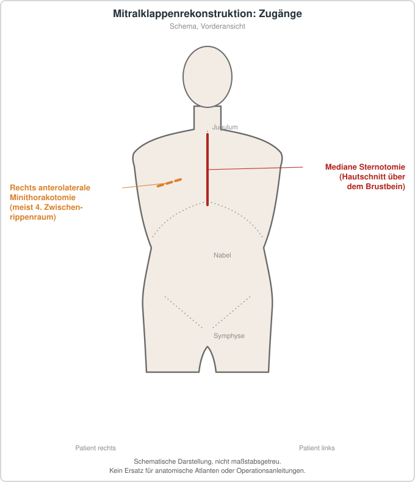

# Mitralklappenrekonstruktion

## Übersicht

Die Mitralklappenrekonstruktion ist ein klappenerhaltendes chirurgisches Verfahren, bei dem die Schlussfähigkeit der Mitralklappe wiederhergestellt wird, anstatt die Klappe durch eine Prothese zu ersetzen.[1] Nach den europäischen Leitlinien stellt sie bei ausgewählten Patienten ohne fortgeschrittenen linksventrikulären Umbau die Klappenschlussfähigkeit wieder her, verbessert die Beschwerden und führt zu einem reversen linksventrikulären Umbau.[1] Die europäische Leitlinie stellt die Rekonstruktion in den Vordergrund, während die AHA/ACC-Leitlinie bei ischämischer Mitralinsuffizienz einen Klappenersatz mit chordalerhaltender Technik gegenüber der Annuloplastik empfiehlt, allerdings mit Evidenzklasse 2b.[1] Die Autoren von Quelle 4 beschreiben diese Divergenz als widersprüchlich.[1] Eine systematische Übersicht verglich dieses Vorgehen mit konventioneller Sternotomie, partieller Sternotomie und rechtsseitiger Minithorakotomie.[2] Die eingeschlossenen Studien waren nicht randomisiert, ein Teil davon war retrospektiv angelegt.[2]

## Indikationen und Kontraindikationen

Eine Rekonstruktion wird nach der europäischen Leitlinie vor allem bei ausgewählten Patienten ohne fortgeschrittenen linksventrikulären Umbau erwogen.[1] Der Ersatz sollte dagegen für Patienten mit ungünstigerem linksventrikulärem Umbau reserviert bleiben.[1] In solchen Fällen kommen eine umfassendere Rekonstruktion mit klappen- und subvalvulären Anteilen oder ein Klappenersatz infrage.[1] Die Autoren betonen, dass die ischämische Mitralinsuffizienz nicht allein als Ringproblem verstanden werden könne.[1]

## Vorbereitung

Die Entscheidung zwischen Rekonstruktion und Ersatz soll nach Auffassung der Autoren am einzelnen Patienten und an der Expertise des Chirurgen ausgerichtet werden, wobei das Verfahren mit dem besten erreichbaren Ergebnis gewählt werden sollte.[1] Ausnahmen bestanden unter anderem für den Verschluss eines persistierenden Foramen ovale oder für Ablationen bei Vorhofflimmern.[2] Die Patienten hatten überwiegend keine oder nur geringe Herzinsuffizienzsymptome, und der präoperative Anteil an Vorhofflimmern schwankte zwischen den Studien von 1 % bis 33 %.[2] Die Patientenauswahl in diesen Studien war von der Verfügbarkeit der Robotertechnik sowie von Präferenzen der Chirurgen und Patienten geprägt, weshalb eine Selektionsverzerrung in allen eingeschlossenen Studien wahrscheinlich war.[2] Vier Studien berichteten über Ergebnisse in der Anfangsphase der Chirurgen mit dem Roboterverfahren, drei davon mit erfahrenen robotischen Herzchirurgen.[2]

## Ablauf Schritt für Schritt

1. Die Mitralklappe wird über einen der verglichenen Zugänge erreicht, also über mediane Sternotomie, partielle Sternotomie, rechtsseitige Minithorakotomie oder robotergestützt.[2]
2. Die Wahl zwischen Rekonstruktion und Ersatz richtet sich nach dem einzelnen Patienten, dem Ausmaß des linksventrikulären Umbaus und der Erfahrung des Operateurs.[1]
3. Bei geeigneter Konstellation wird eine Ringannuloplastik mit einem unterdimensionierten, vollständig starren Ring durchgeführt.[1]
4. Ergänzend können am vorderen Segel eine Segelvergrößerung und eine Chordaschneidung zweiter Ordnung erfolgen, um die adaptiven Veränderungen der Klappe nachzuahmen.[1]
5. Bei Verlust von Sehnenfäden kann die Rekonstruktion mit künstlichen Neo-Chordae aus expandiertem Polytetrafluorethylen erfolgen, die Chordae ersetzen.[3]
6. Bei robotergestützten Eingriffen sind die Zeiten an der Herz-Lungen-Maschine, die Aortenabklemmzeit und die Gesamtdauer länger als bei den anderen verglichenen Zugängen.[2]

## Nachsorge

Nach einer Mitralklappenrekonstruktion wird eine Antikoagulation mit Vitamin-K-Antagonisten derzeit für drei Monate empfohlen, unabhängig vom Rhythmusstatus.[4] Die Evidenz für diese Empfehlung gilt als schwach, und neuere Studien stellen Sicherheit und Wirksamkeit infrage.[4] Eine Vergleichsanalyse mit Thrombozytenaggregationshemmern fand keinen Nutzen der Antikoagulation für die Verhinderung thromboembolischer Ereignisse bei Patienten ohne Vorhofflimmern.[4] Eine Metaanalyse fand bei Patienten nach isolierter Rekonstruktion im Sinusrhythmus keinen Nutzen der Warfarin-Gabe für die thromboembolische Prophylaxe und keinen signifikanten Anstieg von Blutungen.[5] Die Autoren schlussfolgern, dass Warfarin für diese Patientengruppe nicht notwendig sein könnte und die Leitlinienempfehlungen überdacht werden sollten.[5] Eine randomisierte Studie wird als nötig erachtet, um belastbare Empfehlungen zu ermöglichen.[4] Späte Rezidive einer Mitralinsuffizienz sind nach Rekonstruktion beschrieben.[1] Dieses Risiko sollte im Verlauf nicht übersehen werden, auch wenn es selten ist.[3]

## Komplikationen

In einer Metaanalyse trat es nach Rekonstruktion mit 34,4 % deutlich häufiger auf als nach Ersatz mit 3,9 %.[1] Eine Metaanalyse berichtete eine signifikant höhere Rezidivrate nach Rekonstruktion und eine signifikant niedrigere nach Ersatz.[6] Die Autoren weisen darauf hin, dass in die Rezidivdefinition auch mittelgradige Insuffizienzen eingingen, die nicht primär operationspflichtig sind.[1] Reinterventionen unterschieden sich mit 7,0 % gegenüber 6,0 % nicht signifikant.[1] Bei Neo-Chordae wurden in einer Übersichtsarbeit 26 Patienten mit Rissen des Nahtmaterials beschrieben, die meist als Einzelfälle auftraten.[3] Die Risse hingen überwiegend mit der Nahtgröße zusammen.[3] Die Neo-Chordae behielten Länge und Elastizität, wurden von körpereigenem Gewebe bedeckt, zeigten eine geringe Verkalkung ohne Beeinträchtigung der Funktion, und eine Infektion trat nicht auf.[3] Bei robotergestützten Eingriffen waren Schlaganfall, Nierenversagen und Reoperation wegen Blutung im Vergleich zu konventionellen Zugängen vergleichbar.[2] Vorhofflimmern trat nach robotergestützter Rekonstruktion seltener auf als nach konventioneller Sternotomie.[2] Pleuraergüsse traten in einer Studie bei konventioneller oder partieller Sternotomie häufiger auf als nach robotergestützter Operation.[2] Eine Umstellung auf eine konventionelle Sternotomie war in den Studien in einem Bereich von 0 % bis 9 % notwendig.[2] Bei gescheiterter Rekonstruktion kann ein ungeplanter Klappenersatz erforderlich werden, was in vier Studien berichtet wurde.[2] Unter Antikoagulation mit Warfarin wurden in einer Metaanalyse keine signifikant erhöhten Blutungskomplikationen beobachtet.[4][5]

## Ergebnisse und Prognose

Die perioperative Sterblichkeit tendierte nach Rekonstruktion zu niedrigeren Werten als nach Ersatz, der Unterschied verfehlte jedoch die statistische Signifikanz (OR 0,66; 95%-KI 0,41 bis 1,07).[6] Eine andere Auswertung kam zu dem Schluss, dass die Sterblichkeit zwischen den Verfahren vergleichbar ist.[1] Die Autoren der Übersicht zum Thema sehen beide Verfahren als sinnvoll an und halten die Auseinandersetzung um die Überlegenheit eines Verfahrens nicht für zielführend.[1] Für robotergestützte Rekonstruktionen zeigte eine systematische Übersicht eine vergleichbare Sicherheit und frühe postoperative Ergebnisse im Vergleich zu anderen Zugängen, allerdings bei längeren Operationszeiten.[2] Gegenüber der konventionellen Sternotomie war das Verfahren in einigen Parametern überlegen, unter anderem bei Vorhofflimmern, Intensivaufenthalt, Schmerzen, Dauer bis zur Rückkehr in den Alltag und körperlicher Funktionsfähigkeit nach einem Jahr.[2] Die Evidenzqualität wurde insgesamt als niedrig eingeschätzt, und Langzeitdaten fehlen.[2] Die Autoren geben jedoch zu bedenken, dass dieser Befund auch dadurch beeinflusst sein könnte, dass der Klappenersatz nicht immer chordalerhaltend ausgeführt wurde.[1]

## Informationen für Patientinnen und Patienten

Die Wahl zwischen Rekonstruktion und Ersatz richtet sich nach der individuellen Situation und der Erfahrung des behandelnden Chirurgen.[1] Die Leitlinien unterscheiden sich in ihren Empfehlungen, weshalb Fachgespräche mit dem Herzteam für die Entscheidungsfindung wichtig sind.[1] Robotergestützte Verfahren sind mit längeren Operationszeiten verbunden, zeigen in frühen Ergebnissen eine vergleichbare Sicherheit, und langfristige Daten sind begrenzt.[2] Auch nach einer Rekonstruktion sind Nachkontrollen wichtig, da späte Rezidive der Mitralinsuffizienz und späte Risse künstlicher Sehnenfäden auftreten können.[1][3]

## Schematische Darstellung

## Literatur

1. Di Mauro M, Cargoni M, Liberi R et al.. Mitral valve repair or replacement. How long is this feud to last?. J Card Surg. 2022;37:1599-1601. PMID: 35365876. DOI: 10.1111/jocs.16479. https://pubmed.ncbi.nlm.nih.gov/35365876/
2. Fatehi Hassanabad A, Nagase FNI, Basha AM et al.. A Systematic Review and Meta-Analysis of Robot-Assisted Mitral Valve Repair. Innovations (Phila). 2022;17:471-481. PMID: 36529985. DOI: 10.1177/15569845221141488. https://pubmed.ncbi.nlm.nih.gov/36529985/
3. Vendramin I, Milano AD, Pucci A et al.. Artificial chordae for mitral valve repair. J Card Surg. 2022;37:3722-3728. PMID: 36116053. DOI: 10.1111/jocs.16937. https://pubmed.ncbi.nlm.nih.gov/36116053/
4. Tomšič A, Zhao C, Schoones JW et al.. Oral Anticoagulation Versus Antiplatelet Treatment After Mitral Valve Repair: A Systematic Review and Meta-Analysis. Am J Cardiol. 2024;210:58-64. PMID: 37838070. DOI: 10.1016/j.amjcard.2023.10.002. https://pubmed.ncbi.nlm.nih.gov/37838070/
5. Papadimas E, Tan YK, Choong AMTL et al.. Anticoagulation After Isolated Mitral Valve Repair: A Systematic Review and Meta-Analysis of Clinical Outcomes. Heart Lung Circ. 2021;30:247-253. PMID: 33082110. DOI: 10.1016/j.hlc.2020.09.005. https://pubmed.ncbi.nlm.nih.gov/33082110/
6. Gamal MA, El-Fiky MM, Gamea MM et al.. Mitral valve repair versus replacement in severe ischemic mitral regurgitation systematic review and meta-analysis. J Card Surg. 2022;37:1591-1598. PMID: 35366026. DOI: 10.1111/jocs.16477. https://pubmed.ncbi.nlm.nih.gov/35366026/
