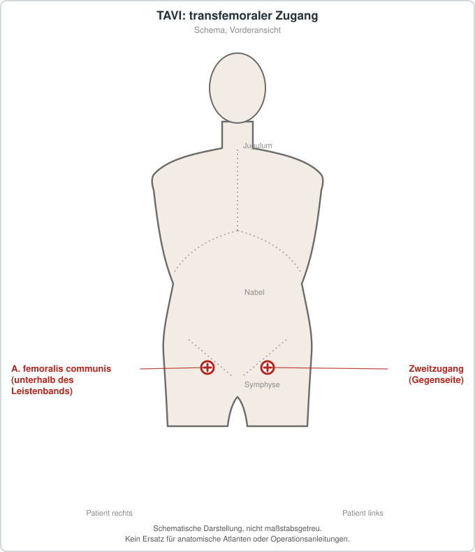

# Transkatheter-Aortenklappenimplantation (TAVI)

## Übersicht

Die Transkatheter-Aortenklappenimplantation (TAVI) ist ein minimalinvasives, kathetergestütztes Verfahren zum Ersatz der Aortenklappe bei symptomatischer schwerer Aortenstenose und stellt eine Alternative zum chirurgischen Klappenersatz dar.[1][2] Die kalzifizierende degenerative Aortenstenose gilt in der westlichen Bevölkerung als häufigste Klappenerkrankung.[3] Seit der Einführung des Verfahrens hat es das Management symptomatischer schwerer Aortenstenosen grundlegend verändert.[1] Ursprünglich für Patienten mit dreiklappiger Aortenklappenanatomie entwickelt, wird TAVI inzwischen zunehmend auch bei komplexeren Klappenanatomien erprobt.[4] Die Zahl der Eingriffe steigt deutlich, und TAVI gilt bei nicht operablen Patienten als Erstwahl.[3]

## Indikationen und Kontraindikationen

TAVI ist bei symptomatischer schwerer Aortenstenose etablierte Standardtherapie für nicht operable Patienten.[1] Bei Patienten mit erhöhtem chirurgischem Risiko, die bestimmte klinische oder anatomische Merkmale aufweisen, wird das Verfahren als bevorzugte Therapie beschrieben.[1] Für Patienten mit hohem oder intermediärem chirurgischem Risiko zeigen Daten eine Nicht-Unterlegenheit gegenüber der herzchirurgischen Klappenersatzoperation.[3][5] Die Formulierungen der Leitlinien und Positionspapiere unterscheiden sich dabei: Während einige Dokumente TAVI vor allem für nicht operable und Hochrisikopatienten hervorheben, beschreiben neuere Übersichtsarbeiten die Anwendung auch bei niedrigem chirurgischem Risiko als gut belegt.[1][6] Metaanalysen randomisierter Studien, die Patienten aller Risikostufen einschlossen, bestätigen die Vielfalt der untersuchten Populationen.[7] Bei sehr alten Patienten mit hohem oder nicht vertretbarem Operationsrisiko kann TAVI eingesetzt werden, sofern eine akzeptable Lebenserwartung besteht.[8] Gebrechlichkeit, Multimorbidität, Behinderung und kognitive Einschränkungen sollen dabei zusätzlich zur klassischen Risikostratifizierung berücksichtigt werden.[8] Bikuspide Aortenklappen galten früher als Gegenanzeige für TAVI.[6] Sie sind durch asymmetrische Verkalkung, Aortenwurzeldilatation und variable Taschenfusionsmuster gekennzeichnet, die Entfaltung, Abdichtung und Langzeithaltbarkeit der Klappe beeinflussen können.[4] Da Patienten mit bikuspider Klappe in fast allen früheren randomisierten Studien ausgeschlossen waren, ist die Evidenzbasis begrenzt; chirurgischer Klappenersatz hat in dieser Gruppe weiterhin einen größeren Stellenwert.[4] Eine Metaanalyse fand bei chirurgisch nicht geeigneten Patienten mit bikuspider Stenose die Durchführbarkeit von TAVI, bei gleichzeitig höheren Raten an Schlaganfall, Konversion zur Operation, Zweitklappenimplantation und paravalvulärer Insuffizienz im Vergleich zu trikuspiden Klappen.[9] Eine Metaanalyse von vier Beobachtungsstudien mit insgesamt 83 Patienten fand ein geringeres Gesamtmortalitätsrisiko bei TAVI im Vergleich zur rein konservativen Therapie.[10] Die Datenbasis ist aufgrund der geringen Fallzahl und des beobachtenden Designs begrenzt.[10] Zudem wird TAVI zur Behandlung degenerierter Aortenbioprothesen (Valve-in-Valve) eingesetzt, wobei die Machbarkeit und Sicherheit in Studien gezeigt wurden.[6]

## Vorbereitung

Die Indikationsstellung erfolgt in einem multidisziplinären Team, das die Patientenauswahl verantwortet.[5] Ein Heart Team kann durch präoperative Optimierung dazu beitragen, die Folgen von Gebrechlichkeit und Begleiterkrankungen für Herz, Nerven, Muskulatur, Atmung und Niere zu verringern.[8] Zur Einschätzung werden multidimensionale Instrumente zur Erfassung von Gebrechlichkeit und kognitiver Funktion empfohlen.[8] Institutionelle und ärztliche Voraussetzungen für den Aufbau eines effizienten TAVI-Programms sind in Positionspapieren beschrieben.[1][5] Die pflegerische Versorgung soll standardisiert werden, um Patientensicherheit und Versorgungsqualität zu gewährleisten.[3] Der transfemorale Zugang ist eine der möglichen Routen, während bei ungeeigneter iliofemoraler Anatomie alternative Zugänge genutzt werden.[11] Zur Planung gehört außerdem die Berücksichtigung der individuellen Klappenanatomie, da sie Auswahl und Strategie beeinflusst.[4] Die Entscheidung für TAVI oder einen chirurgischen Klappenersatz erfolgt im Rahmen eines partizipativen Entscheidungsprozesses, in dem Patientenpräferenzen einbezogen werden.[7] Weitere Einflussfaktoren sind Alter, Lebenserwartung, Komorbiditäten, Gebrechlichkeit und Patientenpräferenz.[12]

## Ablauf Schritt für Schritt

Details unterscheiden sich je nach Zugangsweg und Klappentyp.[11][13]

1. Die Behandlungsindikation wird im multidisziplinären Team gestellt und mit dem Patienten besprochen.[5][7]
2. Der Gefäßzugang wird festgelegt. Neben dem transfemoralen Zugang kommen transcarotisch, transaxillär bzw. subclavial, transapikal oder transaortal in Betracht.[11]
3. Es wird entschieden, ob vor der Klappenimplantation eine Ballonvalvuloplastie (Predilatation) durchgeführt wird oder ob direkt implantiert wird. In einer Metaanalyse zeigte die direkte TAVI ähnliche Erfolgsraten und klinische Ergebnisse wie das Predilatationsvorgehen.[13]
4. Die Klappenprothese wird implantiert. Entfaltung und Abdichtung der Klappe sind entscheidend für das Ergebnis, insbesondere bei komplexer Anatomie.[4]
5. Ein zerebraler Embolieschutz kann eingesetzt werden. Er gilt in den ausgewerteten Studien als sicher, ein signifikanter Nutzen für klinische Schlaganfälle oder Bildgebungsparameter wurde jedoch nicht nachgewiesen.[14]
6. Die pflegerische Betreuung während und nach dem Eingriff folgt standardisierten Konzepten, die auf gemeinsamen Zielen und klinischer Kompetenz beruhen.[3]

## Nachsorge

Die Langzeithaltbarkeit der Bioprothesen ist ein zentrales Ziel der TAVI, da das Verfahren inzwischen auch bei jüngeren und risikoärmeren Patienten angewandt wird.[2] Die strukturelle Klappenverschlechterung ist der wichtigste limitierende Faktor für die Haltbarkeit.[2] Daneben können nicht-strukturelle Dysfunktionen wie Prothese-Patient-Mismatch, paravalvuläre Regurgitation, Klappenthrombose oder Endokarditis zu einem Funktionsverlust führen.[2] Die Inzidenz eines Bioprothesenversagens liegt im mittelfristigen Verlauf von fünf bis acht Jahren nach Angaben einer Übersichtsarbeit unter fünf Prozent.[2] Eine Metaanalyse fand, dass subklinische Klappenthrombosen nach TAVI häufig vorkommen, während orale Antikoagulation mit einer geringeren Prävalenz assoziiert war.[15] Die Autoren betonen, dass Studien zu Prävention und Behandlung notwendig sind.[15]

## Komplikationen

Schlaganfall gilt als eine der meistgefürchteten Komplikationen der TAVI, und die Schlaganfallraten zeigten über mehrere Jahre keinen deutlichen Rückgang.[14] Eine klinisch relevante Zunahme von Schlaganfällen zeigte sich bei klinischer Klappenthrombose, während eine subklinische Thrombose keinen signifikanten Anstieg des Schlaganfallrisikos aufwies.[15] In einer Metaanalyse traten beim transcarotischen Zugang weniger schwere Gefäßkomplikationen während des Krankenhausaufenthalts auf als beim transfemoralen Zugang, jedoch häufiger schwere Blutungen gegenüber dem transaxillären bzw. subclavialen Zugang.[11] Die Sterblichkeit nach einem Monat war beim transcarotischen Zugang in dieser Analyse höher als beim transfemoralen.[11] Bei bikuspiden Klappen wurden in einer Metaanalyse häufiger Schlaganfälle, Konversionen zur Operation, Zweitklappenimplantationen und mittelgradige bis schwere paravalvuläre Lecks beobachtet.[9] Herzschrittmacherimplantationen und akute Nierenschädigungen wurden in Metaanalysen randomisierter Studien berichtet, ohne dass sich im Vergleich zum chirurgischen Klappenersatz eindeutige Unterschiede ergaben.[7]

## Ergebnisse und Prognose

In einer Metaanalyse von neun randomisierten Studien mit 8818 Teilnehmern bestand kein signifikanter Unterschied in der Gesamtsterblichkeit zwischen TAVI und chirurgischem Klappenersatz, weder nach 30 Tagen noch nach einem Jahr oder fünf Jahren.[7] Die kardiovaskuläre Mortalität zeigte ebenfalls keine signifikanten Unterschiede.[7] Die Autoren weisen darauf hin, dass die eingeschlossenen Studien in mehreren Domänen ein hohes Verzerrungsrisiko aufwiesen und die Risikodefinitionen zwischen den Studien stark variierten.[7] Eine ältere Metaanalyse berichtete, dass TAVI bei nicht operablen Patienten das Überleben verbessern kann und bei Patienten mit hohem oder intermediärem Operationsrisiko eine Alternative darstellt.[5] Bei sehr alten Patienten ist ein erheblicher Anteil nach kurz- bis mittelfristiger Nachbeobachtung verstorben oder hat keine Verbesserung der Lebensqualität erreicht.[8] Langzeitdaten randomisierter Studien mit den ersten Klappengenerationen deuten auf eine ähnliche Haltbarkeit von TAVI und chirurgischem Klappenersatz nach zehn Jahren hin, wobei methodische Einschränkungen durch Überlebensverzerrung bestehen.[2] Für Patienten mit kardialer Amyloidose und Aortenstenose zeigte eine Metaanalyse von Beobachtungsstudien ein geringeres Sterberisiko unter TAVI als unter konservativer Therapie.[10] Die Evidenz gilt als begrenzt, und ein konsensbasiertes Vorgehen ist bislang nicht etabliert.[10] Eine Metaanalyse zur Predilatation fand bei randomisierten Studien eine geringere Rate an Postdilatationen unter Predilatation, in Beobachtungsstudien dagegen keinen Unterschied.[13] Die Autoren halten die direkte TAVI für eine mögliche Erstwahl im heutigen Vorgehen.[13] Als mögliche Ursachen werden die Vielfalt der Ursachen der Aortenstenose, Komorbiditäten und die Weiterentwicklung von Therapie und Technik diskutiert.[12] Ein präzisionsmedizinischer Ansatz bei der Auswahl und Behandlung von Patienten wird vorgeschlagen.[12]

## Informationen für Patientinnen und Patienten

Die Wahl zwischen TAVI und chirurgischem Klappenersatz sollte im gemeinsamen Entscheidungsprozess erfolgen, in dem Patienten über Nutzen und Risiken informiert werden und ihre Präferenzen einbringen können.[7] Da Patienten Schlaganfall als besonders bedeutsamen Endpunkt bewerten, wird er in der Aufklärung oft gesondert betrachtet.[14] Relevante Faktoren für die Abwägung sind Alter, Gebrechlichkeit, Begleiterkrankungen, kognitive Funktion und Lebensqualität.[8] Bei bikuspiden Klappen sollten die im Vergleich zu trikuspiden Klappen höheren Raten bestimmter Komplikationen im Entscheidungsprozess thematisiert werden.[9]

## Schematische Darstellung

## Literatur

1. Tarantini G, Esposito G, Musumeci G et al.. [Updated SICI-GISE position paper on institutional and operator requirements for transcatheter aortic valve implantation]. G Ital Cardiol (Rome). 2018;19:519-529. PMID: 30087514. DOI: 10.1714/2951.29672. https://pubmed.ncbi.nlm.nih.gov/30087514/
2. Ternacle J, Hecht S, Eltchaninoff H et al.. Durability of transcatheter aortic valve implantation. EuroIntervention. 2024;20:e845-e864. PMID: 39007831. DOI: 10.4244/EIJ-D-23-01050. https://pubmed.ncbi.nlm.nih.gov/39007831/
3. Longoni M, Chiarabelli M, Germinal F et al.. [Update to the position paper of the Italian Society of Interventional Cardiology (SICI-GISE) on institutional and operator requirements for transcatheter aortic valve implantation (TAVI). Chapter 2: Technical nursing care in TAVI]. G Ital Cardiol (Rome). 2020;21:60S-69S. PMID: 32250372. DOI: 10.1714/3336.33076. https://pubmed.ncbi.nlm.nih.gov/32250372/
4. Barbanti M, Costa G, Windecker S et al.. Bicuspid aortic valve disease: advancements and challenges of transcatheter aortic valve implantation. Eur Heart J. 2025;46:2760-2775. PMID: 40343748. DOI: 10.1093/eurheartj/ehaf307. https://pubmed.ncbi.nlm.nih.gov/40343748/
5. Parma R, Zembala MO, Dąbrowski M et al.. Transcatheter aortic valve implantation. Expert Consensus of the Association of Cardiovascular Interventions of the Polish Cardiac Society and the Polish Society of Cardio-Thoracic Surgeons, approved by the Board of the Polish Cardiac Society…. Kardiol Pol. 2017;75:937-964. PMID: 28895996. DOI: 10.5603/KP.2017.0175. https://pubmed.ncbi.nlm.nih.gov/28895996/
6. Khokhar AA, Curio J, Sticchi A et al.. Transcatheter Aortic Valve Implantation to Treat Degenerated Aortic, Mitral and Tricuspid Bioprosthesis. J Clin Med. 2024;13. PMID: 38276098. DOI: 10.3390/jcm13020592. https://pubmed.ncbi.nlm.nih.gov/38276098/
7. Swift SL, Puehler T, Misso K et al.. Transcatheter aortic valve implantation versus surgical aortic valve replacement in patients with severe aortic stenosis: a systematic review and meta-analysis. BMJ Open. 2021;11:e054222. PMID: 34873012. DOI: 10.1136/bmjopen-2021-054222. https://pubmed.ncbi.nlm.nih.gov/34873012/
8. Pulignano G, Gulizia MM, Baldasseroni S et al.. [ANMCO/SIC/SICI-GISE/SICCH Consensus document: Risk stratification in elderly patients undergoing cardiac surgery and transcatheter aortic valve implantation]. G Ital Cardiol (Rome). 2016;17:756-789. PMID: 27869890. DOI: 10.1714/2448.25664. https://pubmed.ncbi.nlm.nih.gov/27869890/
9. Majmundar M, Kumar A, Doshi R et al.. Meta-Analysis of Transcatheter Aortic Valve Implantation in Patients With Stenotic Bicuspid Versus Tricuspid Aortic Valve. Am J Cardiol. 2021;145:102-110. PMID: 33460604. DOI: 10.1016/j.amjcard.2020.12.085. https://pubmed.ncbi.nlm.nih.gov/33460604/
10. Riley JM, Junarta J, Ullah W et al.. Transcatheter Aortic Valve Implantation in Cardiac Amyloidosis and Aortic Stenosis. Am J Cardiol. 2023;198:101-107. PMID: 37183091. DOI: 10.1016/j.amjcard.2023.04.003. https://pubmed.ncbi.nlm.nih.gov/37183091/
11. Abraham B, Sous M, Sedhom R et al.. Meta-Analysis on Transcarotid Versus Transfemoral and Other Alternate Accesses for Transcatheter Aortic Valve Implantation. Am J Cardiol. 2023;192:196-205. PMID: 36821875. DOI: 10.1016/j.amjcard.2023.01.023. https://pubmed.ncbi.nlm.nih.gov/36821875/
12. Khawaja M, Virk HUH, Bandyopadhyay D et al.. Aortic Stenosis Phenotypes and Precision Transcatheter Aortic Valve Implantation. J Cardiovasc Dev Dis. 2023;10. PMID: 37504521. DOI: 10.3390/jcdd10070265. https://pubmed.ncbi.nlm.nih.gov/37504521/
13. Conrotto F, D'Ascenzo F, Franchin L et al.. Transcatheter Aortic Valve Implantation With or Without Predilation: A Meta-Analysis. J Invasive Cardiol. 2022;34:E104-E113. PMID: 34995208. DOI: 10.25270/jic/21.00023. https://pubmed.ncbi.nlm.nih.gov/34995208/
14. Ahmad Y, Howard JP. Meta-Analysis of Usefulness of Cerebral Embolic Protection During Transcatheter Aortic Valve Implantation. Am J Cardiol. 2021;146:69-73. PMID: 33556360. DOI: 10.1016/j.amjcard.2021.01.023. https://pubmed.ncbi.nlm.nih.gov/33556360/
15. Rheude T, Pellegrini C, Stortecky S et al.. Meta-Analysis of Bioprosthetic Valve Thrombosis After Transcatheter Aortic Valve Implantation. Am J Cardiol. 2021;138:92-99. PMID: 33065085. DOI: 10.1016/j.amjcard.2020.10.018. https://pubmed.ncbi.nlm.nih.gov/33065085/
