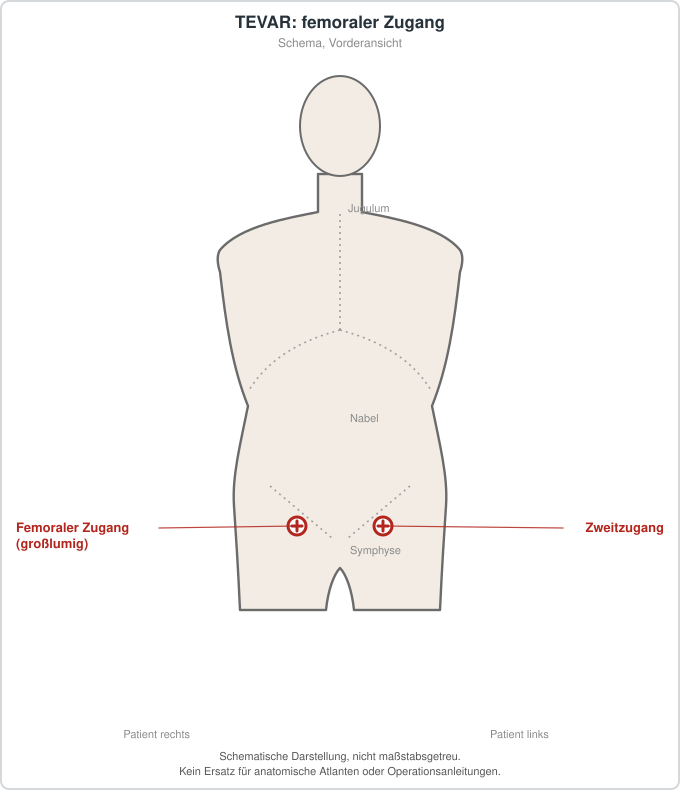

# Thorakale endovaskuläre Aortenreparatur (TEVAR)

## Übersicht

Die thorakale endovaskuläre Aortenreparatur (TEVAR) ist ein minimalinvasives Verfahren, bei dem ein Stentgraft endovaskulär in die erkrankte thorakale Aorta eingebracht wird.[1][2] Das Verfahren hat die offene Operation der absteigenden thorakalen Aorta weitgehend abgelöst, weil es mit geringerer Morbidität und Mortalität verbunden ist.[1] Die Anwendung hat sich inzwischen auch auf die proximale Landezone ausgeweitet, einschließlich der Zone 0 im Bereich der aszendierenden Aorta.[3] Für viele Indikationen fehlen hochwertige vergleichende Studien, und ein Teil der Erkenntnisse stammt aus retrospektiven oder nicht randomisierten Untersuchungen sowie aus Metaanalysen mit eingeschränkter Qualität.[1][4][5]

## Indikationen und Kontraindikationen

Die Leitlinie der Society for Vascular Surgery empfiehlt TEVAR als bevorzugtes Vorgehen zur Behandlung elektiver Aneurysmen der absteigenden thorakalen Aorta bei Patientinnen und Patienten, die für beide Verfahren infrage kommen.[1] Diese Empfehlung gilt jedoch nur innerhalb der Vorgaben der Gebrauchsanweisung der jeweiligen Prothese.[1] Die Leitlinie betrifft neben thorakalen Aneurysmen auch seltenere Erkrankungen der absteigenden Aorta.[1] Als Indikationen werden in den ausgewerteten Arbeiten thorakale Aortenaneurysmen, Pseudoaneurysmen, Aortendissektionen, penetrierende Ulzera, intramurale Hämatome und aortale Fisteln genannt.[6][4][3] Für traumatische Aortenverletzungen liegen Langzeitdaten vor, die auf gute Ergebnisse bei geringem Reinterventionsbedarf hinweisen, wobei die Studienqualität als niedrig eingestuft wird.[5] Die Behandlung von Aortendissektionen und traumatischen Verletzungen wird in der Leitlinie in eigenen Dokumenten behandelt.[1] Bei unkomplizierter Typ-B-Dissektion ergab der Vergleich mit einer alleinigen medikamentösen Therapie keinen frühen Überlebensvorteil für TEVAR.[7] Eine Metaanalyse sah TEVAR als mögliche Option für Patientinnen und Patienten mit hohem Risiko für spätere Komplikationen an und forderte randomisierte Studien zur Klärung einer möglichen Erstlinientherapie.[7] Für Patientinnen und Patienten mit hohem Risiko für ein symptomatisches Aneurysma oder ein akutes Aortensyndrom wird eine zügige Bildgebung empfohlen.[1]

## Vorbereitung

Für die Planung empfiehlt die Leitlinie eine Computertomographie-Angiographie (CTA), die bei hohem Risiko für eine Aortenerkrankung rasch durchgeführt werden sollte.[1] Die CTA soll mit feiner Schichtung die gesamte Aorta sowie die Becken- und Oberschenkelarterien erfassen; zusätzlich ist eine Darstellung von Kopf und Hals erforderlich, um die Anatomie der Vertebralarterien zu beurteilen.[1] Routinemäßig empfohlen wird außerdem eine dreidimensionale Rekonstruktion der Mittellinie der Aorta für eine präzise Planung und Durchführung.[1] Der traditionelle retrograde Zugang erfolgt über die Femoralis oder die Iliakalarterien, gegebenenfalls mit Conduits.[8] Bei ungünstiger Gefäßanatomie kommen alternative antegrade Zugangswege zum Einsatz.[8] Die Zugangsprobleme sind nach aktuellem Kenntnisstand aus Übersichtsarbeiten nur auf begrenzter Evidenz beschrieben, weshalb ein individualisiertes Zugangskonzept empfohlen wird.[8] Frauen erhielten in einer Metaanalyse intraoperativ häufiger iliakale Conduits und benötigten häufiger Bluttransfusionen als Männer.[9] Bei Frauen wurden auch geschlechtsspezifische Gefäßzugangskomplikationen beschrieben.[8] Winkelung und Windungen des Gefäßes, die Länge der Landezone, der Stentgraftdurchmesser sowie Blutdruck und Herzfrequenz beeinflussen die auf den Stentgraft wirkenden Verdrängungskräfte.[10] Diese Kräfte werden mit der Migration und Endoleck-Bildung in Zusammenhang gebracht.[10] Bei sehr komplexer Aortenanatomie ist daher eine sorgfältige Vorausplanung erforderlich.[10] Computergestützte Simulationen des Eingriffs können die Planung unterstützen, sind jedoch heterogen und nicht standardisiert.[2] Eine Konsensusbildung zur Technik- und Prothesenwahl bei Zone-0-Eingriffen steht noch aus.[3]

## Ablauf Schritt für Schritt

1. Vor dem Eingriff erfolgt eine CTA der gesamten Aorta einschließlich der Becken- und Oberschenkelarterien sowie der Gefäße von Kopf und Hals, ergänzt durch eine dreidimensionale Rekonstruktion für die Planung.[1]
2. Die Behandlungstechnik wird anhand der betroffenen Aortenzone festgelegt; neben dem reinen TEVAR kommen Kombinationen mit Debranching oder Bypass der supraaortalen Gefäße, Chimney-, fenestrierte und verzweigte Techniken zum Einsatz.[3]
3. Der Gefäßzugang erfolgt in der Regel retrograd über die Femoralis oder die Iliakalarterien, mit oder ohne Conduit.[8]
4. Wenn der retrograde Zugang nicht möglich ist, werden alternative antegrade Zugänge genutzt, etwa über die Arteria brachialis, axillaris oder carotis, die aszendierende Aorta, transapikal oder transkaval.[8]
5. Der Stentgraft wird im erkrankten Segment platziert; Winkelung, Windungen und Länge der Landezone sowie der Graftdurchmesser beeinflussen dabei die Stabilität der Prothese.[4][10]
6. Bei Eingriffen der Zone 0 wurde in den meisten Fällen der Zufluss der linken Arteria subclavia erhalten.[3]
7. Bei Eingriffen im Bereich der Aorta descendens ist der Erhalt des Blutflusses zum Rückenmark relevant: Ein Kollateralkreislauf und ein möglicher Steal-Effekt sollten beachtet werden, um eine Spinalisschädigung zu vermeiden.[11]

## Nachsorge

Die Leitlinie empfiehlt eine kontrastmittelverstärkte Computertomographie einen Monat und zwölf Monate nach TEVAR, danach jährlich lebenslang.[1] Bei einem Endoleck oder anderen auffälligen Befunden im Ein-Monats-Kontrollbild sind häufigere Untersuchungen zu erwägen.[1] Eine engmaschige, standardisierte Überwachung wird als wesentlich für die frühe Erkennung einer Stentgraftmigration und zur Vermeidung ihrer Folgen angesehen.[4] Die Nachsorge sollte idealerweise in einer auf die Aorta spezialisierten Ambulanz erfolgen, um Krankheitsprogressionen oder Komplikationen frühzeitig zu erkennen.[12] Aortische Reinterventionen treten nach Traumaversorgung vor allem im ersten Jahr und nach dem fünften Jahr auf.[5]

## Komplikationen

In einer Metaanalyse lag die gepoolte Rate bei 4 %, mit einer gepoolten Rate an Morbidität von 31 % und einer Reinterventionsrate von 32 %; die mit der Migration verbundene Mortalität betrug 5 %.[4] Als Ursachen wurden Progression der Aortendegeneration und Endoleck Typ II genannt; ein ungünstiges Oversizing und trichterförmige Landezonen werden ebenfalls diskutiert.[4] Die Heterogenität der Daten ist hoch.[4] Bei Eingriffen der Zone 0 sind Schlaganfälle mit einer gepoolten Rate von knapp 9 % die häufigste postoperative Komplikation, gefolgt von Typ-Ia-Endoleks, retrograden Typ-A-Dissektionen und Spinalisschädigungen.[3] Der Schlaganfall wird dabei als vergleichsweise häufig eingestuft.[3] Eine Spinalisschädigung nach TEVAR bei Aneurysmen wird als Mikroembolie durch einen verletzlichen wandständigen Thrombus beschrieben, während sie bei Dissektionen seltener auftritt.[11] Bei der Stentgraftmigration und Endolecks spielen hämodynamische Kräfte eine Rolle, insbesondere bei komplexer Aortenanatomie.[10] Nach Langzeitbeobachtungen bei Traumapatientinnen und -patienten traten Endoleks, Stentthrombosen, Vogelschnabel-Deformitäten und Migrationen selten auf, eine Vogelschnabel-Deformität wurde jedoch häufig beschrieben.[5] Nach TEVAR mit der frozen-elephant-trunk-Technik sind distale stentgraftinduzierte neue Eintrittsstellen beschrieben, die eine Reintervention erforderlich machen können.[12] Eine Infektion des Stentgrafts ist selten, aber mit einem hohen Mortalitätsrisiko verbunden.[6] Fieber und Schmerzen waren die häufigsten Erstsymptome, am häufigsten wurden Staphylococcus aureus und Candida albicans nachgewiesen.[6] Die Autoren der Übersicht bewerten die Datenlage als schwach.[6] Die Echokardiographie zeigte in einer Metaanalyse keine signifikanten Veränderungen der kardialen Funktionsparameter nach Stentgraftimplantation, bei einer nicht signifikanten Tendenz zur Massenzunahme.[13] Für Gefäßzugangskomplikationen werden in der Literatur sowohl Risiken als auch Folgen beschrieben, die vom Zugangsweg abhängen.[8]

## Ergebnisse und Prognose

Im Vergleich zur offenen Operation sind die Ergebnisse von TEVAR bei elektiven Aneurysmen laut Leitlinie günstiger, insbesondere hinsichtlich Morbidität, Krankenhausaufenthalt und kurzfristiger Mortalität.[1] Die Evidenz für diese Aussagen stammt überwiegend aus großen Einzelzentrumserfahrungen, Verwaltungsdatenbanken und Metaanalysen, während hochwertige randomisierte Studien fehlen.[1] Bei Zone-0-Eingriffen lag die gepoolte 30-Tage- beziehungsweise Krankenhausmortalität bei 7,49 %.[3] Die Autorinnen und Autoren der Metaanalyse halten die Komplikationsraten außer dem Schlaganfall für vergleichbar mit anderen Aortenzonen.[3] Für Frauen zeigte eine Metaanalyse keine signifikanten Unterschiede bei der Operationsmortalität, der Schlaganfallrate, der Spinalisschädigung, dem akuten Nierenversagen und der Krankenhausverweildauer.[9] Das Gesamtüberleben war bei Frauen jedoch niedriger; nach zwei Jahren betrug es 87,2 % gegenüber 89,8 % bei Männern.[9] Langzeitdaten nach TEVAR bei traumatischen Aortenverletzungen zeigen gute Ergebnisse mit seltenem Reinterventionsbedarf, die Studienqualität wird jedoch als niedrig beschrieben.[5] Die Ergebnisse bei infizierten Stentgrafts deuten auf eine höhere Mortalität unter konservativer Behandlung als nach chirurgischer Behandlung hin, allerdings beruht dies auf einer kleinen Zahl von Fällen aus Fallberichten und Fallserien.[6]

## Schematische Darstellung

## Literatur

1. Upchurch GR, Escobar GA, Azizzadeh A et al.. Society for Vascular Surgery clinical practice guidelines of thoracic endovascular aortic repair for descending thoracic aortic aneurysms. J Vasc Surg. 2021;73:55S-83S. PMID: 32628988. DOI: 10.1016/j.jvs.2020.05.076. https://pubmed.ncbi.nlm.nih.gov/32628988/
2. Mandigers TJ, Ramella A, Bissacco D et al.. Thoracic Stent Graft Numerical Models To Virtually Simulate Thoracic Endovascular Aortic Repair: A Scoping Review. Eur J Vasc Endovasc Surg. 2023;66:784-796. PMID: 37330201. DOI: 10.1016/j.ejvs.2023.06.006. https://pubmed.ncbi.nlm.nih.gov/37330201/
3. Zhu L, Li X, Lu Q et al.. A systematic review and meta-analysis of thoracic endovascular aortic repair with the proximal landing zone 0. Front Cardiovasc Med. 2023;10:1034354. PMID: 36910538. DOI: 10.3389/fcvm.2023.1034354. https://pubmed.ncbi.nlm.nih.gov/36910538/
4. Skrypnik D, Kalmykov E, Bischoff MS et al.. Late Endograft Migration After Thoracic Endovascular Aortic Repair: A Systematic Review and Meta-analysis. J Endovasc Ther. 2024;31:7-18. PMID: 35822261. DOI: 10.1177/15266028221109455. https://pubmed.ncbi.nlm.nih.gov/35822261/
5. Gennai S, Leone N, Mezzetto L et al.. Systematic review and meta-analysis of long-term reintervention following thoracic endovascular repair for blunt traumatic aortic injury. J Vasc Surg. 2023;78:540-547.e4. PMID: 36754248. DOI: 10.1016/j.jvs.2023.01.196. https://pubmed.ncbi.nlm.nih.gov/36754248/
6. Wang C, von Segesser LK, Berdajs D et al.. Treatment of infected endografts after thoracic endovascular aortic repair: a systematic review. Sci Prog. 2026;109:368504241296312. PMID: 41747225. DOI: 10.1177/00368504241296312. https://pubmed.ncbi.nlm.nih.gov/41747225/
7. Yang J, Shi Y, Jiang J et al.. Thoracic endovascular aortic repair or best medical therapy for uncomplicated type B aortic dissection? A meta-analysis. J Cardiovasc Surg (Torino). 2022;63:288-298. PMID: 25658975. DOI: 10.23736/S0021-9509.16.08594-3. https://pubmed.ncbi.nlm.nih.gov/25658975/
8. Mandigers TJ, Lomazzi C, Domanin M et al.. Vascular Access Challenges in Thoracic Endovascular Aortic Repair: A Literature Review. Ann Vasc Surg. 2023;94:22-31. PMID: 37534575. DOI: 10.1016/j.avsg.2022.10.001. https://pubmed.ncbi.nlm.nih.gov/37534575/
9. Zhang Y, Zhang Y, Wang Y et al.. Sex-based outcomes after thoracic endovascular aortic repair: A systematic review and meta-analysis. J Vasc Surg. 2024;80:1303-1313.e8. PMID: 38621637. DOI: 10.1016/j.jvs.2024.04.024. https://pubmed.ncbi.nlm.nih.gov/38621637/
10. Domanin M, Bissacco D, Romarowsky RM et al.. Drag Forces after Thoracic Endovascular Aortic Repair. General Review of the Literature. Ann Vasc Surg. 2021;75:479-488. PMID: 33823255. DOI: 10.1016/j.avsg.2021.02.042. https://pubmed.ncbi.nlm.nih.gov/33823255/
11. Banno H, Lee C, Ikeda S et al.. ＜Editors' Choice＞ Thoracic endovascular aortic repair and spinal cord injury. Nagoya J Med Sci. 2024;86:16-23. PMID: 38505712. DOI: 10.18999/nagjms.86.1.16. https://pubmed.ncbi.nlm.nih.gov/38505712/
12. Kreibich M, Berger T, Walter T et al.. Downstream thoracic endovascular aortic repair following the frozen elephant trunk procedure. Cardiovasc Diagn Ther. 2022;12:272-277. PMID: 35800359. DOI: 10.21037/cdt-22-99. https://pubmed.ncbi.nlm.nih.gov/35800359/
13. Papakonstantinou K, Rorris FP, Schizas N et al.. Echocardiographic Changes in Cardiac Function After Thoracic Endovascular Aortic Repair: A Systematic Review and Meta-Analysis. Ann Vasc Surg. 2023;90:119-127. PMID: 36442711. DOI: 10.1016/j.avsg.2022.10.011. https://pubmed.ncbi.nlm.nih.gov/36442711/
