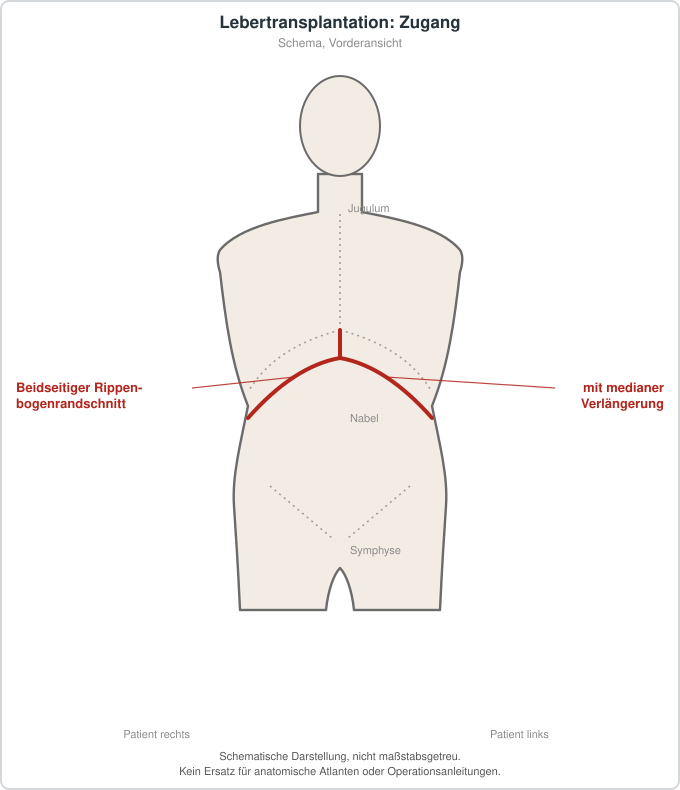

# Lebertransplantation

## Übersicht

Lebertransplantation ist ein etablierter, lebensrettender Eingriff, bei dem Patientinnen und Patienten mit schwerer Lebererkrankung eine Spenderleber übertragen wird.[1][2] Da Spenderorgane knapp sind, richtet sich ihre Verteilung nach den Prinzipien Gerechtigkeit, Chancengleichheit und erwartbarer Nutzen.[3] Die Indikationen wurden erweitert, Transplantationen bei akut-auf-chronischem Leberversagen wurden durchgeführt, Organe nach Herztod wurden genutzt, neue Operationstechniken wurden eingesetzt und die Priorisierung auf der Warteliste wurde überarbeitet.[1] Zudem haben Organperfusionsmaschinen, neu erkannte Abstoßungsformen und die Betreuung beim Übergang von pädiatrischen zu erwachsenen Patientinnen und Patienten zu einem verbesserten Management beigetragen.[1] Eine enge Zusammenarbeit zwischen Transplantationszentrum und Hausärztin bzw. Hausarzt gilt als wesentlich.[4]

## Indikationen und Kontraindikationen

Lebertransplantation wird bei Lebererkrankung im Endstadium eingesetzt, außerdem bei manchen Patientinnen und Patienten mit fortgeschrittenen Leberkarzinomen und bei akutem Leberversagen.[2] Die Indikationen wurden in den letzten Jahren erweitert.[1] Sie soll dabei gut ausgewählten Patientinnen und Patienten vorbehalten bleiben.[5] Ein internationaler Konsens empfiehlt für diese Situation eine standardisierte Terminologie sowie Entscheidungsprinzipien zur Patientenauswahl, zum biologischen Verhalten des Tumors, zur Spenderorganauswahl, zu Empfängerfaktoren und zu Ergebnissen.[5] Zusätzlich werden ethische Fragen der Organzuteilung bei malignen Indikationen und die Auswirkungen auf die nationalen Wartelisten berücksichtigt.[5] Eine Lebertransplantation sollte Patientinnen und Patienten mit klaren Indikationen und einer realistischen Aussicht auf Nutzen angeboten werden.[3] Ob diese Voraussetzungen gegeben sind, wird im Rahmen der Evaluation geprüft, die auch Hürden für einen erfolgreichen Verlauf identifizieren soll.[3]

## Vorbereitung

Sie dient dazu, Personen mit Bedarf zu identifizieren, Hindernisse für ein erfolgreiches Ergebnis aufzuzeigen und einen wirksamen Transplantationsplan zu entwickeln.[3] Für diesen Prozess existiert eine leitliniengestützte Vorlage.[3] Bereits vor der Operation sollten Patientinnen und Patienten auf Mangelernährung untersucht und, wenn möglich, behandelt werden.[6] Eine Metaanalyse fand bei Verstorbenen niedrigere präoperative Natriumwerte als bei Überlebenden, der Unterschied war jedoch statistisch nicht eindeutig.[7] Beim Vergleich von Empfängern mit präoperativer Hyponatriämie und solchen mit normalem Natriumspiegel zeigte sich ein kürzeres posttransplantäres Überleben bei Hyponatriämie.[7] Die Autorinnen und Autoren formulieren dies als wahrscheinlichen Zusammenhang und nicht als gesicherte Aussage.[7]

## Ablauf Schritt für Schritt

1. Evaluation und Aufnahme auf die Warteliste: Die Eignung wird anhand von Indikation, Nutzenaussicht und Transplantationsplan beurteilt.[3]
2. Organzuteilung: Die Verteilung der Spenderorgane erfolgt nach Gerechtigkeitsprinzipien und wird durch standortübergreifende Regeln festgelegt.[3] Die Priorisierung auf der Warteliste hat sich in den letzten Jahren verändert.[1]
3. Auswahl und Konservierung des Spenderorgans: Neben der traditionellen statischen Kältelagerung werden Maschinenperfusionsverfahren wie hypotherme oxygenierte Perfusion (HOPE) oder normotherme Maschinenperfusion (NMP) eingesetzt, um Organe aus erweiterten Spenderkriterien oder nach Kreislauftod zu verbessern.[8][9]
4. Operation im Rahmen eines Behandlungspfads: Die perioperative Versorgung folgt in vielen Zentren einem ERAS-Konzept, also einem multimodalen, evidenzbasierten Versorgungsprogramm zur Verringerung der chirurgischen Stressantwort.[6]
5. Perioperative Maßnahmen: Eine prophylaktische Magensonde und eine prophylaktische Bauchdrainage können nach den ERAS-Empfehlungen entfallen, eine frühe Extubation sollte erwogen werden.[6]
6. Frühe Mobilisation und Ernährung: Frühe orale Nahrungsaufnahme, Mobilisation und eine multimodale, ausgewogene Analgesie werden empfohlen.[6]
7. Immunsuppression und Transplantatüberwachung: Nach der Transplantation wird eine immunsuppressive Therapie eingesetzt, deren Wirksamkeit und Sicherheit zu den besser belegten Bereichen gehören.[10]

## Nachsorge

Die Nachsorge umfasst die Steuerung der Immunsuppression und die Erkennung von Transplantatabstoßung und Rezidiven.[10] Leitlinien empfehlen zudem Strategien, um Rezidive alkoholassoziierter, metabolisch bedingter und immunvermittelter Lebererkrankungen zu verhindern.[10] Die Langzeitsterblichkeit nach Lebertransplantation spiegelt vor allem Komplikationen der Immunsuppression, Rezidive der Grunderkrankung sowie Begleiterkrankungen wider.[4] Dazu gehören metabolisches Syndrom, chronische Nierenerkrankung, kardiovaskuläre Erkrankungen, Malignome und Hernien.[4] Die Empfehlungen zur präventiven und krankheitsspezifischen Versorgung beziehen sich auf die Zeit jenseits der ersten 90 Tage nach der Transplantation.[4] Eine Metaanalyse empfiehlt, alle transplantierten Patientinnen und Patienten in Lebensstilinterventionen einzubinden, um einem posttransplantären metabolischen Syndrom vorzubeugen.[11]

## Komplikationen

Transplantatbezogene Komplikationen umfassen Abstoßungsreaktionen, einschließlich der antikörpervermittelten Abstoßung, für die die Evidenz überwiegend aus Expertenmeinung und Extrapolation aus anderen soliden Organtransplantationen stammt.[10] Frühe Transplantatdysfunktion (early allograft dysfunction) und biliäre Komplikationen werden in Metaanalysen unter Maschinenperfusion seltener beschrieben als unter statischer Kältelagerung.[8][9] Eine hepatische Steatose kann nach Lebertransplantation sowohl als Rezidiv der Grunderkrankung als auch als Neuauftreten vorkommen.[11] Eine Metaanalyse fand eine Prävalenz von rund 40 Prozent, wobei ein Rezidiv deutlich häufiger war als eine De-novo-Steatose.[11] Metabolische Faktoren wie Adipositas und metabolisches Syndrom waren nach Transplantation stärkere Risikofaktoren als vor der Transplantation, mit Ausnahme des Diabetes mellitus.[11] Ein Prädiktor für eine posttransplantäre Steatohepatitis war vor allem eine präexistierende NAFLD.[11] Als einziges Immunsuppressivum mit erhöhtem Risiko wurde Sirolimus identifiziert, wobei die Autorinnen und Autoren empfehlen, es bei Hochrisikopatienten zu vermeiden.[11] Opportunistische Candida-Infektionen und Läsionen mit Malignitätspotenzial werden häufiger beschrieben.[12] Eine Metaanalyse ermittelte für Mundkrebs ein etwa fünffach erhöhtes Risiko gegenüber der Allgemeinbevölkerung.[12] Präklinische Daten zeigen, dass Ischämie die Mitochondrienfunktion im Transplantat beeinträchtigt, was die postoperative Erholung erschweren kann.[13]

## Ergebnisse und Prognose

Lebertransplantation ist bei geeigneter Indikation eine lebensrettende Therapie.[1][3] Die Langzeitprognose wird maßgeblich durch Komplikationen der Immunsuppression, Rezidive und Begleiterkrankungen bestimmt.[4] Eine Netzwerkmetaanalyse randomisierter Studien fand für HOPE und dHOPE im Vergleich zur statischen Kältelagerung eine geringere Rate an früher Transplantatdysfunktion, ein besseres einjähriges Transplantatüberleben, weniger Transplantatversagen und weniger biliäre Komplikationen.[8] Für NMP und NMP mit ischämiefreier Transplantation wurde ein geringeres Risiko für das Postreperfusionssyndrom berichtet.[8] Die Cochrane-Übersicht kommt demgegenüber zu einem zurückhaltenderen Ergebnis: Ob das Überleben unter HOPE oder NMP im Vergleich zur statischen Kältelagerung verbessert ist, blieb unsicher, die Evidenz war nur von niedriger bzw. sehr niedriger Sicherheit.[2] Eine weitere Metaanalyse fand unter HMP eine Reduktion der frühen Transplantatdysfunktion und nicht-anastomotischer biliärer Strikturen, für NMP waren die Studien zu heterogen für eine quantitative Auswertung.[9] Die Autorinnen und Autoren der Leitlinien betonen, dass für viele Aspekte des Transplantatmanagements retrospektive Kohortendaten oder Expertenmeinungen die Grundlage bilden.[10] Auch für die Langzeitbetreuung fehlen nach Einschätzung der Leitliniengruppe robuste prospektive Studien.[4] Bei Patientinnen und Patienten mit hepatischer Steatose nach Transplantation wurde in den einbezogenen Studien keine erhöhte Rate an Zirrhose oder Mortalität gefunden; die Datenlage hierzu ist jedoch begrenzt.[11]

## Informationen für Patientinnen und Patienten

Die Lebertransplantation ist ein etablierter, lebensrettender Eingriff bei schwerer Lebererkrankung.[1][2] Vor einer Aufnahme auf die Warteliste wird geprüft, ob eine Transplantation mit einer realistischen Nutzenaussicht verbunden ist.[3] Nach der Operation ist eine dauerhafte immunsuppressive Behandlung erforderlich, deren Steuerung und Kontrolle zur Nachsorge gehören.[10][4] Mit der Zeit können Begleiterkrankungen wie metabolisches Syndrom, Nierenerkrankung, Herz-Kreislauf-Erkrankungen, Tumoren oder Hernien auftreten, die regelmäßig beobachtet werden sollten.[4] Lebensstilmaßnahmen werden zur Vorbeugung eines metabolischen Syndroms empfohlen.[11] Nach Lebertransplantation ist das Risiko für Veränderungen der Mundschleimhaut und für Mundkrebs erhöht.[12] Die Betreuung erfolgt idealerweise in Abstimmung zwischen Transplantationszentrum und Hausarztpraxis.[4]

## Schematische Darstellung

## Literatur

1. EASL Clinical Practice Guidelines on liver transplantation. J Hepatol. 2024;81:1040-1086. PMID: 39487043. DOI: 10.1016/j.jhep.2024.07.032. https://pubmed.ncbi.nlm.nih.gov/39487043/
2. Tingle SJ, Dobbins JJ, Thompson ER et al.. Machine perfusion in liver transplantation. Cochrane Database Syst Rev. 2023;9:CD014685. PMID: 37698189. DOI: 10.1002/14651858.CD014685.pub2. https://pubmed.ncbi.nlm.nih.gov/37698189/
3. Dove L, Chadha RM, Lai JC et al.. AASLD AST Practice Guideline on adult liver transplantation: Candidate evaluation. Hepatology. 2026;83:1609-1645. PMID: 41405234. DOI: 10.1097/HEP.0000000000001644. https://pubmed.ncbi.nlm.nih.gov/41405234/
4. Sharma P, Izzy M, Ghabril MS et al.. AASLD AST Practice Guideline on adult liver transplantation: Diagnosis and post-transplant management of non-graft-related complications. Liver Transpl. 2026;32:1157-1193. PMID: 41405235. DOI: 10.1097/LVT.0000000000000785. https://pubmed.ncbi.nlm.nih.gov/41405235/
5. Bonney GK, Chew CA, Lodge P et al.. Liver transplantation for non-resectable colorectal liver metastases: the International Hepato-Pancreato-Biliary Association consensus guidelines. Lancet Gastroenterol Hepatol. 2021;6:933-946. PMID: 34506756. DOI: 10.1016/S2468-1253(21)00219-3. https://pubmed.ncbi.nlm.nih.gov/34506756/
6. Brustia R, Monsel A, Skurzak S et al.. Guidelines for Perioperative Care for Liver Transplantation: Enhanced Recovery After Surgery (ERAS) Recommendations. Transplantation. 2022;106:552-561. PMID: 33966024. DOI: 10.1097/TP.0000000000003808. https://pubmed.ncbi.nlm.nih.gov/33966024/
7. Sahmeddini MA, Afshari M, Khosravi MB et al.. Association Between Preoperative Hyponatremia and Survival After Liver Transplant: A Systematic Review and Meta-Analysis. Exp Clin Transplant. 2024;22:440-450. PMID: 39072515. DOI: 10.6002/ect.2023.0332. https://pubmed.ncbi.nlm.nih.gov/39072515/
8. Jaber F, Abuelazm M, Soliman Y et al.. Machine perfusion strategies in liver transplantation: A systematic review, pairwise, and network meta-analysis of randomized controlled trials. Liver Transpl. 2025;31:596-615. PMID: 39868927. DOI: 10.1097/LVT.0000000000000567. https://pubmed.ncbi.nlm.nih.gov/39868927/
9. Jakubauskas M, Jakubauskiene L, Leber B et al.. Machine Perfusion in Liver Transplantation: A Systematic Review and Meta-Analysis. Visc Med. 2022;38:243-254. PMID: 36160822. DOI: 10.1159/000519788. https://pubmed.ncbi.nlm.nih.gov/36160822/
10. Te HS, Agopian VG, Demetris AJ et al.. AASLD AST Practice Guideline on adult liver transplantation: Diagnosis and management of graft-related complications. Liver Transpl. 2026;32:444-490. PMID: 40844852. DOI: 10.1097/LVT.0000000000000715. https://pubmed.ncbi.nlm.nih.gov/40844852/
11. Silva AC, Nogueira P, Machado MV et al.. Hepatic steatosis after liver transplantation: a systematic review and meta-analysis. Liver Transpl. 2023;29:431-448. PMID: 36735478. DOI: 10.1097/LVT.0000000000000060. https://pubmed.ncbi.nlm.nih.gov/36735478/
12. Didilescu AC, Vacaru RP, Pronk C et al.. Oral diseases after liver transplantation: a systematic review and meta-analysis. Br Dent J. 2021;231:117-124. PMID: 34302095. DOI: 10.1038/s41415-021-3219-1. https://pubmed.ncbi.nlm.nih.gov/34302095/
13. Horváth T, Jász DK, Baráth B et al.. Mitochondrial Consequences of Organ Preservation Techniques during Liver Transplantation. Int J Mol Sci. 2021;22. PMID: 33802177. DOI: 10.3390/ijms22062816. https://pubmed.ncbi.nlm.nih.gov/33802177/
