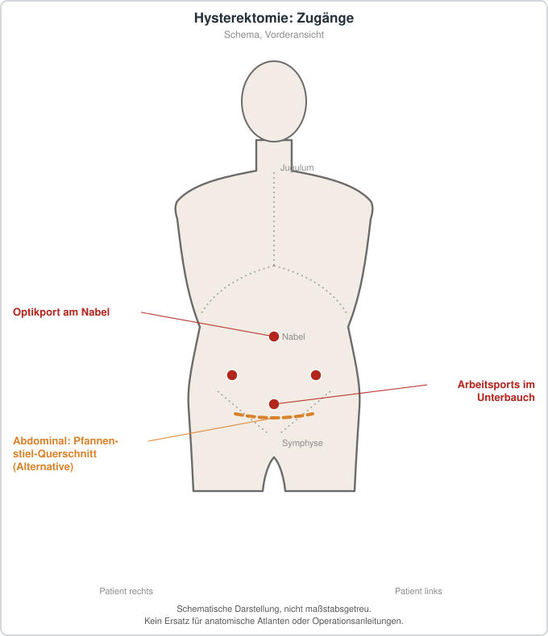

# Hysterektomie

## Übersicht

Hysterektomie ist die operative Entfernung der Gebärmutter, wobei je nach Verfahren auch ein Teil des Gebärmutterhalses erhalten bleiben kann.[1][2] Der Eingriff gehört zu den häufigsten chirurgischen Operationen bei Frauen; für die USA wird er als zweithäufigste Operation bei Frauen beschrieben.[3][4] Die Leitlinien beziehen sich überwiegend auf Hysterektomien bei gutartigen gynäkologischen Erkrankungen.[5][6] Der Eingriff wird in der Regel durchgeführt, um Beschwerden zu lindern und die Lebensqualität zu verbessern.[6] Für den Zugangsweg werden fünf Hauptverfahren unterschieden: die abdominale, die vaginale, die laparoskopische, die roboterassistierte Hysterektomie sowie die vaginale Hysterektomie über natürliche Körperöffnungen (V-NOTES).[7] Innerhalb der laparoskopischen Verfahren unterscheidet man die laparoskopisch assistierte vaginale Hysterektomie, die totale laparoskopische Hysterektomie und die Einport-Technik.[7] Vaginale und laparoskopische Verfahren gelten als minimalinvasiv, da sie keinen großen Bauchschnitt erfordern und daher meist mit einem kürzeren Krankenhausaufenthalt und einer schnelleren Erholung verbunden sind als die offene abdominale Hysterektomie.[3]

## Indikationen und Kontraindikationen

Die Indikation zur Hysterektomie soll nach den Leitlinien anhand der zugrunde liegenden Erkrankung, der präoperativen Abklärung und der verfügbaren Behandlungsalternativen gestellt werden.[6] Für bestimmte gynäkologische Erkrankungen gilt die Hysterektomie als Behandlung der Wahl, wobei der erwartete Nutzen sorgfältig gegen die Operationsrisiken und die Alternativen abzuwägen ist.[6] Ein Delphi-Konsens internationaler Expertinnen und Experten nennt als Merkmale, die die chirurgische Komplexität einer laparoskopischen Hysterektomie beeinflussen können, Adipositas und andere Begleiterkrankungen, die die Durchführung der Standardschritte erschweren, sowie die Größe und das Vorliegen von Myomen.[8] Zusätzlich werden Endometriose, Ovarialzysten und Adhäsionen im kleinen Becken als relevante Befunde genannt.[8] Als Größe für einen vergrößerten Uterus wird in einer systematischen Übersicht eine Länge von 12 Wochen oder mehr beziehungsweise ein Gewicht von 250 g oder mehr verwendet.[9] Für große Uteri zeigen die Daten laut dieser Übersicht Vorteile minimalinvasiver Verfahren hinsichtlich Blutverlust und Krankenhausaufenthalt, wobei die Evidenz insgesamt eine hohe Verzerrungsgefahr aufweist.[9] Eine Leitlinie empfiehlt den vaginalen oder laparoskopischen Zugang bei gutartiger Indikation auch dann, wenn der Uterus groß ist oder die Patientin adipös ist.[2] Eine vaginale Hysterektomie ist laut Leitlinie bei nullliparen Frauen nicht kontraindiziert.[2] Auch nach einer früheren Sectio caesarea gilt sie nicht als Kontraindikation.[2] Eine Leitlinie der ISGE zur vaginalen Hysterektomie bezieht sich auf die Auswahl von Frauen mit nicht vorgefallenem Uterus, bei denen der vaginale Eingriff sicher durchführbar ist.[10] Für die Auswahl des Verfahrens werden in den Leitlinien außerdem die Erfahrung des Operateurs, die Art der Anästhesie und organisatorische Rahmenbedingungen genannt.[2] Eine subtotale Hysterektomie wird nach einer französischen Leitlinie nicht empfohlen, um das Risiko peri- oder postoperativer Komplikationen zu senken.[2] Bei prämenopausalen Frauen ohne Ovarialerkrankung und ohne persönliche oder familiäre Anamnese für Brust- oder Ovarialkarzinom sollen die Eierstöcke nach dieser Leitlinie erhalten werden.[2]

## Vorbereitung

Vor einer Hysterektomie wird eine sorgfältige präoperative Beurteilung empfohlen, die auch alternative Behandlungen berücksichtigt.[6] Eine Leitlinie aus den USA betont, dass die Entscheidung unter Abwägung der Vorteile, Risiken und Präferenzen der informierten Patientin getroffen werden soll.[3] Zur Qualitätssicherung wird empfohlen, dass Hysterektomien von erfahrenen Operateurinnen und Operateuren mit hohem Eingriffsvolumen durchgeführt werden, wobei die französische Leitlinie mehr als zehn Hysterektomien pro Jahr als Richtwert nennt.[2] Zur präoperativen Infektionsprophylaxe wird eine vaginale Desinfektion mit Povidon-Iod-Lösung empfohlen.[2] Eine Antibiotikaprophylaxe wird laut derselben Leitlinie unabhängig vom gewählten Zugangsweg empfohlen.[2] Stimulierende Abführmaßnahmen in Form von Einläufen werden vor einer Hysterektomie dagegen nicht empfohlen.[2]

## Ablauf Schritt für Schritt

1. Präoperative Abklärung und gemeinsame Entscheidung über Indikation, Alternativen und Risiken.[6][3]
2. Auswahl des Zugangswegs: Der vaginale Zugang wird unter den minimalinvasiven Verfahren bevorzugt. Die laparoskopische Operation dient als Alternative, wenn eine vaginale Hysterektomie nicht indiziert oder nicht durchführbar ist. Der offene abdominale Zugang bleibt für einige Patientinnen eine wichtige Option.[3][2]
3. Vaginale Antiseptik mit Povidon-Iod-Lösung.[2]
4. Antibiotikaprophylaxe, unabhängig vom Zugangsweg.[2]
5. Festlegung, ob der Gebärmutterhals erhalten oder vollständig entfernt wird, da beide Vorgehensweisen in den Leitlinien als Optionen beschrieben werden.[1]
6. Entscheidung über den Erhalt der Eierstöcke, soweit keine Ovarialerkrankung oder entsprechende familiäre Belastung vorliegt.[2]
7. Durchführung des Eingriffs über den gewählten Zugang; dabei ist zu beachten, dass laparoskopische Verfahren im Vergleich zur abdominalen Hysterektomie mit mehr Harnwegsverletzungen einhergehen können.[7]
8. Berücksichtigung des erhöhten Harnleiterverletzungsrisikos bei der totalen laparoskopischen Hysterektomie im Vergleich zur totalen vaginalen Hysterektomie.[9]
9. Blutstillung: Eine spezifische hämostatische Technik zur Vermeidung von Harnwegsverletzungen wird nach der französischen Leitlinie nicht empfohlen.[2]

## Nachsorge

Nach einer vaginalen Hysterektomie kehren Patientinnen laut einer Cochrane-Übersicht wahrscheinlich früher zu ihren normalen Aktivitäten zurück als nach einer abdominalen Hysterektomie.[7] Auch nach laparoskopischen Verfahren wird eine frühere Rückkehr berichtet, wobei die Evidenz hier als von niedriger Sicherheit eingestuft wird.[7] Ein Behandlungskonzept mit verbesserter Erholung nach Operation (ERAS) war in einer Metaanalyse mit einer kürzeren Krankenhausverweildauer und weniger postoperativen Komplikationen wie Ileus verbunden, ohne dass Wiederaufnahmeraten oder berichteter Schmerz anstiegen.[11] Die Autorinnen und Autoren der Analyse sehen darin eine Grundlage für eine breitere, standardisierte Anwendung solcher Pfade, betonen jedoch die deutliche Heterogenität der eingeschlossenen Studien.[11] Zur postoperativen Unterstützung des Beckenbodens wurde in einer Metaanalyse randomisierter Studien ein moderater Nutzen des Beckenbodenmuskeltrainings für die sexuelle Funktion nach Hysterektomie im Vergleich zu keiner Intervention gefunden.[12] Für Harnsymptome, Beckenbodenkraft, Lebensqualität und Organsenkung ist der Effekt dagegen nicht sicher belegt, und Langzeiteffekte über den Interventionszeitraum hinaus sind unklar.[12]

## Komplikationen

Bei der Komplikationsanalyse zeigte eine systematische Übersicht für die totale laparoskopische Hysterektomie ein deutlich höheres Risiko für Harnleiterverletzungen als für die totale vaginale Hysterektomie.[9] Hinsichtlich Darmverletzungen fanden sich zwischen den Gruppen dagegen keine signifikanten Unterschiede.[9] Bei der abdominalen Hysterektomie war das Transfusionsrisiko im Vergleich zu einer roboterassistierten totalen Hysterektomie in einer Einzelauswertung erhöht.[9] Die Aussagekraft dieser Vergleiche wird durch die methodische Qualität der eingeschlossenen Studien eingeschränkt.[9] Langfristig zeigte eine Metaanalyse nach Hysterektomie einen Zusammenhang mit einem höheren Risiko für Harninkontinenz aller Typen innerhalb von zehn Jahren.[4] Nach mehr als zehn Jahren war die Hysterektomie mit einem erhöhten Risiko für Organprolaps und Belastungsinkontinenz assoziiert.[4] Diese Risiken sollen daher bei der Beratung zur Hysterektomie besprochen werden.[4] Werden die Eierstöcke bei der Hysterektomie zusätzlich entfernt, zeigten sich in einer Metaanalyse bei jüngeren Frauen ein geringeres Brustkrebsrisiko und ein erhöhtes Darmkrebsrisiko.[13] Außerdem wurden bei einer beidseitigen Salpingo-Oophorektomie vor dem 50. Lebensjahr ein erhöhtes Risiko für kardiovaskuläre Erkrankungen, Hyperlipidämie, Diabetes, Hypertonie, Demenz und Depression berichtet.[13] Die Autorinnen und Autoren empfehlen, den Nutzen gegen die Risiken abzuwägen, und die Evidenz zur Gesamtmortalität junger Frauen ist uneinheitlich.[13]

## Ergebnisse und Prognose

Eine systematische Übersicht über große gutartige Uteri stuft minimalinvasive Zugänge als sicher und wirksam mit wenigen Komplikationen ein.[9] Vaginale, laparoskopische und roboterassistierte Zugänge führten dort zu geringerem Blutverlust und kürzerem Krankenhausaufenthalt, während der abdominale Zugang eine kürzere Operationszeit aufwies.[9] Für die Gruppen der Frauen mit vaginaler Hysterektomie wurde im Vergleich zur laparoskopisch assistierten vaginalen Hysterektomie eine kürzere Operationszeit berichtet.[9] Die Übersicht weist allerdings auf eine hohe Verzerrungsgefahr vieler eingeschlossener Studien hin.[9] Die Cochrane-Übersicht zu Zugangswegen bei gutartigen Erkrankungen stützt sich auf Studien mit überwiegend niedriger oder mittlerer Evidenzsicherheit, wobei vor allem unzureichende Berichterstattung und Unpräzision limitierend sind.[7] Für die Frage nach Harnwegsverletzungen wird bei der laparoskopischen Hysterektomie gegenüber der abdominalen Hysterektomie eine moderate Evidenz für ein erhöhtes Risiko berichtet.[7] Bemerkenswert ist eine Abweichung zwischen den Quellen: Während eine systematische Übersicht die Ergebnisse roboterassistierter Verfahren beim Blutverlust günstig darstellt, beruhen diese Aussagen laut derselben Übersicht nur auf einzelnen Studien.[9] Eine Leitlinie aus den USA bevorzugt die vaginale Hysterektomie unter den minimalinvasiven Verfahren, während die französische Leitlinie die Wahl zwischen vaginalem und laparoskopischem Zugang vom Erfahrungsstand des Operateurs, der Anästhesie und organisatorischen Faktoren abhängig macht.[3][2] Eine weitere Leitlinie aus Kanada zur Hysterektomie wird aufgrund ihres Recherchezeitraums als älter eingestuft; sie betont vor allem den Vorteil der Hysterektomie bei geeigneten Patientinnen mit Verbesserung der Lebensqualität.[6] Laut einer aktuellen Leitlinie zur vaginalen Hysterektomie ist dieser Zugang für viele gynäkologische Patientinnen die Behandlung der Wahl und sollte einem größeren Kreis geeigneter Patientinnen angeboten werden.[10] Die Zufriedenheit von Patientinnen nach Hysterektomie wird in der Leitlinie aus Kanada als hoch beschrieben.[6] Ein Teil dieser Zufriedenheit soll durch sorgfältige präoperative Beurteilung und Besprechung von Alternativen beeinflusst werden.[6]

## Informationen für Patientinnen und Patienten

Eine Hysterektomie ist ein häufiger Eingriff, bei dem die Praxis zwischen verschiedenen Fachleuten stark variiert; deshalb sind klare Informationen über Zugangswege und Alternativen wichtig.[5] Die Entscheidung über das Verfahren soll gemeinsam mit der Patientin getroffen werden, wobei deren Werte und Präferenzen berücksichtigt werden.[3] Zu besprechen sind auch die erwarteten Vorteile im Verhältnis zu den Risiken und Behandlungsalternativen.[6] Langfristige Effekte wie Harninkontinenz oder Organprolaps sollen ebenfalls thematisiert werden.[4]

## Schematische Darstellung

## Literatur

1. Kives S, Lefebvre G. No. 238-Supracervical Hysterectomy. J Obstet Gynaecol Can. 2018;40:e597-e604. PMID: 29921438. DOI: 10.1016/j.jogc.2018.04.033. https://pubmed.ncbi.nlm.nih.gov/29921438/
2. Deffieux X, Rochambeau Bd, Chene G et al.. Hysterectomy for benign disease: clinical practice guidelines from the French College of Obstetrics and Gynecology. Eur J Obstet Gynecol Reprod Biol. 2016;202:83-91. PMID: 27196085. DOI: 10.1016/j.ejogrb.2016.04.006. https://pubmed.ncbi.nlm.nih.gov/27196085/
3. Committee Opinion No 701: Choosing the Route of Hysterectomy for Benign Disease. Obstet Gynecol. 2017;129:e155-e159. PMID: 28538495. DOI: 10.1097/AOG.0000000000002112. https://pubmed.ncbi.nlm.nih.gov/28538495/
4. Chang OH, Saldanha IJ, Encalada-Soto D et al.. Associations between hysterectomy and pelvic floor disorders: a systematic review and meta-analysis. Am J Obstet Gynecol. 2025;233:141-151.e6. PMID: 40120730. DOI: 10.1016/j.ajog.2025.03.018. https://pubmed.ncbi.nlm.nih.gov/40120730/
5. Thurston J, Murji A, Scattolon S et al.. No. 377-Hysterectomy for Benign Gynaecologic Indications. J Obstet Gynaecol Can. 2019;41:543-557. PMID: 30879487. DOI: 10.1016/j.jogc.2018.12.006. https://pubmed.ncbi.nlm.nih.gov/30879487/
6. Lefebvre G, Allaire C, Jeffrey J et al.. No. 109-Hysterectomy. J Obstet Gynaecol Can. 2018;40:e567-e579. PMID: 29921436. DOI: 10.1016/j.jogc.2018.04.031. https://pubmed.ncbi.nlm.nih.gov/29921436/
7. Pickett CM, Seeratan DD, Mol BWJ et al.. Surgical approach to hysterectomy for benign gynaecological disease. Cochrane Database Syst Rev. 2023;8:CD003677. PMID: 37642285. DOI: 10.1002/14651858.CD003677.pub6. https://pubmed.ncbi.nlm.nih.gov/37642285/
8. Leonardi M, Robledo KP, Gordijn SJ et al.. A consensus-based core feature set for surgical complexity at laparoscopic hysterectomy. Am J Obstet Gynecol. 2022;226:700.e1-700.e9. PMID: 34785175. DOI: 10.1016/j.ajog.2021.10.042. https://pubmed.ncbi.nlm.nih.gov/34785175/
9. Mamik MM, Kim-Fine S, Yang L et al.. Hysterectomy Techniques and Outcomes for Benign Large Uteri: A Systematic Review. Obstet Gynecol. 2024;144:40-52. PMID: 38743951. DOI: 10.1097/AOG.0000000000005607. https://pubmed.ncbi.nlm.nih.gov/38743951/
10. Chrysostomou A, Djokovic D, Edridge W et al.. Evidence-based guidelines for vaginal hysterectomy of the International Society for Gynecologic Endoscopy (ISGE). Eur J Obstet Gynecol Reprod Biol. 2018;231:262-267. PMID: 30447552. DOI: 10.1016/j.ejogrb.2018.10.058. https://pubmed.ncbi.nlm.nih.gov/30447552/
11. Nian J, Li Z, Chen P et al.. Enhanced recovery after surgery versus conventional postoperative care in patients undergoing hysterectomy: a systematic review and meta-analysis. Arch Gynecol Obstet. 2024;310:515-524. PMID: 38836927. DOI: 10.1007/s00404-024-07475-5. https://pubmed.ncbi.nlm.nih.gov/38836927/
12. de Oliveira NFF, Santuzzi CH, da Conceição TV et al.. Pelvic floor muscle training for urinary symptoms, vaginal prolapse, sexual function, pelvic floor muscle strength, and quality of life after hysterectomy: a systematic review with meta-analyses. Braz J Phys Ther. 2024;28:101122. PMID: 39426098. DOI: 10.1016/j.bjpt.2024.101122. https://pubmed.ncbi.nlm.nih.gov/39426098/
13. Hassan H, Allen I, Sofianopoulou E et al.. Long-term outcomes of hysterectomy with bilateral salpingo-oophorectomy: a systematic review and meta-analysis. Am J Obstet Gynecol. 2024;230:44-57. PMID: 37364803. DOI: 10.1016/j.ajog.2023.06.043. https://pubmed.ncbi.nlm.nih.gov/37364803/
