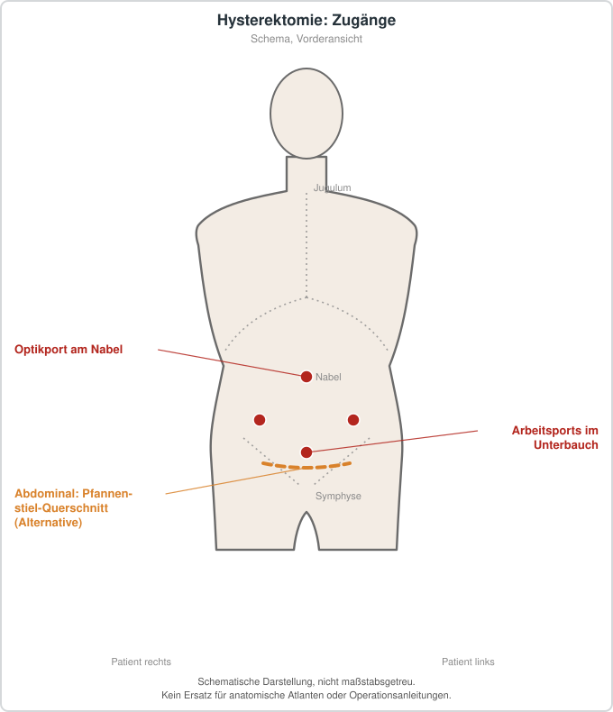

# Hysterektomie
## Übersicht
Als Hysterektomie wird die operative Entfernung der Gebärmutter bezeichnet. Sie kann bei benignen Erkrankungen oder im Rahmen onkologischer Behandlungen angezeigt sein; Organerhalt und nichtoperative Optionen müssen dabei ebenso einbezogen werden.[1][2]
## Zugangswege und Entscheidung
Je nach Indikation, Anatomie, Begleiterkrankungen und Voroperationen kommen vaginale, laparoskopische, robotisch assistierte oder offene Zugänge infrage. Die Wahl soll gemeinsam mit der Patientin oder dem Patienten nach Nutzen-Risiko-Abwägung erfolgen.[1][2]
## Risiken und Nachsorge
Mögliche Komplikationen sind Blutung, Infektion, Thromboembolie sowie Verletzungen benachbarter Organe. Konsequenzen für Fertilität, gegebenenfalls hormonelle Situation und Beckenbodenfunktion sind vor dem Eingriff zu besprechen.
## Patienteninformation
Nach einer Hysterektomie ist eine Schwangerschaft nicht mehr möglich. Welche Alternative und welcher Zugangsweg sinnvoll sind, hängt stark vom Grund der Behandlung und von persönlichen Zielen ab.
## Schematische Darstellung

*Laparoskopisch: Optikport am Nabel, Arbeitsports im Unterbauch (Anordnung variiert). Abdominaler Zugang: Pfannenstiel-Querschnitt. Der vaginale Zugang ist nicht dargestellt. Schematische Darstellung, nicht maßstabsgetreu. Kein Ersatz für anatomische Atlanten oder Operationsanleitungen.*
## Literatur
1. ACOG. *Choosing the Route of Hysterectomy for Benign Disease.* Obstet Gynecol. 2024. PMID: 38743951. https://pubmed.ncbi.nlm.nih.gov/38743951/
2. Cochrane Review. *Surgical approach to hysterectomy for benign gynaecological disease.* 2023. PMID: 37642285. https://pubmed.ncbi.nlm.nih.gov/37642285/
