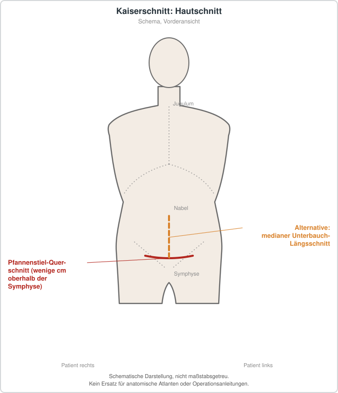

# Kaiserschnitt
## Übersicht
Der Kaiserschnitt ist die operative Entbindung eines Kindes. Er kann geplant oder bei geburtshilflicher Dringlichkeit erforderlich sein. Indikation, Zeitpunkt und Alternativen werden unter Einbezug der Schwangeren und der jeweiligen klinischen Situation entschieden.[1][2]
## Nutzen und Risiken
Der Eingriff kann in bestimmten Situationen für Mutter oder Kind lebensrettend oder komplikationsmindernd sein. Dem stehen unter anderem Risiken für Blutung, Infektion, Thromboembolie und Folgeschwangerschaften gegenüber.
## Nachfolgeschwangerschaften
Nach einem Kaiserschnitt hängt die Beratung zu einer späteren vaginalen Geburt oder erneuten Sectio von der individuellen Vorgeschichte und der geburtshilflichen Risikokonstellation ab.[2]
## Patienteninformation
Ein Kaiserschnitt ist eine große Operation. Vor einer geplanten Entbindung sollten Anlass, mögliche Alternativen, Erholung und Auswirkungen auf spätere Schwangerschaften verständlich erläutert werden.
## Schematische Darstellung

*Üblich ist der Pfannenstiel-Querschnitt oberhalb der Symphyse; der mediane Unterbauch-Längsschnitt bleibt Sonderfällen vorbehalten. Schematische Darstellung, nicht maßstabsgetreu. Kein Ersatz für anatomische Atlanten oder Operationsanleitungen.*
## Literatur
1. ACOG. *Cesarean Delivery on Maternal Request.* Obstet Gynecol. 2024. PMID: 38228512. https://pubmed.ncbi.nlm.nih.gov/38228512/
2. ACOG. *Vaginal Birth After Cesarean Delivery.* Obstet Gynecol. 2024. PMID: 38286476. https://pubmed.ncbi.nlm.nih.gov/38286476/
