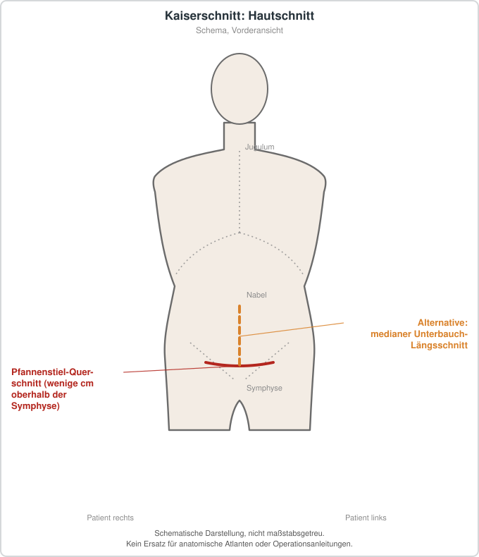

# Kaiserschnitt

## Übersicht

Der Kaiserschnitt ist ein operatives Verfahren zur Entbindung des Kindes und zählt zu den häufigsten chirurgischen Eingriffen.[1] Im Fachschrifttum wird zwischen geplanten (elektiven) und Notfall-Kaiserschnitten unterschieden, wobei die Zuordnung in den Studien uneinheitlich erfolgt.[2][3] Der Anteil der Kaiserschnitte an den Geburten wird international als hoch beschrieben und gilt als gesundheitspolitisches Anliegen.[4] Für die Zukunft wird erwartet, dass die Zahl abdominaler Wandkomplikationen nach Kaiserschnitt mit steigenden Kaiserschnittraten zunimmt.[5] Leitlinienempfehlungen beziehen sich vor allem auf einzelne Fragestellungen, etwa auf die Prävention von Beckenbodenstörungen.[6]

## Indikationen und Kontraindikationen

Sie beschreibt Hinweise auf einen möglichen Schutzeffekt bei Harninkontinenz, Analinkontinenz und sexuellen Störungen, die jedoch durch Selektionsverzerrungen und eingeschränkt vergleichbare Gruppen belastet sind.[6] Randomisierte Studien zeigten für diese Störungen keinen schützenden Effekt eines geplanten Kaiserschnitts.[6] Eine Ausnahme ist eine symptomatische Analsphinkterverletzung in der Vorgeschichte, bei der die Entbindungsart individuell besprochen werden sollte.[6] Die Kaiserschnittentbindung war dort mit einer geringeren perinatalen Sterblichkeit verbunden, zugleich jedoch mit einem höheren Blutungsrisiko und einer häufigeren Hospitalisierung der Mütter.[7] Die Mehrzahl der eingeschlossenen Studien wurde mit mittlerem oder schwerwiegendem Verzerrungsrisiko bewertet, sodass die Aussagekraft begrenzt ist.[7]

## Vorbereitung

In ERAS-Protokollen umfasst sie Angaben zum Verfahren, zum Schmerzkonzept, zur frühen Nahrungsaufnahme und Mobilisation, zur Stillplanung und zu den Entlasskriterien.[2] Daneben gehören standardisierte Nüchternheitsregeln sowie die präoperative Gabe eines Kohlenhydratgetränks zu den Vorbereitungsmaßnahmen.[2] Zur Infektionsprophylaxe wird eine intravenöse Antibiotikagabe unmittelbar vor dem Hautschnitt beschrieben.[2] Auch Maßnahmen zur Thromboseprophylaxe sind Teil der präoperativen Planung.[2] Die Metaanalysen beschreiben eine Verringerung des Blutverlusts und des Transfusionsbedarfs, mit einem größeren Nutzen bei Frauen mit erhöhtem Risiko.[8] Die Evidenzqualität wird jedoch als niedrig bis sehr niedrig eingestuft, weshalb die Autoren weitere hochwertige Studien fordern.[8] Bei der Anästhesieplanung ist die Spinalanästhesie in ERAS-Protokollen das übliche Standardverfahren.[2] Eine Spinalanästhesie ohne Zusatzverfahren ging in einer Analyse mit häufigerem postoperativem Schmerz einher.[9] Periphere Nervenblockaden waren ebenfalls mit geringerem postoperativem Schmerz assoziiert.[1][9]

## Ablauf Schritt für Schritt

1. Präoperative Information der Patientin zu Verfahren, Schmerzkonzept, früher Nahrungsaufnahme, Mobilisation und Entlasskriterien.[2]
2. Einhaltung der Nüchternheitsregeln: klare Flüssigkeiten bis zwei Stunden, leichte Mahlzeit bis sechs Stunden vor dem Eingriff und orale Kohlenhydratgabe zwei Stunden vor dem Kaiserschnitt.[2]
3. Intravenöse Antibiotikaprophylaxe innerhalb einer Stunde vor dem Hautschnitt.[2]
4. Gabe von Tranexamsäure vor dem Hautschnitt; eine Gabe nach dem Abklemmen der Nabelschnur war nicht mit vergleichbarem Nutzen verbunden.[8]
5. Regionale Anästhesie, im Standardverfahren als Spinalanästhesie.[2]
6. Kreislaufmanagement mit dem Ziel einer ausgeglichenen Volumenbilanz, ergänzt durch vasoaktive Substanzen bei Hypotonie und antiemetische Maßnahmen.[2]
7. Aktiver Wärmeerhalt mit Wärmegeräten und vorgewärmten Infusionen.[2]
8. Verzögertes Abklemmen der Nabelschnur und möglichst frühzeitiger Haut-zu-Haut-Kontakt beziehungsweise Stillbeginn nach der Entbindung.[2]
9. Mechanische Thromboseprophylaxe, etwa mit Kompressionsstrümpfen.[2]
10. Multimodale postoperative Schmerztherapie mit nichtopioiden Analgetika und Regionalverfahren.[2][1]
11. Frühe orale Nahrungsaufnahme sowie Kaugummikauen zur Förderung der Darmfunktion.[2]
12. Frühzeitige Entfernung des Blasenkatheters und frühe Mobilisation.[2]

## Nachsorge

In einer Metaanalyse traten akute postoperative Schmerzen bei rund 58 % der Frauen auf.[9] Assoziiert waren eine Schnittlänge über 10 Zentimeter, eine Spinalanästhesie ohne Zusatzverfahren, eine Allgemeinanästhesie, präoperative Angst und fehlende periphere Nervenblockaden.[9] Eine Netzwerk-Metaanalyse fand, dass regionale Nervenblockaden eine sichere und wirksame Analgesie darstellen, wobei die Befunde zu einzelnen Verfahren uneinheitlich sind.[1] ERAS-Protokolle sehen eine frühe Mobilisation, eine frühe Katheterentfernung und in einzelnen Programmen die Möglichkeit einer Entlassung am ersten postoperativen Tag vor.[2] Hinweise auf eine Verkürzung des Krankenhausaufenthalts ergeben sich aus mehreren Metaanalysen.[2][10] Die Auswertung randomisierter Studien ergab eine mittlere Verkürzung um etwa 17 Stunden, bei hoher statistischer Heterogenität.[2]

## Komplikationen

In einer Metaanalyse traten sie bei etwa 15 % der Fälle auf, am häufigsten als Zystotomie.[3] Das Risiko war bei Hysterektomie höher als bei konservativem Vorgehen und bei Notfalleingriffen höher als bei geplanten Eingriffen.[3] Besonders hoch war es bei einer als Plazenta percreta beschriebenen Form.[3] Die Sterblichkeit nach einer Relaparotomie nach Kaiserschnitt wurde in einer Metaanalyse mit etwa 7 % angegeben, mit deutlichen Unterschieden zwischen Ländern mit hohen und niedrigen Ressourcen.[4] Zu den Risikofaktoren zählten unter anderem ein höheres mütterliches Alter, eine Präeklampsie und Frühgeburtlichkeit.[4] Über 70 % der Relaparotomien folgten einem Notfall-Kaiserschnitt.[4] Tranexamsäure erhöhte in den eingeschlossenen Studien das Risiko nichtthromboembolischer Nebenwirkungen, ohne dass thromboembolische Ereignisse in den Daten vermehrt auftraten, wobei die Datenlage hierzu begrenzt ist.[8] Eine systematische Übersicht mit 484 Fällen beschreibt Bauchschmerzen und tastbare Raumforderungen als häufigste Symptome.[5] Die Diagnose wurde im Median etwa vier Jahre nach dem Kaiserschnitt gestellt, und Rezidive traten in rund 5 % auf.[5]

## Ergebnisse und Prognose

Mehrere Metaanalysen berichten eine schnellere postoperative Erholung, etwa bei Darmfunktion und Schmerz.[2][10] Ein Vorteil bezüglich Wundinfektionen wird in einer Analyse beschrieben, in einer anderen dagegen nicht bestätigt.[2][10] Eine weitere Metaanalyse fand unter ERAS einen Rückgang des postpartalen Blutverlusts, der in der anderen Analyse nicht untersucht wurde.[10] Übelkeit und Erbrechen, Wiederaufnahmen und Infektionen zeigten in den Analysen keine eindeutigen Unterschiede.[2][10] Eine Analyse fand keine Hinweise auf eine Beeinträchtigung der maternalen oder neonatalen Sicherheit, die Autoren betonen jedoch die begrenzte Zahl und Heterogenität der Studien.[10] Zu neonatalen Folgen zeigen Übersichtsarbeiten, dass Kinder nach Kaiserschnitt eine andere Darmmikrobiota aufweisen als vaginal geborene Kinder.[11] Diese Unterschiede werden mit langfristigen Gesundheitsrisiken wie immunvermittelten Erkrankungen und Allergien in Verbindung gebracht, wobei ein kausaler Zusammenhang nicht belegt ist.[11] Ein Verfahren, bei dem Kinder nach Kaiserschnitt mit vaginalen Sekreten in Kontakt gebracht werden (vaginal seeding), führte in einer systematischen Übersicht nur zu moderaten Veränderungen der Darmflora, und weitere klinische Studien werden für nötig gehalten.[12]

## Informationen für Patientinnen und Patienten

Eine Leitlinie empfiehlt keinen geplanten Kaiserschnitt zur Vorbeugung von Beckenbodenstörungen; bei symptomatischer Vorgeschichte einer Analsphinkterverletzung wird eine individuelle Abwägung der Entbindungsart empfohlen.[6] Schmerzen nach einem Kaiserschnitt sind häufig, und eine gute Schmerztherapie gilt als wichtiger Bestandteil der Nachsorge.[9] ERAS-Programme sehen eine frühe Mobilisation, frühe Nahrungsaufnahme und eine frühe Entfernung des Blasenkatheters vor.[2]

## Schematische Darstellung

## Literatur

1. Jing Y, Zhao S, Guo W et al.. Comparison of analgesic modalities after cesarean section: a network meta-analysis and systematic review. Int J Surg. 2025;111:3599-3612. PMID: 40146253. DOI: 10.1097/JS9.0000000000002352. https://pubmed.ncbi.nlm.nih.gov/40146253/
2. de Oliveira TTC, Tapioca V, Pereira E et al.. Enhanced recovery after surgery for cesarean delivery: a systematic review and meta-analysis of randomized trials with trial sequential analysis. Braz J Anesthesiol. 2026;76:844817. PMID: 42600936. DOI: 10.1016/j.bjane.2026.844817. https://pubmed.ncbi.nlm.nih.gov/42600936/
3. Lucidi A, Jauniaux E, Hussein AM et al.. Urological complications in women undergoing Cesarean section for placenta accreta spectrum disorders: systematic review and meta-analysis. Ultrasound Obstet Gynecol. 2023;62:633-643. PMID: 37401769. DOI: 10.1002/uog.26299. https://pubmed.ncbi.nlm.nih.gov/37401769/
4. Shan D, Han J, Tan X et al.. Mortality rate and risk factors for relaparotomy after caesarean section: a systematic review and meta-analysis. BMC Pregnancy Childbirth. 2025;25:269. PMID: 40069713. DOI: 10.1186/s12884-025-07365-x. https://pubmed.ncbi.nlm.nih.gov/40069713/
5. Salmeri N, Ragusi A, Buffo C et al.. Abdominal Wall Endometriosis After Cesarean Section: A Systematic Review of Clinical Presentation, Timing, and Outcomes. J Minim Invasive Gynecol. 2026;33:694-702. PMID: 41534699. DOI: 10.1016/j.jmig.2026.01.015. https://pubmed.ncbi.nlm.nih.gov/41534699/
6. Gachon B. [Cesarean section and perineal protection: CNGOF Perineal Prevention and Protection in Obstetrics Guidelines]. Gynecol Obstet Fertil Senol. 2018;46:968-985. PMID: 30377093. DOI: 10.1016/j.gofs.2018.10.030. https://pubmed.ncbi.nlm.nih.gov/30377093/
7. Sorensen HA, Obel J, Schroll JB et al.. Breech delivery in low-income settings: A systematic review of perinatal and maternal outcomes in vaginal versus cesarean breech deliveries. Int J Gynaecol Obstet. 2023;161:17-25. PMID: 36181290. DOI: 10.1002/ijgo.14483. https://pubmed.ncbi.nlm.nih.gov/36181290/
8. Cheema HA, Ahmad AB, Ehsan M et al.. Tranexamic acid for the prevention of blood loss after cesarean section: an updated systematic review and meta-analysis of randomized controlled trials. Am J Obstet Gynecol MFM. 2023;5:101049. PMID: 37311484. DOI: 10.1016/j.ajogmf.2023.101049. https://pubmed.ncbi.nlm.nih.gov/37311484/
9. Demilew BC, Zurbachew N, Getachew N et al.. Prevalence and Associated Factors of Postoperative Acute Pain for Mothers Who Gave Birth With Cesarean Section: A Systematic Review and Meta-Analysis. Pain Manag Nurs. 2024;25:e452-e464. PMID: 39033057. DOI: 10.1016/j.pmn.2024.05.010. https://pubmed.ncbi.nlm.nih.gov/39033057/
10. Lou J, Guo F. The efficacy and safety of enhanced recovery after surgery (ERAS) protocols in cesarean delivery: a meta-analysis of randomized controlled trials. Arch Gynecol Obstet. 2026;313. PMID: 41832375. DOI: 10.1007/s00404-026-08392-5. https://pubmed.ncbi.nlm.nih.gov/41832375/
11. Inchingolo F, Inchingolo AD, Palumbo I et al.. The Impact of Cesarean Section Delivery on Intestinal Microbiota: Mechanisms, Consequences, and Perspectives-A Systematic Review. Int J Mol Sci. 2024;25. PMID: 38256127. DOI: 10.3390/ijms25021055. https://pubmed.ncbi.nlm.nih.gov/38256127/
12. Wang X, Cui H, Li N et al.. Impact of vaginal seeding on the gut microbiome of infants born via cesarean section: A systematic review. J Infect. 2024;89:106348. PMID: 39537035. DOI: 10.1016/j.jinf.2024.106348. https://pubmed.ncbi.nlm.nih.gov/39537035/
