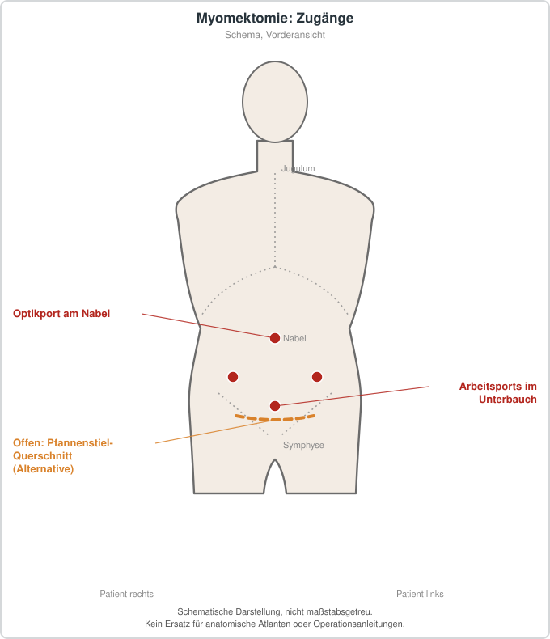

# Myomektomie

## Übersicht

Myomektomie ist die operative Entfernung von Uterusmyomen, bei der die Gebärmutter erhalten bleibt.[1][2] Uterusmyome sind die häufigsten benignen Tumoren des weiblichen Genitaltrakts und können unter anderem abnorme Uterusblutungen, Schmerzen, Druckbeschwerden und Subfertilität verursachen.[3] Ein operativer Eingriff kann bei einzelnen symptomatischen Myomen erforderlich werden, wobei abdominale oder transvaginale Zugangswege in Betracht kommen.[3] Das Verfahren hat sich von der offenen Laparotomie über die Laparoskopie und Hysteroskopie bis hin zu VNOTES- und robotergestützten Techniken entwickelt.[2] Minimalinvasive Zugänge gelten aufgrund kürzerer Krankenhausaufenthalte, geringerer postoperativer Schmerzen, rascherer Erholung und eines kosmetisch günstigeren Narbenbildes als bevorzugte Vorgehensweise.[2] Ein wesentliches Ziel der Myomektomie gegenüber der Hysterektomie ist der Erhalt der Fertilität.[2]

## Indikationen und Kontraindikationen

Die Myomektomie wird Frauen angeboten, die bei symptomatischen Uterusmyomen ihre Fertilität erhalten möchten.[1] Als Beschwerden, die eine Behandlung nahelegen können, werden abnorme Uterusblutungen, Schmerzen, Druckgefühl und Subfertilität genannt.[3] Submukös gelegene Myome sind die seltenste Myomform, können aber zu Blutungen beitragen und eine Rolle bei Infertilität und Fehlgeburten spielen.[4] Für die Blutungsbeschwerden dieser Myome wird die hysteroskopische Myomektomie als bevorzugte Behandlung beschrieben, die zugleich die normale Struktur der Uterushöhle wiederherstellen soll.[4] Auch für symptomatische submuköse Myome wird die hysteroskopische Myomektomie als Methode der Wahl mit hoher Erfolgsrate und niedriger Komplikationsrate angesehen.[5] Für Myome vom FIGO-Typ 0 bis 2 werden in einer Übersichtsarbeit Vorteile der transzervikalen Resektion gegenüber transabdominalen Eingriffen beschrieben, darunter kürzere Operationszeit und Krankenhausaufenthalt, schnellere Erholung und geringere Schmerzen.[2] Totalintramurale Myome vom Typ 3 und höher eignen sich nach derselben Quelle nicht für die hysteroskopische Morcellation.[2] Die Größe und Anzahl der Myome können einen offenen Zugang erforderlich machen.[1] Sehr große Myome, die den Einsatz laparoskopischer Trokare behindern, sowie multiple Myome, die ohne intraoperative Palpation nicht vollständig entfernt werden können, sprechen laut einer Übersichtsarbeit für eine Laparotomie.[2] In einer Metaanalyse zeigte sich bei der Embolisation eine höhere Rate an Reinterventionen und Hysterektomien im Vierjahres-Follow-up, zugleich eine niedrigere Rate früher Komplikationen und Wiederaufnahmen.[6] Die Autoren empfehlen, die Wahl des Verfahrens an individuellen Präferenzen und der Expertise des behandelnden Arztes auszurichten.[6] Bei der Kaiserschnitt-Myomektomie wird die Durchführbarkeit bei ausgewählten Patientinnen als möglicherweise sicher beschrieben, sofern geeignete hämostatische Techniken angewendet und das Verfahren von erfahrenen Chirurgen durchgeführt wird.[7] Ausgenommen sind nach derselben Metaanalyse Myome im Bereich des Cornu oder in unmittelbarer Nähe großer Gefäße sowie Situationen mit intraoperativer Uterusatonie.[7]

## Vorbereitung

Für eine dreimonatige Gabe eines GnRH-Agonisten vor laparoskopischer Myomektomie wird eine moderate Evidenz zur Reduktion des Blutverlusts beschrieben.[8] Die Leitlinie hat zudem Empfehlungen zum präoperativen Einsatz von Progesteron formuliert.[8] Eine präoperative Risikobewertung wird als wichtig beschrieben, insbesondere im Hinblick auf spätere Schwangerschaften, da Faktoren wie Myomgröße, erhöhter Body-Mass-Index und Plazentaanomalien mit dem Risiko einer schwangerschaftsbedingten Uterusruptur nach laparoskopischer Myomektomie assoziiert sind.[9] Für die Planung und Kartierung von Myomen werden in einer Übersichtsarbeit MRT-Untersuchungen genannt, da sie Lage, Typ und FIGO-Klasse der Myome zuverlässig darstellen können.[2] Zur Planung einer hysteroskopischen Myomektomie empfiehlt die ISGE-Leitlinie die Beurteilung des Uterus mittels Saline-Infusions-Sonohysterographie oder einer kombinierten transvaginalen Sonographie und diagnostischen Hysteroskopie.[10] Zur Abschätzung von Komplikationen, einer unvollständigen Entfernung und einer langen Operationszeit wird zudem die STEPW-Klassifikation submuköser Myome empfohlen.[10] Fünf von elf vorgeschlagenen Maßnahmen erreichten einen Konsens für den Einschluss, darunter verdünntes Vasopressin, Tranexamsäure, ein perizervikales Tourniquet, ein Cell Saver und eine restriktive Transfusionspraxis.[1]

## Ablauf Schritt für Schritt

1. Die Wahl des Zugangs (laparoskopisch, robotergestützt, offen oder hysteroskopisch) richtet sich nach Typ und Lage der Myome sowie nach der Expertise des Chirurgen.[2][1]
2. Bei einem offenen Vorgehen wird der Uterus über einen Laparotomieschnitt erreicht, wobei die Wahl des Hautschnitts vor allem von der Myomgröße abhängt.[2]
3. Die Uteruseröffnung kann quer oder längs erfolgen, wobei in einer randomisierten Studie kein signifikanter Unterschied im intraoperativen Blutverlust zwischen beiden Inzisionen gefunden wurde.[2]
4. Das Myom wird enukleiert, wobei der Blutverlust durch hämostatische und Nahttechniken reduziert werden soll.[2]
5. Zur intraoperativen Blutungsreduktion werden Vasokonstriktoren, Uterusarterienokklusion, Misoprostol, Oxytocin und Vasopressin genannt, deren Einsatz laut einer Leitlinie durch moderate Evidenz gestützt ist.[8]
6. Die Uterusnaht erfolgt mit resorbierbarem Material, wobei intrakorporale Knoten bei laparoskopischer Technik besondere chirurgische Fertigkeiten erfordern.[11]
7. Barbed-Nähte können nach einer Übersichtsarbeit die Nahtzeit und den Blutverlust bei laparoskopischer Myomektomie verringern.[11]
8. Das entfernte Myom wird entweder über einen Endobag extrahiert, gegebenenfalls nach Zerkleinerung im Bag, oder bei größeren Präparaten aus dem Abdomen geborgen.[2]
9. Bei hysteroskopischen Eingriffen wird das Myom mittels Resektoskop, Morcellation oder Slicing-Technik entfernt, wobei für Typ-0-Myome Morcellation und für Typ-1- bis -2-Myome die Slicing-Technik empfohlen wird.[10][2]

## Nachsorge

Nach laparoskopischer Myomektomie wird eine verstärkte Schwangerschaftsüberwachung empfohlen, da das Risiko einer Uterusruptur in späteren Schwangerschaften durch verschiedene Faktoren erhöht sein kann.[9] Eine Metaanalyse nennt zudem sorgfältige Nahttechniken als Maßnahme zur Risikominderung.[9] Die Erholung nach minimalinvasiven Verfahren wird als rascher beschrieben als nach offenen Eingriffen, mit geringerem postoperativem Schmerzmittelbedarf und kürzerem Krankenhausaufenthalt.[2] Nach hysteroskopischer Myomektomie sind Flüssigkeitsbilanz und Erkennung von Komplikationen wie Wasserintoxikation von Bedeutung.[2][10]

## Komplikationen

Eine Übersichtsarbeit beschreibt laparoskopische Myomektomien als mit einem erhöhten Blutungsrisiko verbunden.[11] Bei offener Myomektomie wird eine hohe Rate perioperativer Bluttransfusionen berichtet.[1] Für Misoprostol zeigte eine Metaanalyse randomisierter Studien eine signifikante Reduktion von Blutverlust, Hämoglobinabfall und Transfusionsbedarf bei offener Myomektomie, ohne Zunahme postoperativen Fiebers.[12] Tranexamsäure reduzierte in einer Metaanalyse den intraoperativen und postoperativen Blutverlust, senkte den Krankenhausaufenthalt und war insgesamt weitgehend sicher, ging aber mit einer signifikant höheren Übelkeitsrate einher.[13] Bei der Kaiserschnitt-Myomektomie wurden im Vergleich zum alleinigen Kaiserschnitt ein größerer Hämoglobinabfall, häufigere Blutungen, höhere Transfusionsraten und längere Operationszeiten berichtet.[7] Bei der hysteroskopischen Myomektomie werden uterine Perforation, Wasserintoxikation und Darmverletzung als häufige Nachteile des Verfahrens genannt.[2] Diese lassen sich nach derselben Quelle durch die hysteroskopische Morcellation im Vergleich zu monopolaren oder bipolaren Energieformen verringern.[2] Fallberichte beschreiben Plazentaakkreta nach transzervikaler Resektion, ein kausaler Zusammenhang ist jedoch nicht gesichert.[2] Für Flüssigkeitsdefizite bei bipolarer Myomektomie mit Kochsalzlösung wird ein Defizit von 1000 ml bei gesunden Frauen im reproduktiven Alter als mit geringem Risiko für schwere Komplikationen beschrieben, bei älteren Frauen oder bei Komorbiditäten werden niedrigere Schwellen von 750 ml erwogen.[10] Die robotergestützte laparoskopische Myomektomie ist nach einer Metaanalyse mit einer längeren Operationszeit verbunden, während die Rate von Kaiserschnitten nach dem Eingriff niedriger lag.[14] Eine Metaanalyse von Single-Site- und Multiport-Verfahren fand dagegen keine signifikanten Unterschiede bei Blutverlust und Transfusionsrate, dafür weniger Gesamtkomplikationen bei der Single-Site-Technik.[15] Schwerwiegende Komplikationen wie die Uterusruptur in einer späteren Schwangerschaft sind laut einer Metaanalyse mit Myomgröße, erhöhtem Body-Mass-Index und Plazentaanomalien assoziiert.[9]

## Ergebnisse und Prognose

Für die Myomektomie wird eine effektive Behandlung symptomatischer Myome beschrieben, wobei sich Ergebnisse je nach Verfahren unterscheiden.[6] Im Vergleich zur Uterusarterienembolisation zeigten sich nach vier Jahren höhere Reinterventionsraten bei der Embolisation, während die Schwangerschaftsraten und die Besserung abnormer Uterusblutungen vergleichbar waren.[6] Eine andere Metaanalyse beschreibt die robotergestützte Methode als sicher und wirksam gegenüber der abdominalen Myomektomie, aber unterlegen gegenüber der laparoskopischen Methode.[14] Für die hysteroskopische Myomektomie wird eine hohe Effektivität und Sicherheit bei submukösen Myomen beschrieben.[16] Die ISGE-Leitlinie bezeichnet sie als wirksamste konservative minimalinvasive gynäkologische Intervention bei submukösen Leiomyomen.[10] Barbed-Nähte waren in einer Übersichtsarbeit mit geringerer Operationszeit und geringerem Blutverlust verbunden, ohne nachteilige Auswirkungen auf Schwangerschaftsergebnisse.[11]

## Informationen für Patientinnen und Patienten

Uterusmyome sind die häufigsten gutartigen Tumoren der weiblichen Geschlechtsorgane und können Blutungen, Schmerzen, Druckbeschwerden oder Fruchtbarkeitsprobleme verursachen.[3] Die Myomektomie ist ein operatives Verfahren, bei dem die Myome entfernt werden und die Gebärmutter erhalten bleibt.[1][2] Welcher Zugang infrage kommt, hängt von Größe, Anzahl und Lage der Myome sowie von der Erfahrung des Operateurs ab.[2][1] Minimalinvasive Verfahren gelten als bevorzugt, weil sie in der Regel mit kürzerem Krankenhausaufenthalt und rascherer Erholung verbunden sind.[2] Als Alternative zur Operation wird die Uterusarterienembolisation untersucht, bei der im Vierjahres-Follow-up häufiger eine erneute Behandlung nötig war als nach Myomektomie.[6] Die Entscheidung für ein Verfahren sollte nach Quellenlage an den persönlichen Präferenzen und der Expertise der behandelnden Ärztin beziehungsweise des behandelnden Arztes orientiert werden.[6]

## Schematische Darstellung

## Literatur

1. Bao J, Shore EM, Simpson AN et al.. Delphi Approach for the Design of an Intraoperative Blood Conservation Pathway for Open Myomectomy. J Obstet Gynaecol Can. 2020;42:31-37. PMID: 31296447. DOI: 10.1016/j.jogc.2019.04.023. https://pubmed.ncbi.nlm.nih.gov/31296447/
2. Paredes JS, Lee CL, Chua PT et al.. Myomectomy: Choosing the Surgical Approach - A Systematic Review. Gynecol Minim Invasive Ther. 2024;13:146-153. PMID: 39184254. DOI: 10.4103/gmit.gmit_152_23. https://pubmed.ncbi.nlm.nih.gov/39184254/
3. Saridogan E, Antoun L, Bouwsma EVA et al.. European Society for Gynaecological Endoscopy (ESGE) Good Practice Recommendations on surgical techniques for removal of fibroids: part 1 abdominal (laparoscopic and open) myomectomy. Facts Views Vis Obgyn. 2024;16:263-280. PMID: 39357857. DOI: 10.52054/FVVO.16.3.041. https://pubmed.ncbi.nlm.nih.gov/39357857/
4. Clark TJ, Antoun L, Di Spiezio Sardo A et al.. European Society for Gynaecological Endoscopy (ESGE) Good Practice Recommendations on surgical techniques for Removal of Fibroids: Part 2 Hysteroscopic Myomectomy. Facts Views Vis Obgyn. 2024;16:383-397. PMID: 39718323. DOI: 10.52054/FVVO.16.4.054. https://pubmed.ncbi.nlm.nih.gov/39718323/
5. Moawad NS, Palin H. Hysteroscopic Myomectomy. Obstet Gynecol Clin North Am. 2022;49:329-353. PMID: 35636812. DOI: 10.1016/j.ogc.2022.02.012. https://pubmed.ncbi.nlm.nih.gov/35636812/
6. Peng J, Wang J, Shu Q et al.. Systematic review and meta-analysis of current evidence in uterine artery embolization vs myomectomy for symptomatic uterine fibroids. Sci Rep. 2024;14:19252. PMID: 39164326. DOI: 10.1038/s41598-024-69754-0. https://pubmed.ncbi.nlm.nih.gov/39164326/
7. Huang Y, Ming X, Li Z et al.. Feasibility and safety of performing cesarean myomectomy: a systematic review and meta-analysis. J Matern Fetal Neonatal Med. 2022;35:2619-2627. PMID: 32674632. DOI: 10.1080/14767058.2020.1791816. https://pubmed.ncbi.nlm.nih.gov/32674632/
8. Evidence-Based Practice for Minimization of Blood Loss During Laparoscopic Myomectomy: An AAGL Practice Guideline: The Practice Guideline Committee of AAGL. J Minim Invasive Gynecol. 2025;32:113-132. PMID: 39919888. DOI: 10.1016/j.jmig.2024.09.021. https://pubmed.ncbi.nlm.nih.gov/39919888/
9. Fu L, Song Z, Cao J et al.. Risk factors for pregnancy-related uterine rupture following laparoscopic myomectomy: A systematic review and meta-analysis. Medicine (Baltimore). 2025;104:e44363. PMID: 41054050. DOI: 10.1097/MD.0000000000044363. https://pubmed.ncbi.nlm.nih.gov/41054050/
10. Loddo A, Djokovic D, Drizi A et al.. Hysteroscopic myomectomy: The guidelines of the International Society for Gynecologic Endoscopy (ISGE). Eur J Obstet Gynecol Reprod Biol. 2022;268:121-128. PMID: 34902749. DOI: 10.1016/j.ejogrb.2021.11.434. https://pubmed.ncbi.nlm.nih.gov/34902749/
11. Savasta F, Libretti A, Leo L et al.. Barbed suture in laparoscopic myomectomy. Minerva Obstet Gynecol. 2025;77:128-136. PMID: 39283288. DOI: 10.23736/S2724-606X.24.05494-0. https://pubmed.ncbi.nlm.nih.gov/39283288/
12. Wali S, Balfoussia D, Touqmatchi D et al.. Misoprostol for open myomectomy: a systematic review and meta-analysis of randomised control trials. BJOG. 2021;128:476-483. PMID: 32613769. DOI: 10.1111/1471-0528.16389. https://pubmed.ncbi.nlm.nih.gov/32613769/
13. Baradwan S, Hafidh B, Latifah HM et al.. Prophylactic tranexamic acid during myomectomy: A systematic review and meta-analysis of randomized controlled trials. Eur J Obstet Gynecol Reprod Biol. 2022;276:82-91. PMID: 35839714. DOI: 10.1016/j.ejogrb.2022.07.004. https://pubmed.ncbi.nlm.nih.gov/35839714/
14. Chen W, Ma J, Yang Z et al.. Robotic-assisted laparoscopic versus abdominal and laparoscopic myomectomy: A systematic review and meta-analysis. Int J Gynaecol Obstet. 2024;166:994-1005. PMID: 38588036. DOI: 10.1002/ijgo.15485. https://pubmed.ncbi.nlm.nih.gov/38588036/
15. Wang L, Deng JY, Li KP et al.. A systematic review and meta-analysis comparing robotic single-site versus multi-port myomectomy. J Robot Surg. 2023;17:1319-1328. PMID: 37093509. DOI: 10.1007/s11701-023-01597-9. https://pubmed.ncbi.nlm.nih.gov/37093509/
16. Lasmar RB, Lasmar BP, Moawad NS et al.. HYSTEROSCOPIC MYOMECTOMY. Medicina (Kaunas). 2022;58. PMID: 36422166. DOI: 10.3390/medicina58111627. https://pubmed.ncbi.nlm.nih.gov/36422166/
