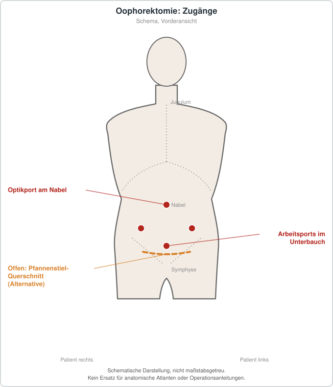

# Oophorektomie

## Übersicht

Bei beidseitiger Entfernung entsteht eine vorzeitige, chirurgisch ausgelöste Menopause.[1][2] In der Fachliteratur wird die beidseitige Entfernung häufig zusammen mit den Eileitern als bilaterale Salpingo-Oophorektomie (BSO) beschrieben.[3][4] Die Oophorektomie wird in unterschiedlichen Situationen durchgeführt: zur Risikoreduktion bei erblich erhöhtem Eierstockkrebsrisiko, im Rahmen einer Hysterektomie aus gutartiger Indikation, bei Endometriose sowie als Teil der onkologischen Behandlung bestimmter Brustkrebsformen.[1][5][6][7] Die Datenlage unterscheidet sich je nach Indikation und Patientinnenkollektiv erheblich, weshalb Entscheidungen in der Regel individuell getroffen werden.[1][8]

## Indikationen und Kontraindikationen

Bei Trägerinnen von BRCA1- oder BRCA2-Varianten wird die risikoreduzierende Salpingo-Oophorektomie (RRSO) als wirksamste Methode zur Verringerung des Eierstockkrebsrisikos und der krebsbedingten Mortalität beschrieben.[1][9] Auch bei Frauen mit Lynch-Syndrom wird die RRSO angeboten, wobei dort in der Regel zusätzlich eine Hysterektomie erfolgt, da bei diesen Frauen ein erhebliches Lebenszeitrisiko für Gebärmutterschleimhautkrebs besteht.[1] Darüber hinaus wird die Operation bei Frauen mit moderat erhöhten Risikogenen wie RAD51C, RAD51D und BRIP1 sowie bei ausgeprägter familiärer Belastung durch Eierstock- oder Brustkrebs in Betracht gezogen.[1] Für PALB2-Trägerinnen besteht nach den vorliegenden Quellen keine einheitliche Empfehlung: Einige Fachgesellschaften unterstützen die RRSO, andere verweisen auf die begrenzte Evidenz.[1] Die Entscheidung soll dabei die familiäre Anamnese und weitere Risiko- und Schutzfaktoren einbeziehen.[1] Für Frauen ohne Adnexerkrankung und mit durchschnittlichem Eierstockkrebsrisiko werden in der Übersichtsliteratur unterschiedliche Empfehlungen beschrieben, da frühere Modellierungen eine Erhöhung der Mortalität durch Entfernung der Eierstöcke nahelegten, neuere Daten diese Annahme jedoch infrage stellen.[6] Bei Frauen unter 50 Jahren mit Östrogensubstitution und bei Frauen über 50 Jahren ohne Östrogensubstitution wurde in einer neueren Übersicht keine erhöhte Mortalität im Zusammenhang mit einer gleichzeitigen Oophorektomie gefunden.[6] Bei tiefer infiltrierender Endometriose kann eine Hysterektomie mit oder ohne beidseitige Oophorektomie das Rezidivrisiko und die Notwendigkeit erneuter Eingriffe im Vergleich zur alleinigen Resektion der Läsionen senken.[5] Gleichzeitig wird empfohlen, bei einer Hysterektomie wegen tiefer Endometriose den Erhalt der Eierstöcke mit der Patientin zu besprechen, da die vielfältigen Folgen einer frühen Menopause für Lebenserwartung und Lebensqualität berücksichtigt werden sollen.[5] In der Onkologie wird die Ausschaltung der Ovarialfunktion bei prämenopausalen Patientinnen mit östrogenrezeptorpositivem Brustkrebs als Option genannt, wobei die bilaterale Oophorektomie eine von mehreren Methoden darstellt und langfristige Folgen hat.[7] Die Autoren dieser Übersicht betonen, dass die routinemäßige Empfehlung dieser Strategie einer kritischen Prüfung bedarf.[7]

## Vorbereitung

Vor einer risikoreduzierenden Oophorektomie wird eine sorgfältige Beratung über Vor- und Nachteile der Operation und der möglichen Hormonersatztherapie empfohlen, damit Frauen informierte Entscheidungen treffen können.[1] Die Entscheidung über das Ob und den Zeitpunkt des Eingriffs ist ein komplexer Prozess, der klinische Faktoren und persönliche Präferenzen berücksichtigt.[1] Zur Risikoeinschätzung gehören nach den Leitlinienaussagen die Familienanamnese und, sofern verfügbar, genetische Befunde.[1] Bei komplexen oder unklaren Risikokonstellationen wird die Hinzuziehung einer spezialisierten Fachperson empfohlen, etwa einer klinischen Genetikerin oder einer gynäkologischen Onkologin mit Expertise in der genetischen Risikoabklärung.[1] Vor einer Oophorektomie bei Brustkrebs-Patientinnen sollen nach einer Übersichtsarbeit die onkologische Prognose, das kardiovaskuläre Risiko und psychosoziale Faktoren in die präoperative Bewertung einfließen.[7] Ergänzend wird die präoperative Einordnung des Lebenszeitrisikos und des Operationszeitpunkts als individualisierter Prozess beschrieben.[1]

## Ablauf Schritt für Schritt

1. Risikoabklärung mit Erhebung der Familienanamnese und, falls indiziert, genetischer Testung; bei komplexer Konstellation Hinzuziehung einer spezialisierten Fachperson.[1]
2. Ausführliche Beratung über Nutzen, Risiken und Alternativen der Operation sowie über eine mögliche Hormonersatztherapie, um eine informierte Entscheidung zu ermöglichen.[1]
3. Festlegung des Zeitpunkts, der in der Regel nach Abschluss der Familienplanung erfolgt und sich am individuellen Risiko orientiert.[1]
4. Entfernung beider Eileiter und beider Eierstöcke, da eine alleinige Entfernung der Eierstöcke zur Krebsprävention als unzureichend beschrieben wird.[1]
5. Bei Lynch-Syndrom in der Regel gleichzeitige Hysterektomie, da ein erhebliches Lebenszeitrisiko für Gebärmutterschleimhautkrebs besteht.[1]
6. Bei gutartiger Indikation im Rahmen einer Hysterektomie Abwägung der Oophorektomie unter Berücksichtigung von Alter, Hormonstatus und individuellen Faktoren.[6]

## Nachsorge

Nach einer Oophorektomie vor dem natürlichen Menopausenalter wird in den Leitlinienquellen eine Hormonersatztherapie empfohlen, um die gesundheitlichen Risiken einer frühen Menopause zu minimieren; sie sollte üblicherweise bis zum Alter von 51 Jahren angeboten werden, sofern keine Brustkrebserkrankung vorliegt.[1] Bei Frauen mit Gebärmutter wird die Östrogentherapie mit einem Gestagen kombiniert, um eine Verdickung der Gebärmutterschleimhaut zu verhindern; ohne Gebärmutter erfolgt eine reine Östrogengabe.[1] Nach den vorliegenden Daten erhöht die Hormonersatztherapie bei Frauen in früher Menopause das Brustkrebsrisiko nicht, auch nicht bei BRCA1- oder BRCA2-Trägerinnen nach präventiver Operation.[1] Bei Frauen mit einer Vorgeschichte von östrogenrezeptorpositivem Brustkrebs wird eine Hormonersatztherapie in der Regel nicht angeboten.[1] Bei rezeptornegativem Brustkrebs wird die Entscheidung fallweise gemeinsam mit einer onkologischen Fachperson getroffen.[1] Für Frauen, die keine Hormontherapie erhalten können, werden verhaltenstherapeutische und nichthormonelle Medikamente genannt; diese gelten jedoch als weniger wirksam als die Hormonersatztherapie.[1] Regelmäßige körperliche Aktivität, ein gesunder Lebensstil und das Vermeiden von Symptomauslösern werden ergänzend empfohlen.[1] In einer systematischen Übersicht war Estradiol mit einer Besserung depressiver Stimmung nach chirurgischer Menopause assoziiert, wobei die Heterogenität hoch war.[2] Testosteron war mit einer Verbesserung der sexuellen Funktion und des sexuellen Verlangens assoziiert.[2] Die Autorinnen und Autoren betonen, dass die Studienlage klein ist und das Verzerrungsrisiko vielfach unklar bleibt.[2] Nach einer Oophorektomie bei Endometriose schien die Hormontherapie die Symptome der Erkrankung nicht zu verstärken, und sie gilt bei postmenopausalen Frauen mit Endometriose nicht als kontraindiziert.[5]

## Komplikationen

Zudem werden Stimmungsveränderungen, Knochenabbau, Gedächtnisprobleme, ein erhöhtes Herz-Kreislauf-Risiko sowie eine verminderte Libido oder Sexualfunktion beschrieben.[1] Die Auswirkungen auf das Skelett sind in einer aktuellen Metaanalyse untersucht worden: Eine beidseitige Oophorektomie war im Vergleich zu keiner Oophorektomie mit einem erhöhten Frakturrisiko assoziiert, während die Assoziation mit Osteoporose nicht statistisch signifikant war.[8] Für die Kombination aus Hysterektomie und beidseitiger Oophorektomie gegenüber alleiniger Hysterektomie zeigte sich kein erhöhtes Frakturrisiko, wohingegen die alleinige Hysterektomie gegenüber keiner Operation mit einem höheren Osteoporoserisiko assoziiert war.[8] Die Autorinnen und Autoren weisen darauf hin, dass viele eingeschlossene Studien Alter bei Operation, Hormontherapie und Operationsindikation nicht berücksichtigt haben.[8] Für das kardiovaskuläre System zeigte eine Metaanalyse von 18 Studien zur beidseitigen Oophorektomie eine geringfügig erhöhte Rate kardiovaskulärer Ereignisse, die besonders bei prämenopausaler Operation auftrat; bei postmenopausaler Operation war keine erhöhte Rate nachweisbar.[10] Für Herzinsuffizienz wurde ebenfalls ein erhöhtes Risiko berichtet.[10] In einer anderen Metaanalyse war die Kombination aus Hysterektomie und beidseitiger Salpingo-Oophorektomie vor dem 50. Lebensjahr mit einem erhöhten Risiko für Herz-Kreislauf-Erkrankungen, koronare Herzkrankheit und Schlaganfall assoziiert.[3] Eine weitere Metaanalyse fand für die Hysterektomie mit Oophorektomie ein größeres Herz-Kreislauf-Risiko als für die Hysterektomie allein.[11] Eine Metaanalyse zu Parkinson-Erkrankungen fand keine signifikante Assoziation zwischen beidseitiger Oophorektomie und der Diagnose Parkinson, wohl aber eine signifikante Assoziation mit Parkinsonismus.[12] Die Autorinnen und Autoren betonen, dass weitere Forschung nötig ist.[12] Für Demenz und Depression wurden in einer Übersicht erhöhte Risiken bei Hysterektomie mit beidseitiger Salpingo-Oophorektomie vor dem 50. Lebensjahr berichtet.[3] Nach einer Oophorektomie wurden zudem andere Effekte beschrieben: Bei der Kombination aus Hysterektomie und beidseitiger Salpingo-Oophorektomie zeigte sich in einer Übersicht ein erhöhtes Risiko für Dickdarmkrebs.[3] Bei BRCA1- und BRCA2-Trägerinnen verbleibt nach RRSO ein Restrisiko für ein primäres Peritonealkarzinom von etwa 2 bis 4 Prozent.[1] Eine Individualdatenmetaanalyse zeigte bei BRCA-Trägerinnen mit seröser tubarer intraepithelialer Karzinom-Läsion (STIC) im Präparat ein deutlich erhöhtes Risiko für ein Peritonealkarzinom im Vergleich zu Frauen ohne STIC.[4] Die Datenlage zu dieser Konstellation ist durch geringe Ereigniszahlen limitiert.[4]

## Ergebnisse und Prognose

Eine Metaanalyse von 2025 fand, dass Hysterektomie und Oophorektomie gemeinsam mit einer Verringerung des Brustkrebsrisikos assoziiert waren; für die beidseitige Oophorektomie betrug die gepoolte Hazard Ratio 0,81.[13] Die Effektgröße der beidseitigen Oophorektomie war nach dieser Analyse durch Hormontherapie und Menopausenstatus moduliert.[13] Eine Metaanalyse bei BRCA1- und BRCA2-Trägerinnen berichtete ebenfalls eine Risikoreduktion durch RRSO, insbesondere bei jüngeren Frauen.[9] Demgegenüber wird in einer Übersicht zu präventiven Operationen festgestellt, dass neuere Berichte keine solche Reduktion des Brustkrebsrisikos zeigen, während frühere Studien eine Halbierung nahegelegt hatten.[1] Zur kardiovaskulären Mortalität zeigte eine Metaanalyse keine signifikante Assoziation zwischen beidseitiger Oophorektomie und erhöhter Mortalität durch Herz-Kreislauf-Erkrankungen, wobei die Heterogenität erheblich war.[10] Eine weitere Übersicht berichtete, dass die Oophorektomie bei Hysterektomie für Frauen unter 50 Jahren mit Östrogensubstitution nicht mit erhöhter Mortalität assoziiert war.[6] Für Gesamtmortalität bei jungen Frauen mit Hysterektomie und beidseitiger Salpingo-Oophorektomie wurde in einer Übersicht eine hohe Heterogenität berichtet, sodass die Ergebnisse nur eingeschränkt interpretierbar sind.[3] Für die Hysterektomie allein wurde in einer Metaanalyse keine signifikante Assoziation mit der Gesamtmortalität gefunden.[11] Die Quellen betonen, dass Frauen mit früher Oophorektomie ohne Hormonersatztherapie eine möglicherweise geringere Überlebensrate aufweisen können.[1] Die Verringerung des Eierstockkrebsrisikos durch RRSO bei Hochrisikofrauen gilt dagegen als gut belegt.[1][9] Hohe Zufriedenheitsraten von über 85 Prozent sowie geringere krebsbezogene Sorgen wurden nach RRSO berichtet.[1] Die Entscheidung für oder gegen eine Oophorektomie erfordert daher eine Abwägung zwischen dem Nutzen der Krebsprävention oder Krankheitskontrolle und den möglichen langfristigen Folgen der Hormonentziehung.[1][6][7]

## Informationen für Patientinnen und Patienten

Die Entfernung der Eierstöcke führt in der Regel zu einer frühen Menopause, deren Beschwerden durch eine Hormonersatztherapie häufig gelindert werden können.[1] Vor der Entscheidung ist eine ausführliche Aufklärung über Vor- und Nachteile der Operation und der möglichen Alternativen vorgesehen.[1] Mögliche Folgen einer frühen Menopause umfassen Hitzewallungen, Schweißausbrüche, Stimmungsschwankungen, Knochenabbau, Veränderungen der Sexualfunktion und ein verändertes Herz-Kreislauf-Risiko.[1][8][10] Regelmäßige körperliche Aktivität und ein gesunder Lebensstil werden als unterstützende Maßnahmen empfohlen.[1] Bei einer Vorgeschichte von Brustkrebs ist die Hormonersatztherapie abhängig von der Rezeptorsituation des Tumors und muss mit der behandelnden Onkologie abgestimmt werden.[1][7]

## Schematische Darstellung

## Literatur

1. Manchanda R, Gaba F, Talaulikar V et al.. Risk-Reducing Salpingo-Oophorectomy and the Use of Hormone Replacement Therapy Below the Age of Natural Menopause: Scientific Impact Paper No. 66 October 2021: Scientific Impact Paper No. 66. BJOG. 2022;129:e16-e34. PMID: 34672090. DOI: 10.1111/1471-0528.16896. https://pubmed.ncbi.nlm.nih.gov/34672090/
2. Stuursma A, Lanjouw L, Idema DL et al.. Surgical Menopause and Bilateral Oophorectomy: Effect of Estrogen-Progesterone and Testosterone Replacement Therapy on Psychological Well-being and Sexual Functioning; A Systematic Literature Review. J Sex Med. 2022;19:1778-1789. PMID: 36175351. DOI: 10.1016/j.jsxm.2022.08.191. https://pubmed.ncbi.nlm.nih.gov/36175351/
3. Hassan H, Allen I, Sofianopoulou E et al.. Long-term outcomes of hysterectomy with bilateral salpingo-oophorectomy: a systematic review and meta-analysis. Am J Obstet Gynecol. 2024;230:44-57. PMID: 37364803. DOI: 10.1016/j.ajog.2023.06.043. https://pubmed.ncbi.nlm.nih.gov/37364803/
4. Steenbeek MP, van Bommel MHD, Bulten J et al.. Risk of Peritoneal Carcinomatosis After Risk-Reducing Salpingo-Oophorectomy: A Systematic Review and Individual Patient Data Meta-Analysis. J Clin Oncol. 2022;40:1879-1891. PMID: 35302882. DOI: 10.1200/JCO.21.02016. https://pubmed.ncbi.nlm.nih.gov/35302882/
5. Niro J, Panel P. [Interest of hysterectomy with or without bilateral oophorectomy in the surgical treatment of endometriosis: CNGOF-HAS Endometriosis Guidelines]. Gynecol Obstet Fertil Senol. 2018;46:314-318. PMID: 29530555. DOI: 10.1016/j.gofs.2018.02.019. https://pubmed.ncbi.nlm.nih.gov/29530555/
6. Haber HR, French HM, Movilla PR et al.. Take it or leave it: oophorectomy at the time of benign hysterectomy. Curr Opin Obstet Gynecol. 2023;35:344-351. PMID: 37266568. DOI: 10.1097/GCO.0000000000000885. https://pubmed.ncbi.nlm.nih.gov/37266568/
7. Khan F, Rojas K, Schlumbrecht M et al.. Oophorectomy in Premenopausal Patients with Estrogen Receptor-Positive Breast Cancer: New Insights into Long-Term Effects. Curr Oncol. 2023;30:1794-1804. PMID: 36826100. DOI: 10.3390/curroncol30020139. https://pubmed.ncbi.nlm.nih.gov/36826100/
8. Shariful Islam M, Tuesley KM, Wilson LF et al.. Hysterectomy, oophorectomy, and bone health: a systematic review and meta-analysis. Eur J Endocrinol. 2025;193:S15-S25. PMID: 40845177. DOI: 10.1093/ejendo/lvaf177. https://pubmed.ncbi.nlm.nih.gov/40845177/
9. Wang Y, Song Z, Zhang S et al.. Risk-reducing salpingo-oophorectomy and breast cancer risk in BRCA1 or BRCA2 mutation carriers: A systematic review and meta-analysis. Eur J Surg Oncol. 2022;48:1209-1216. PMID: 35216860. DOI: 10.1016/j.ejso.2022.02.019. https://pubmed.ncbi.nlm.nih.gov/35216860/
10. Attachaipanich T, Attachaipanich S, Kaewboot K et al.. Cardiovascular outcomes of bilateral oophorectomy: A systematic review and meta-analysis. Indian Heart J. 2025;77:424-431. PMID: 40812682. DOI: 10.1016/j.ihj.2025.08.001. https://pubmed.ncbi.nlm.nih.gov/40812682/
11. Chen Y, Li F, Liang L et al.. Examining the association of hysterectomy with and without oophorectomy on cardiovascular disease and all-cause, cardiovascular or cancer mortality: A systematic review and meta-analysis. BJOG. 2024;131:1444-1455. PMID: 38747094. DOI: 10.1111/1471-0528.17843. https://pubmed.ncbi.nlm.nih.gov/38747094/
12. Ali A, Tabassum SA, Rehman Z et al.. Association of bilateral oophorectomy with incidence of Parkinson's disease: A systematic review and meta-analysis. Parkinsonism Relat Disord. 2024;121:106025. PMID: 38364624. DOI: 10.1016/j.parkreldis.2024.106025. https://pubmed.ncbi.nlm.nih.gov/38364624/
13. Wang B, Wang M, Xu H et al.. Association between hysterectomy, oophorectomy, and risk of breast cancer: a meta-analysis. Arch Gynecol Obstet. 2025;312:2031-2042. PMID: 41317195. DOI: 10.1007/s00404-025-08179-0. https://pubmed.ncbi.nlm.nih.gov/41317195/
