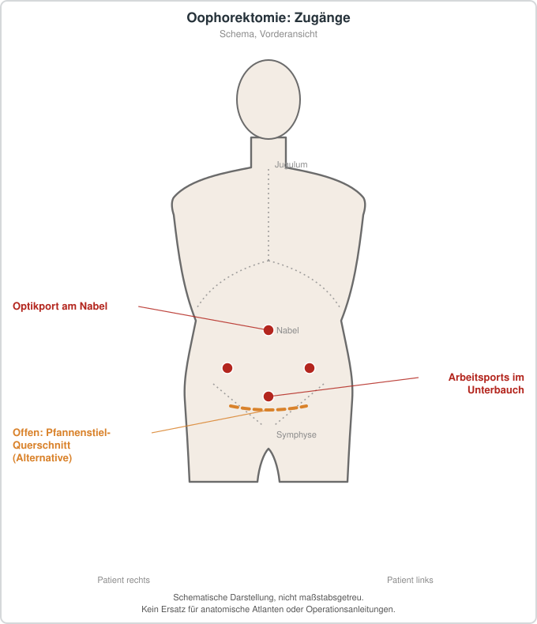

# Oophorektomie
## Übersicht
Die Oophorektomie ist die operative Entfernung eines oder beider Eierstöcke. Sie kann bei malignen oder suspekten Befunden, ausgewählten genetischen Risikokonstellationen oder selten bei anderen Erkrankungen erwogen werden.[1][2]
## Entscheidungsgrundlagen
Die Entscheidung unterscheidet sich wesentlich zwischen einseitiger und beidseitiger Entfernung. Bei prämenopausalen Personen müssen insbesondere Fertilität, endokrine Folgen und Alternativen sorgfältig besprochen werden. Eine prophylaktische bilaterale Entfernung ist nicht mit einer opportunistischen Salpingektomie gleichzusetzen.[1]
## Risiken und Nachsorge
Neben allgemeinen Operationsrisiken kann eine beidseitige Oophorektomie eine chirurgische Menopause auslösen. Langzeitfolgen und gegebenenfalls onkologische, endokrinologische oder reproduktionsmedizinische Nachsorge sind individuell zu planen.
## Patienteninformation
Die Entfernung der Eierstöcke kann die Hormonproduktion und Fruchtbarkeit dauerhaft verändern. Anlass, Alternativen und mögliche Langzeitfolgen sollten vor der Operation ausführlich erläutert werden.
## Schematische Darstellung

*Laparoskopisch: Optikport am Nabel, Arbeitsports im Unterbauch (Anordnung variiert). Offener Zugang: Pfannenstiel-Querschnitt. Schematische Darstellung, nicht maßstabsgetreu. Kein Ersatz für anatomische Atlanten oder Operationsanleitungen.*
## Literatur
1. Mor-Hadar D, et al. *FIGO position statement on opportunistic salpingectomy.* 2024. PMID: 39412638. https://pubmed.ncbi.nlm.nih.gov/39412638/
2. SOGC. *Guideline No. 404: Initial Investigation and Management of Benign Ovarian Masses.* 2020. PMID: 32736855. https://pubmed.ncbi.nlm.nih.gov/32736855/
