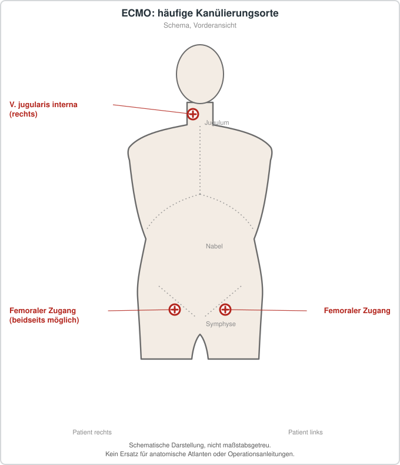

# ECMO-Kanülierung

## Übersicht

ECMO-Kanülierung ist die Anlage der Gefäßzugänge für die extrakorporale Membranoxygenierung (ECMO), einschließlich der Entscheidung über das Verfahren und die Kanülierungsstrategie.[1][2] Die Wahl ist ein komplexer Entscheidungsprozess, der auf Verfahren, Anatomie und Komplikationsprofil des Patienten abgestimmt wird.[1] Man unterscheidet bei der VA-ECMO (venoarterielle ECMO) grundsätzlich die periphere und die zentrale Kanülierung.[2] Die periphere Kanülierung erfolgt meist über die femoralen Gefäße, kann rasch am Bett durchgeführt werden, ist weniger invasiv und wird weltweit am häufigsten angewendet.[2] Die Entwicklung von Doppellumen-Kanülen in den frühen 1990er-Jahren ermöglichte einen einzigen Gefäßzugang für die venovenöse (VV) Atemunterstützung.[1] Die VV-ECMO dient vor allem der respiratorischen Unterstützung, während die VA-ECMO kardiale und gegebenenfalls zusätzlich respiratorische Unterstützung leistet.[3][1]

## Indikationen und Kontraindikationen

Die VA-ECMO wird bei refraktärem kardiogenem Schock eingesetzt; insbesondere bei refraktären Fällen gilt sie als empfohlen.[2] Bei Neugeborenen mit kardialer und/oder respiratorischer Insuffizienz wird die ECMO eingesetzt, wenn konventionelle Behandlungen versagen.[1] Die VV-ECMO hat sich bei Neugeborenen und Säuglingen unter 10 kg zunehmend als bevorzugtes Verfahren zur respiratorischen Unterstützung etabliert, wobei neurologische Sicherheitsvorteile gegenüber der VA-ECMO eine Rolle spielen.[3] Bei schwerem akutem Atemnotsyndrom im Rahmen einer COVID-19-Erkrankung wurde die veno-venöse ECMO als etablierte unterstützende Therapie beschrieben.[4]

## Vorbereitung

Dabei werden Körpergröße, Gefäßkaliber und Risikoprofil berücksichtigt, da diese Faktoren bei Kindern stark variieren.[5] Allgemeine Empfehlungen sehen bei Kindern unter 15 bis 20 kg eher die Karotiskanülierung und bei größeren, gehfähigen Patienten eher den femoralen Zugang vor.[5] Die Praxis weicht von diesen Empfehlungen jedoch ab: Auch bei älteren Kindern wird die Karotiskanülierung weiterhin häufig gewählt.[5] Die Quellenlage zeigt, dass die Praxis wenig standardisiert ist und stark von der lokalen Expertise, der Anatomie und der Datenlage abhängt.[5] Entscheidend ist daher eine individuelle Abwägung anhand der Patientenmerkmale und der Erfahrung der jeweiligen Einrichtung.[5] Für die VV-Kanülierung bei kleinen Säuglingen werden erfahrene Teams und eine erweiterte bildgebende Unterstützung als Voraussetzungen für Sicherheit und Wirksamkeit beschrieben.[3]

## Ablauf Schritt für Schritt

1. Festlegung von Modalität (VV oder VA) und Kanülierungsstrategie passend zu Bedarf, Anatomie und Komplikationsprofil des Patienten.[1]
2. Bei der VA-ECMO Wahl zwischen peripherer Kanülierung, meist femoral, und zentraler Kanülierung über Aorta und rechten Vorhof.[2]
3. Bei peripherer Kanülierung Anlage über die femoralen Gefäße, die rasch am Bett erfolgen kann.[2]
4. Bei zentraler Kanülierung direkte Kanülierung von Aorta und rechtem Vorhof, wodurch ein antegrader Fluss erreicht wird, jedoch mit größerem chirurgischem Aufwand.[2]
5. Bei Kindern Berücksichtigung der Karotiskanülierung oder femoralen Kanülierung in Abhängigkeit von Gewicht, Alter und Anatomie.[5]
6. Bei der VV-ECMO bei Neugeborenen und kleinen Säuglingen Einsatz von Doppellumen-Kanülen, etwa vom Typ Crescent-Right-Atrial, oder Multisite-Strategien.[3]
7. Anlage unter bildgebender Unterstützung, insbesondere bei kleinen Patienten.[3]
8. Bei femorojugulärer VV-Kanülierung Nutzung eines femoralen und eines jugulären Zugangs im Vergleich zur femorofemoralen Variante.[4]
9. Dekanülierung mit verschiedenen beschriebenen Techniken, die bei VA- und VV-ECMO bei Neugeborenen beschrieben werden.[1]

## Nachsorge

Bei COVID-19-Patienten mit VV-ECMO war die femorojugulare Kanülierung mit einer möglicherweise verlängerten Dauer ereignisfreier Unterstützung und einer erleichterten Mobilisation der Patienten verbunden.[4] Da der femorale Zugang mit einem Risiko für Extremitätenischämie einhergeht, ist diese Komplikation während der Unterstützung im Blick zu behalten.[2][5] Die Dekanülierung stellt einen eigenen Behandlungsschritt dar, für den mehrere Techniken beschrieben sind.[1]

## Komplikationen

In einer Metaanalyse erwiesen sich periphere VA-ECMO-Kanülierungen als mit einem geringeren Risiko für schwere Blutungen verbunden (relatives Risiko 0,55), jedoch mit einem höheren Risiko für Extremitätenischämie (relatives Risiko 1,43).[2] Für Infektionen, Nierenersatztherapie und zerebrovaskuläre Ereignisse zeigte sich kein signifikanter Unterschied zwischen den Strategien.[2] Bei Kindern werden Extremitätenischämien mit femoraler Kanülierung zwischen 7,5 und 20 % angegeben; dabei können gefäßchirurgische Interventionen oder Amputationen notwendig werden.[5] Einige Studien sahen einen Zusammenhang mit der Karotiskanülierung und einem höheren Risiko für Schädigungen des zentralen Nervensystems, andere fanden keinen signifikanten Unterschied.[5] Die Datenlage bei Kindern ist zudem durch uneinheitliche Definitionen und unzureichende Berichterstattung eingeschränkt.[5] Bei Neugeborenen wird die neurologische Sicherheit der VV-Kanülierung gegenüber der VA-Kanülierung betont.[3] Die Sorge um neurologische Folgen einer Karotisligatur war zudem ein Anlass für die Entwicklung der Doppellumen-Kanülen.[1] Bei COVID-19-Patienten mit VV-ECMO traten schwerwiegende therapiebedingte unerwünschte Ereignisse in beiden untersuchten Gruppen bei mehr als 70 % der Patienten auf, wobei am häufigsten eine Sepsis auftrat.[4]

## Ergebnisse und Prognose

Der kardiogene Schock ist trotz therapeutischer Fortschritte mit einer Sterblichkeit verbunden, die sich etwa 50 % nähert.[2] Die Anwendung der ECMO hat in den letzten Jahren deutlich zugenommen.[2] Ergebnisse wie erfolgreiche Entwöhnung, Mortalität und 6-Monats-Überleben unterschieden sich nicht signifikant zwischen den Gruppen.[4] Die Autoren der Quelle folgern, dass die Kanülierungsstrategie das Ergebnis nicht beeinflusste, die VV-ECMO bei COVID-19 jedoch mit einer hohen Sterblichkeit verbunden bleibt.[4] Bei Neugeborenen und Säuglingen unter 10 kg werden die Sicherheit und Wirksamkeit der VV-ECMO durch institutionelle Erfahrungen gestützt, sofern sie von erfahrenen Teams mit bildgebender Unterstützung durchgeführt wird.[3] Bei Kindern bleibt die Datenlage zur optimalen Strategie unklar, sodass weitere Studien mit klareren Definitionen notwendig erscheinen.[5]

## Informationen für Patientinnen und Patienten

Die Wahl des Gefäßzugangs bei der ECMO richtet sich nach den individuellen Merkmalen des Patienten und der Erfahrung des behandelnden Zentrums.[5] Bei der peripheren VA-ECMO wird das geringere Blutungsrisiko gegen das höhere Risiko einer Extremitätenischämie abgewogen.[2] Die ECMO-Therapie ist mit schwerwiegenden Nebenwirkungen verbunden, und bei schweren Grunderkrankungen bleibt die Sterblichkeit hoch.[4] Mit einer femorojugulären Kanülierung kann die Mobilisation während der Unterstützung erleichtert werden.[4]

## Schematische Darstellung

## Literatur

1. Jensen AR, Davis C, Gray BW et al.. Cannulation and decannulation techniques for neonatal ECMO. Semin Fetal Neonatal Med. 2022;27:101404. PMID: 36437185. DOI: 10.1016/j.siny.2022.101404. https://pubmed.ncbi.nlm.nih.gov/36437185/
2. Chilingarashvili G, Maisuradze G, Shah A et al.. Peripheral Versus Central Cannulation for Venoarterial Extracorporeal Membrane Oxygenation (VA-ECMO): A Meta-Analysis of Bleeding and Vascular Complications. Cureus. 2026;18:e101271. PMID: 41674774. DOI: 10.7759/cureus.101271. https://pubmed.ncbi.nlm.nih.gov/41674774/
3. Assy J, El Rassi I. VV ECMO cannulation in infants and children under 10 kg: Evolving strategies, outcomes, and innovations. Perfusion. 2026;41:568-575. PMID: 40934369. DOI: 10.1177/02676591251379622. https://pubmed.ncbi.nlm.nih.gov/40934369/
4. Immohr MB, Hettlich V, Brandenburger T et al.. [ECMO cannulation for COVID-19]. Z Herz Thorax Gefasschir. 2022;36:255-259. PMID: 35497646. DOI: 10.1007/s00398-022-00504-y. https://pubmed.ncbi.nlm.nih.gov/35497646/
5. Assy J, Di Nardo M, El Rassi I et al.. Peripheral veno-arterial ECMO cannulation in children: Review of the relevant ELSO publications. Perfusion. 2026;41:1087-1096. PMID: 41358522. DOI: 10.1177/02676591251407295. https://pubmed.ncbi.nlm.nih.gov/41358522/
