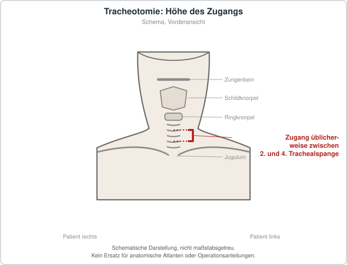

# Tracheotomie

## Übersicht

Die Tracheotomie ist ein operativer Eingriff, bei dem die Luftröhre eröffnet und eine Tracheostomiekanüle eingelegt wird, um die Atemwege definitiv zu sichern.[1][2] Der Eingriff gehört zu den häufig durchgeführten Maßnahmen bei kritisch kranken Erwachsenen, die maschinell beatmet werden.[3][4] Gegenüber einem Endotrachealtubus werden unter anderem weniger Sinusitiden und Rachenverletzungen, eine bessere Mundrachenhygiene, eine einfachere Kommunikation und mehr Komfort beschrieben.[3] In spezialisierten onkologischen Zentren wird die Tracheotomie häufig angewandt, um respiratorische Komplikationen durch Tumoren im Mund-, Rachen-, Kehlkopf- und Halsbereich sowie durch große zervikale Raumforderungen zu behandeln.[1] Sie wird daher nicht nur als unmittelbare Atemwegsrettung, sondern auch als strategische Entscheidung mit Auswirkungen auf Lebensqualität, Fortführung der onkologischen Behandlung und Prognose verstanden.[1]

## Indikationen und Kontraindikationen

Die klassische Indikation liegt in nichtonkologischen Situationen, etwa bei verlängerter maschineller Beatmung und respiratorischem Versagen auf Intensivstationen.[1] Eine Leitlinie der lateinamerikanischen Intensivmedizinverbände kommt zu dem Ergebnis, dass eine frühe Tracheotomie offenbar die Beatmungsdauer verkürzt, nicht jedoch die Pneumonierate, die Liegedauer oder die langfristige Sterblichkeit.[5] Eine aktuelle Umbrella-Review mit Metaanalyse randomisierter Studien berichtet dagegen eine geringere Rate beatmungsassoziierter Pneumonien bei früher Tracheotomie, ohne signifikanten Unterschied in der Mortalität.[6] Die Autoren dieser Übersicht bewerten die Evidenz insgesamt als schwach und halten weitere Untersuchungen zur Identifikation einer Population, die von einer frühen Tracheotomie profitiert, für notwendig.[6] Für Schlaganfallpatientinnen und -patienten fand eine Metaanalyse von neun Studien bei früher Tracheotomie kürzere Intensiv- und Krankenhausaufenthalte sowie eine kürzere Beatmungsdauer, ein geringeres Auftreten von Pneumonien unter Beatmung, jedoch keinen Unterschied in der Mortalität.[4] Bei COVID-19-Patientinnen und -Patienten ergab eine Metaanalyse zu den Zeitpunkten 7, 10 und 14 Tage keine signifikanten Unterschiede zur Kurzzeitmortalität mit Ausnahme des 10-Tage-Zeitpunkts, an dem die späte Tracheotomie mit einer niedrigeren Mortalität verbunden war.[7] Bei Kindern wird die Tracheotomie zur Behandlung einer aktuellen oder erwarteten langfristigen Beatmungsunterstützung, zur Sekretsteuerung oder bei fixierter oberer Atemwegsobstruktion eingesetzt.[8] Bei Kindern mit Mukopolysaccharidose kann sie bei schwierigen Atemwegen erforderlich werden.[9] Eine Tumorbeteiligung der Krikothyreoidregion kann hohe Atemwegszugänge anfällig für Tumordurchbruch und neoplastische Implantation im Operationsweg machen, was die lokale Krankheitskontrolle und die Folgebehandlung beeinträchtigen kann.[1] Eine vorangegangene Strahlentherapie verändert häufig die Gewebeintegrität und erhöht das Risiko eines technischen Versagens und perioperativer Komplikationen.[1] Die Krikothyreotomie gilt deshalb bei progredienter Atemwegsobstruktion nicht als ausreichend definitive Atemwegssicherung und ist für lebensbedrohliche Notfälle mit sofortigem Eingriffsbedarf vorbehalten.[1] Bei Patientinnen und Patienten mit erheblichem Risiko einer akuten Atemwegsobstruktion wird eine wache Tracheotomie unter Lokalanästhesie bevorzugt.[1]

## Vorbereitung

Vor einer Tracheotomie empfiehlt eine Leitlinie eine umfassende Untersuchung und sorgfältige Vorbereitung.[10] Die Entscheidung sollte individuell erfolgen, idealerweise in engem Austausch zwischen HNO-Chirurgie und Intensivmedizin.[10] Bei Kopf-Hals-Tumoren beruht die Indikation auf der integrierten Beurteilung klinischer, endoskopischer und kontextueller Kriterien.[1] Die Quellen betonen, dass der Eingriff in einer kontrollierten Umgebung mit ausreichender Planung unter geringerem technischem Risiko stattfinden kann als ein Notfalleingriff unter ungünstigen Bedingungen.[1] Bei Patientinnen und Patienten mit COVID-19 wurden in einer malaysischen Leitlinie eigene Empfehlungen zu Zeitpunkt, Gerinnungsmanagement und chirurgischer Planung formuliert.[10] Dabei wird ein erhebliches Risiko für das Prozedurenteam betont.[10] Eine Übersicht zum interprofessionellen Management hebt hervor, dass ein standardisiertes Managementprotokoll eine wichtige Grundlage darstellt.[3] Laut einer Leitlinie ist eine geeignete Vorausbildung für die Reduktion von Komplikationen mindestens so bedeutsam wie die gewählte Technik.[5]

## Ablauf Schritt für Schritt

1. Die Indikation und der Zeitpunkt werden individuell festgelegt; bei Tumorpatientinnen und -patienten wird das „Fenster der Gelegenheit“ vor einem Atemwegskollaps genutzt.[1]
2. Bei erhöhtem Risiko einer akuten Atemwegsobstruktion wird eine wache Tracheotomie unter Lokalanästhesie bevorzugt.[1]
3. Bei Kehlkopfneoplasien wird die Höhe des Zugangs strategisch gewählt, unter Berücksichtigung der späteren onkologischen Operation.[1]
4. Zwischen perkutanem und chirurgischem Vorgehen wird entschieden; perkutane Techniken sind mit einem geringeren Infektionsrisiko verbunden als die chirurgische Tracheotomie.[5][11]
5. Eine routinemäßige bronchoskopische Führung wird durch die Evidenz nicht gestützt.[5][11]
6. Der Einsatz von Kehlkopfmasken während des Eingriffs wird durch die Evidenz nicht unterstützt.[5][11]
7. Der Eingriff wird von einem Team mit entsprechender Vorerfahrung durchgeführt, da dies einen wesentlichen Einfluss auf die Komplikationsrate hat.[5]
8. Unter Pandemiebedingungen erfolgt die Beurteilung im Einzelfall, mit sorgfältiger Planung und Schutzmaßnahmen für das Team.[10]

## Nachsorge

Das Management tracheotomierter Patientinnen und Patienten umfasst zahlreiche Aufgaben verschiedener Berufsgruppen.[2] Eine Leitlinie empfiehlt Tracheostomie-Bundles, die von einem erfahrenen Team geprüft und freigegeben wurden, um die Zeit bis zur Dekanülierung und die tracheostomiebedingten unerwünschten Ereignisse zu reduzieren; zusätzlich wird eine verbesserte orale Kosttoleranz beschrieben.[2] Ein multidisziplinäres Tracheostoma-Team kann nach dieser Leitlinie die Zeit bis zur Dekanülierung, die Liegedauer und die Rate unerwünschter Ereignisse verbessern und den Einsatz von Sprechventilen erhöhen.[2] Eine systematische Übersichtsarbeit zu interprofessionellen Teams berichtet in überwiegend Prä-Post-Kohortenstudien einen vermehrten Einsatz von Sprechventilen und kürzere Zeiten bis zur Sprachfähigkeit und Dekanülierung sowie eine geringere Rate unerwünschter Ereignisse; eine signifikante Veränderung der Intensivliegedauer und der Mortalität zeigte sich nicht.[12] Ein Weaning- bzw. Dekanülierungsprotokoll kann nach einer Leitlinie die Entwöhnung und Entfernung der Trachealkanüle strukturieren und die Zeit bis zur Dekanülierung verkürzen.[2] Eine chinesische Expertenleitlinie befasst sich mit der postoperativen Versorgung, einschließlich Atemwegsreinigung, Kanülenwechsel und Kriterien für die Dekanülierung, sowie mit Rehabilitation durch Atem- und Skelettmuskeltraining sowie Interventionen bei Schluckstörungen und Sprechen.[3] Patientinnen und Patienten mit Tracheostoma benötigen nach derselben Quelle eine qualitativ hochwertige Pflege, da Dysphagie, Dysphonie, Trachealstenose und vermehrte Atemwegssekretion häufig auftreten.[3] Zur Prävention tracheostomiebedingter Druckschäden zeigt eine Metaanalyse, dass hydrophile Verbände unter den Flansch und Schaumstoffkragen die Inzidenz verringern können.[13] Die Inzidenz sank in den eingeschlossenen Studien von 17,0 % vor auf 3,5 % nach der Intervention.[13] Druckschäden betreffen vor allem die periostomale Haut sowie Bereiche unter Halteband und Flansch.[13] Bei Kindern, die langfristig über ein Tracheostoma beatmet werden, ist die Wiederaufnahmerate hoch, und ein Großteil der Wiederaufnahmen erfolgt innerhalb der ersten zwei Jahre nach Entlassung.[14] Risikofaktoren für Wiederaufnahmen und Sterblichkeit umfassen Alter, niedriges Einkommen, Entlassungsform, chronische Erkrankungen, fehlende respiratorische Physiotherapie, eine Gastrostomie und niedriges Geburtsgewicht.[14]

## Komplikationen

Bei Kombination leichter und schwerer Ereignisse werden Werte von über 40 % bis 50 % genannt, insbesondere in Notfallsituationen und ohne erfahrene Teams.[1] Bei Notfalleingriffen unter ungünstigen technischen Bedingungen ist das Risiko zusätzlich erhöht.[1] Zu den möglichen schweren Komplikationen zählen Hypoxie und kardiorespiratorischer Arrest.[1] Eine Leitlinie hält fest, dass die perkutane Technik mit einem geringeren Infektionsrisiko verbunden ist als die chirurgische Tracheotomie.[5] Bei Kindern mit Mukopolysaccharidose wurden als typische Komplikationen Trachealgranulationen, Wundinfektionen, Stomaverengung, anhaltend vermehrtes Sekret und Tracheitis beschrieben.[9] Bei der Auswertung von Tracheostomiepatientinnen und -patienten zeigten interprofessionelle Teams eine verringerte Rate unerwünschter Ereignisse.[12] Tracheostomiebedingte Druckschäden stellen eine eigenständige Komplikation dar.[13] Eine frühe Tracheotomie wurde in mehreren Metaanalysen mit einer geringeren Rate beatmungsassoziierter Pneumonien verbunden.[6][4] Eine Leitlinie berichtet dagegen keine Reduktion der Pneumonierate durch frühe Tracheotomie.[5]

## Ergebnisse und Prognose

Eine Umbrella-Review mit Metaanalyse fand bei frühen gegenüber späten Tracheotomien keinen signifikanten Unterschied in der Mortalität, die Evidenz wurde als schwach eingestuft.[6] Die Leitlinie kommt zum gleichen Ergebnis hinsichtlich der langfristigen Sterblichkeit.[5] In einzelnen Subgruppen einer weiteren Übersichtsarbeit zeigte sich bei früher Tracheotomie eine geringere Langzeitmortalität, jedoch wurde die Signifikanz nach dem Ausschluss von Studien mit unklarem Verzerrungsrisiko nicht mehr erreicht.[6] Bei Schlaganfallpatientinnen und -patienten blieb die Mortalität ohne signifikante Differenz, während Liegedauer und Beatmungsdauer kürzer ausfielen.[4] Bei Patientinnen und Patienten mit COVID-19 zeigte sich in einer Metaanalyse zum Zeitpunkt 10 Tage eine höhere Mortalität bei früher Tracheotomie, während für die Zeitpunkte 7 und 14 Tage keine signifikanten Unterschiede bestanden.[7] Die Autoren betonen, dass zur Bestimmung eines optimalen Zeitpunkts weitere Forschung erforderlich ist.[7] Bei Kindern mit Langzeitbeatmung über Tracheostoma wurden Sterblichkeitsraten im ersten Jahr nach Entlassung zwischen 0 % und 16 % berichtet.[14] Bei Kindern mit Mukopolysaccharidose gilt die Tracheotomie als im Wesentlichen dauerhaft, und ein Teil der Verläufe erforderte eine erneute Anlage.[9]

## Informationen für Patientinnen und Patienten

Die Tracheotomie kann die Lebensqualität bei Patientinnen und Patienten mit Kopf-Hals-Tumoren maßgeblich beeinflussen, da sie Auswirkungen auf die weitere onkologische Behandlung und die Prognose hat.[1] Für Kinder mit langfristiger Beatmung über ein Tracheostoma wird ein häusliches Umfeld als vorteilhaft für die Lebensqualität und zur Reduktion von Infektionen beschrieben, zugleich bleiben Wiederaufnahmen und Sterblichkeit relevante Themen.[14] Eine Leitlinie zur Versorgung im Kindesalter sieht die Schulung von Personal, Eltern, Betreuenden und Patientinnen und Patienten als wichtigen Bestandteil der Prävention von Notfällen.[8]

## Schematische Darstellung

## Literatur

1. Santa Ritta Barreira CE, de Farias TP, Dias FL et al.. Urgent and emergency tracheostomy in head and neck cancer: practical guide from the Brazilian Society of Surgical Oncology (SBCO). Braz J Otorhinolaryngol. 2026;92:101865. PMID: 42508207. DOI: 10.1016/j.bjorl.2026.101865. https://pubmed.ncbi.nlm.nih.gov/42508207/
2. Mussa CC, Gomaa D, Rowley DD et al.. AARC Clinical Practice Guideline: Management of Adult Patients with Tracheostomy in the Acute Care Setting. Respir Care. 2021;66:156-169. PMID: 32962998. DOI: 10.4187/respcare.08206. https://pubmed.ncbi.nlm.nih.gov/32962998/
3. [Recommendations for the management and rehabilitation of patients with a tracheostomy]. Zhonghua Jie He He Hu Xi Za Zhi. 2023;46:965-976. PMID: 37554082. DOI: 10.3760/cma.j.cn112147-20230331-00153. https://pubmed.ncbi.nlm.nih.gov/37554082/
4. Qiu Y, Yin Z, Wang Z et al.. Early versus late tracheostomy in stroke-related patients: A systematic review and meta-analysis. J Clin Neurosci. 2023;114:48-54. PMID: 37302372. DOI: 10.1016/j.jocn.2023.06.004. https://pubmed.ncbi.nlm.nih.gov/37302372/
5. Raimondi N, Vial MR, Calleja J et al.. Evidence-based guidelines for the use of tracheostomy in critically ill patients. J Crit Care. 2017;38:304-318. PMID: 28103536. DOI: 10.1016/j.jcrc.2016.10.009. https://pubmed.ncbi.nlm.nih.gov/28103536/
6. Boni A, Tonietto TA, Rihl MF et al.. Early versus late tracheostomy in critically ill patients: an umbrella review of systematic reviews of randomised clinical trials with meta-analyses and trial sequential analysis. BMJ Open Respir Res. 2025;12. PMID: 40187743. DOI: 10.1136/bmjresp-2024-002434. https://pubmed.ncbi.nlm.nih.gov/40187743/
7. Kim BK, Choi H, Kim CY et al.. Timing dilemma: a systematic review and meta-analysis of short-term mortality in patients with COVID-19 undergoing tracheostomy with varied timing, including 7, 10 and 14 days. BMJ Open. 2024;14:e084405. PMID: 39658285. DOI: 10.1136/bmjopen-2024-084405. https://pubmed.ncbi.nlm.nih.gov/39658285/
8. Doherty C, Neal R, English C et al.. Multidisciplinary guidelines for the management of paediatric tracheostomy emergencies. Anaesthesia. 2018;73:1400-1417. PMID: 30062783. DOI: 10.1111/anae.14307. https://pubmed.ncbi.nlm.nih.gov/30062783/
9. Galluzzi F, Garavello W. Tracheostomy in children with mucopolysaccharidosis: A systematic review. Int J Pediatr Otorhinolaryngol. 2024;187:112167. PMID: 39581170. DOI: 10.1016/j.ijporl.2024.112167. https://pubmed.ncbi.nlm.nih.gov/39581170/
10. Rohaizam J, Tham YS, Zakinah Y et al.. Tracheostomy during the COVID-19 pandemic in Malaysia; a revised guideline. Med J Malaysia. 2021;76:23-26. PMID: 34558553. https://pubmed.ncbi.nlm.nih.gov/34558553/
11. Raimondi N, Vial MR, Calleja J et al.. Evidence-based guides in tracheostomy use in critical patients. Med Intensiva. 2017;41:94-115. PMID: 28188061. DOI: 10.1016/j.medin.2016.12.001. https://pubmed.ncbi.nlm.nih.gov/28188061/
12. Ninan A, Grubb LM, Brenner MJ et al.. Effectiveness of interprofessional tracheostomy teams: A systematic review. J Clin Nurs. 2023;32:6967-6986. PMID: 37395139. DOI: 10.1111/jocn.16815. https://pubmed.ncbi.nlm.nih.gov/37395139/
13. Moser CH, Peeler A, Long R et al.. Prevention of Tracheostomy-Related Pressure Injury: A Systematic Review and Meta-analysis. Am J Crit Care. 2022;31:499-507. PMID: 36316177. DOI: 10.4037/ajcc2022659. https://pubmed.ncbi.nlm.nih.gov/36316177/
14. Scheller L, Mariano K, Staveski S et al.. Readmission and mortality among children requiring long-term mechanical ventilation via tracheostomy: a systematic review. BMC Pulm Med. 2025;25:385. PMID: 40790566. DOI: 10.1186/s12890-025-03818-3. https://pubmed.ncbi.nlm.nih.gov/40790566/
