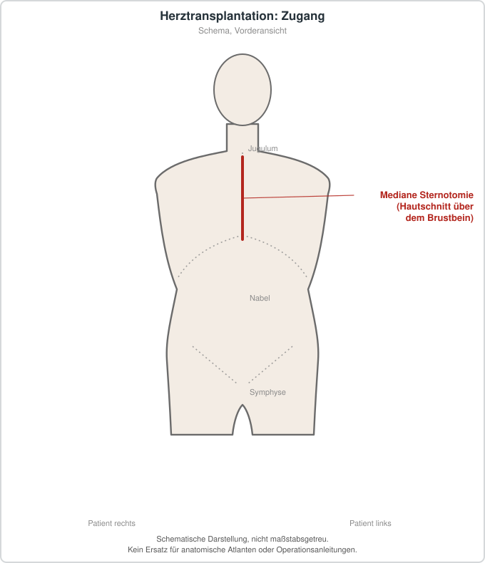

# Herztransplantation

## Übersicht

Herztransplantation ist die Transplantation eines Spenderherzens bei Patientinnen und Patienten mit fortgeschrittener Herzinsuffizienz.[1] Sie gilt weiterhin als definitive Therapie für diese Patientengruppe.[1] Die internationalen Leitlinien zur Beurteilung und Versorgung von Transplantationskandidaten wurden 2024 aktualisiert und ersetzen die Listungskriterien von 2006 sowie deren Aktualisierung von 2016.[2] Die Verfügbarkeit von Spenderherzen ist die zentrale Herausforderung des Fachgebiets.[3] Zur Erweiterung des Spenderpools werden Konservierungsverfahren untersucht, die über die konventionelle statische Kaltlagerung hinausgehen.[4]

## Indikationen und Kontraindikationen

Die Leitlinie der International Society for Heart and Lung Transplantation von 2024 soll die zahlreichen Variablen integrieren, die bei der Beurteilung von Patientinnen und Patienten für eine Transplantation zu berücksichtigen sind.[2] Aktualisiert wurden insbesondere die Kriterien zur Patientenauswahl, die Versorgung ausgewählter Patientenpopulationen und der Umgang mit dauerhafter mechanischer Kreislaufunterstützung.[2] Die Leitliniengruppen wurden so besetzt, dass Besonderheiten der pädiatrischen Herztransplantation ausdrücklich berücksichtigt werden.[2] Für Kinder ist die Verfügbarkeit geeigneter Spenderorgane ein besonders begrenzender Faktor.[3] Die Eignung eines Kandidaten ergibt sich daher aus einer Gesamtbeurteilung mehrerer Faktoren und nicht aus einzelnen Kriterien.[2] Ob und wann ein Patient auf die Warteliste aufgenommen wird, hängt damit von dieser umfassenden Bewertung ab.[2]

## Vorbereitung

Die Vorbereitung umfasst die medizinische Evaluation des Kandidaten nach den aktuellen Leitlinienempfehlungen.[2] Neben der kardiologischen Beurteilung ist die psychosoziale Evaluation von Empfängern und ihren Familien Bestandteil des Prozesses.[3] Für diese Evaluationen steht mittlerweile ein Konsensusrahmen zur Verfügung, der eine angemessene Steuerung und Kontrolle der knappen Ressource unterstützen soll.[3] Ein linksventrikuläres Unterstützungssystem (LVAD) oder eine venoarterielle extrakorporale Membranoxygenierung (VA-ECMO) vor der Transplantation waren in einer Metaanalyse mit dem Auftreten eines vasoplegischen Syndroms assoziiert.[5] Ebenfalls mit einem vasoplegischen Syndrom assoziiert waren männliches Geschlecht, ein höherer Body-Mass-Index, eine Hypothyreose sowie die präoperative Einnahme bestimmter Calciumkanalblocker oder von Amiodaron.[5] Künstliche Intelligenz und Big-Data-Verfahren werden als mögliche Hilfen für Versorgungsentscheidungen, Zuteilung und Prognoseabschätzung diskutiert.[6] Die bisher publizierten Studien zeigen jedoch relevante Verzerrungsrisiken und nur selten eine externe Validierung, weshalb ihr Einsatz als systematische Entscheidungshilfe noch nicht etabliert ist.[6]

## Ablauf Schritt für Schritt

1. Auswahl des Spenders: Die Organe stammen entweder von Spendern nach dem Hirntod (DBD) oder von Spendern nach dem Kreislauftod (DCD).[4]
2. Konservierung des Herzens: Neben der statischen Kaltlagerung nach Hirntod werden maschinelle Perfusionsverfahren eingesetzt.[4] Bei Spenderherzen nach Hirntod verringerte die hypotherme, sauerstoffgesättigte Maschinenperfusion die Rate schwerer primärer Transplantatfunktionsstörungen im Vergleich zur statischen Kaltlagerung.[4]
3. Implantation und intraoperative Kreislaufführung: Während des Eingriffs muss mit einem vasoplegischen Syndrom gerechnet werden, das in einer Metaanalyse bei rund 29 Prozent der Herztransplantationen auftrat.[5] Eine verlängerte Zeit an der Herz-Lungen-Maschine und ein höherer Bedarf an Blutprodukten waren mit diesem Syndrom assoziiert.[5]
4. Immunsuppression und Induktionstherapie: Zur Induktion werden Basiliximab oder rATG eingesetzt, wobei der Nutzen einer Induktionstherapie in den Quellen umstritten bleibt.[7]
5. Frühe postoperative Phase: In den ersten Stunden nach der Transplantation wird auf eine primäre Transplantatfunktionsstörung geachtet, die als ventrikuläre Dysfunktion ohne identifizierbare sekundäre Ursache definiert ist.[8]

## Nachsorge

Die Interpretation endomyokardialer Biopsien variiert zwischen Zentren, weshalb zunehmend ergänzende Verfahren genutzt werden.[1] Dazu gehören der Nachweis humaner Leukozytenantigen-spezifischer Spenderantikörper sowie molekulare Diagnostik wie donorassoziierte zellfreie DNA oder die intragrafte Genexpression.[1] Ihre Auswertung zeigt bei Statinanwendern eine niedrigere Mortalität und seltener eine Transplantatvaskulopathie; für Abstoßungsreaktionen insgesamt ergab sich dagegen kein signifikanter Unterschied.[9] In randomisierten Studien war die Abstoßungsrate unter Statinen jedoch niedriger, in Fall-Kontroll-Studien nicht.[9] Die Autoren weisen zudem auf mögliche Publikationsverzerrungen hin.[9] In einer Metaanalyse betrug die gepoolte Zunahme nach zwölf Monaten 7,1 kg, wobei die Ergebnisse je nach Land stark variierten.[10] Die stärkste Zunahme wurde in den Vereinigten Staaten, die geringste in Europa beobachtet.[10]

## Komplikationen

Die primäre Transplantatfunktionsstörung bleibt eine wesentliche Ursache für frühe Mortalität nach der Transplantation.[8] Eine Konsensuskonferenz zu diesem Thema hat die Definition und Schweregradeinteilung überprüft, wobei Risikostratifizierungswerkzeuge in der heutigen Ära nur eingeschränkt treffsicher sind.[8] Die Definition nennt ein Zeitfenster von 24 Stunden, während sich der Titel der Konsensuskonferenz auf die ersten 72 Stunden bezieht.[8] Eine Vasoplegie tritt häufig gemeinsam mit einer primären Transplantatfunktionsstörung auf, und ihr Zusammenspiel ist noch nicht vollständig verstanden.[8] Ein vasoplegisches Syndrom ist mit einem häufigeren postoperativen Bedarf an VA-ECMO, Nierenersatzverfahren, Reoperationen wegen Blutungen und längerer maschineller Beatmung verbunden.[5] Auch die 30-Tage- und die 1-Jahres-Mortalität sind bei betroffenen Patienten erhöht.[5] Eine einheitliche Definition des vasoplegischen Syndroms fehlt bislang, was die Vergleichbarkeit der Daten einschränkt.[5] Die antikörpervermittelte Abstoßung ist eine führende Ursache für Transplantatversagen und Mortalität.[1] Ihre berichtete Inzidenz variiert stark, unter anderem wegen Unterschieden in der Patientenpopulation, der Biopsiebeurteilung und den klinischen Schwellen für eine Behandlung.[1] Neuere Therapien richten sich gegen komplementvermittelte Schädigung, kostimulatorische Blockade und spezifische Zytokinwege.[1] Die Transplantatvaskulopathie spielt ebenfalls eine wichtige Rolle, da der überwiegende Teil der Mortalität nach Herztransplantation schweren Transplantatvaskulopathien und Abstoßungsreaktionen zugeschrieben wird.[9]

## Ergebnisse und Prognose

In einer Netzwerk-Metaanalyse unterschied sich die 30-Tage-Mortalität zwischen den Konservierungsverfahren nicht signifikant.[4] Nach einem Jahr war die direkte Entnahme mit Perfusion von DCD-Spenderherzen mit einer geringeren Mortalität im Vergleich zur statischen Kaltlagerung nach Hirntod verbunden, mit hoher Evidenzsicherheit.[4] Für die normotherme regionale Perfusion bei DCD-Herzen zeigte sich ebenfalls eine geringere Mortalität, allerdings mit niedriger Evidenzsicherheit.[4] Unter den DBD-Gruppen fanden sich keine Mortalitätsunterschiede.[4] Die Autoren schließen, dass die Ergebnisse der Maschinenperfusion nicht schlechter als die der konventionellen Methode erscheinen und das Potenzial besitzen, den Spenderpool zu erweitern.[4] In randomisierten Studien ließ sich der Effekt von Basiliximab und rATG nur sehr unsicher beurteilen.[7] In Beobachtungsstudien mit niedriger Evidenzsicherheit ging Basiliximab mit einer etwas höheren Mortalität im Vergleich zu keiner Induktionstherapie einher.[7] Für rATG wurden in Beobachtungsstudien eine geringere Transplantatvaskulopathie und eine geringere Mortalität im Vergleich zu Basiliximab berichtet, jedoch ebenfalls mit niedriger bis sehr niedriger Evidenzsicherheit.[7] Die Autoren sehen darin keine ausreichende Grundlage für eine routinemäßige Anwendung.[7] Die Metaanalysen zur Statintherapie berichten für Statinanwender eine deutlich geringere Mortalität als für Nichtanwender, ebenso wird eine Assoziation mit weniger Transplantatvaskulopathie beschrieben.[9] Die Autoren formulieren, dass Statine die Prognose verbessern könnten, betonen jedoch die begrenzte Aussagekraft wegen der Heterogenität der Studien.[9] Künstliche Intelligenz zeigte in den analysierten Arbeiten bessere Vorhersagen als klassische statistische Modelle, wobei jedoch Verzerrungsrisiken, fehlende externe Validierung und eine eingeschränkte Anwendbarkeit im klinischen Alltag bestehen.[6] Ein frei verfügbarer Algorithmus sagte die einjährige Mortalität in einem der untersuchten Zentren nicht zuverlässig voraus.[6] Für die pädiatrische Herztransplantation ermöglichen Register und Lernnetzwerke eine multizentrische Zusammenarbeit zur Verbesserung des Überlebens vor und nach der Transplantation.[3] Für die Zukunft werden Fortschritte bei der Xenotransplantation erwartet, die die Standards der Versorgung grundlegend verändern könnten.[3]

## Informationen für Patientinnen und Patienten

Herztransplantation bleibt die definitive Therapie bei fortgeschrittener Herzinsuffizienz.[1] Zur Vorbereitung gehört neben der medizinischen auch eine psychosoziale Beurteilung, die für Empfänger und Familien vorgesehen ist.[3] Nach der Transplantation nimmt das Körpergewicht bei vielen Empfängern zu, im Durchschnitt um etwa 7 kg innerhalb eines Jahres, wobei die Ausprägung von Land zu Land unterschiedlich war.[10] Abstoßungsreaktionen und Transplantatversagen bleiben auch nach der Operation relevante Risiken, weshalb die regelmäßige Nachsorge wichtig ist.[1] Mögliche Komplikationen in den ersten Tagen nach der Operation umfassen die primäre Transplantatfunktionsstörung.[8]

## Schematische Darstellung

## Literatur

1. Mehta A, DeFilippis EM, Stehlik J et al.. Contemporary Antibody-Mediated Rejection in Heart Transplantation: JACC: Heart Failure Position Statement. JACC Heart Fail. 2025;13:102614. PMID: 40848703. DOI: 10.1016/j.jchf.2025.102614. https://pubmed.ncbi.nlm.nih.gov/40848703/
2. Peled Y, Ducharme A, Kittleson M et al.. International Society for Heart and Lung Transplantation Guidelines for the Evaluation and Care of Cardiac Transplant Candidates-2024. J Heart Lung Transplant. 2024;43:1529-1628.e54. PMID: 39115488. DOI: 10.1016/j.healun.2024.05.010. https://pubmed.ncbi.nlm.nih.gov/39115488/
3. Johnson JN, Kindel SJ, Ameduri RK et al.. Pediatric heart transplantation. Curr Opin Organ Transplant. 2026;31:167-171. PMID: 41934116. DOI: 10.1097/MOT.0000000000001289. https://pubmed.ncbi.nlm.nih.gov/41934116/
4. Kim DY, Kang M, Kim J et al.. Machine perfusion across different donor pathways in heart transplantation: A systematic review and network meta-analysis. J Heart Lung Transplant. 2025;44:1920-1932. PMID: 40850366. DOI: 10.1016/j.healun.2025.08.013. https://pubmed.ncbi.nlm.nih.gov/40850366/
5. Kumar N, Fitzsimons MG, Iyer MH et al.. Vasoplegic syndrome during heart transplantation: A systematic review and meta-analysis. J Heart Lung Transplant. 2024;43:931-943. PMID: 38428755. DOI: 10.1016/j.healun.2024.02.1458. https://pubmed.ncbi.nlm.nih.gov/38428755/
6. Palmieri V, Montisci A, Vietri MT et al.. Artificial intelligence, big data and heart transplantation: Actualities. Int J Med Inform. 2023;176:105110. PMID: 37285695. DOI: 10.1016/j.ijmedinf.2023.105110. https://pubmed.ncbi.nlm.nih.gov/37285695/
7. Kugathasan L, Rayner DG, Wang SM et al.. Induction therapy in heart transplantation: A systematic review and network meta-analysis for developing evidence-based recommendations. Clin Transplant. 2024;38:e15326. PMID: 38716786. DOI: 10.1111/ctr.15326. https://pubmed.ncbi.nlm.nih.gov/38716786/
8. Kobashigawa J, Zuckermann A, Potena L et al.. Summary of the International Society for Heart and Lung Transplantation (ISHLT) Consensus Conference on Graft Dysfunction within the First 72 hours after Heart Transplantation: A 10-year Update. J Heart Lung Transplant. 2026;45:e149-e171. PMID: 41823895. DOI: 10.1016/j.healun.2025.12.029. https://pubmed.ncbi.nlm.nih.gov/41823895/
9. Mardani-Nafchi H, Hashemi Rafsanjani SMR, Heidari-Soureshjani S et al.. A Systematic Review and Meta-Analysis of the Effects of Statin Therapy on Heart Transplantation. Rev Recent Clin Trials. 2024;19:256-266. PMID: 38840403. DOI: 10.2174/0115748871301446240513093612. https://pubmed.ncbi.nlm.nih.gov/38840403/
10. Miura K, Yu R, Sivapalan K et al.. Weight Gain After Heart Transplantation in Adults: Systematic Review and Meta-Analysis. ASAIO J. 2022;68:1107-1116. PMID: 34560719. DOI: 10.1097/MAT.0000000000001566. https://pubmed.ncbi.nlm.nih.gov/34560719/
