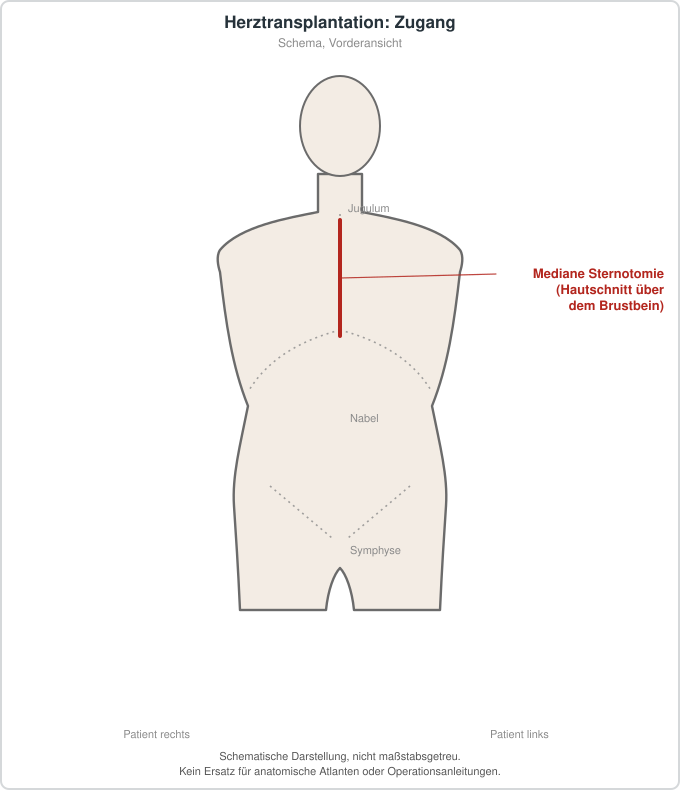

# Herztransplantation
## Übersicht
Die Herztransplantation ist eine Therapieoption für ausgewählte Personen mit fortgeschrittener Herzinsuffizienz, wenn andere Behandlungsoptionen nicht ausreichen. Die Kandidatenauswahl erfolgt nach spezialisierten, evidenzbasierten Kriterien.[1][2]
## Risiken und Nachsorge
Wesentliche Risiken sind perioperative Komplikationen, Abstoßung, Infektionen, Transplantatvaskulopathie und Folgen der dauerhaften Immunsuppression. Die Nachsorge erfolgt lebenslang und engmaschig.
## Patienteninformation
Vor einer Herztransplantation wird umfassend geprüft, ob Nutzen und Risiken in der individuellen Situation angemessen sind. Auch nach einer erfolgreichen Transplantation bleiben regelmäßige Kontrollen nötig.
## Schematische Darstellung

*Üblicher Zugang ist die mediane Sternotomie. Schematische Darstellung, nicht maßstabsgetreu. Kein Ersatz für anatomische Atlanten oder Operationsanleitungen.*

## Literatur
1. ISHLT. *Guidelines for Cardiac Transplant Candidates.* 2024. PMID: 39115488. https://pubmed.ncbi.nlm.nih.gov/39115488/
2. ISHLT. *Guidelines for care of heart transplant recipients.* 2023. PMID: 37080658. https://pubmed.ncbi.nlm.nih.gov/37080658/
