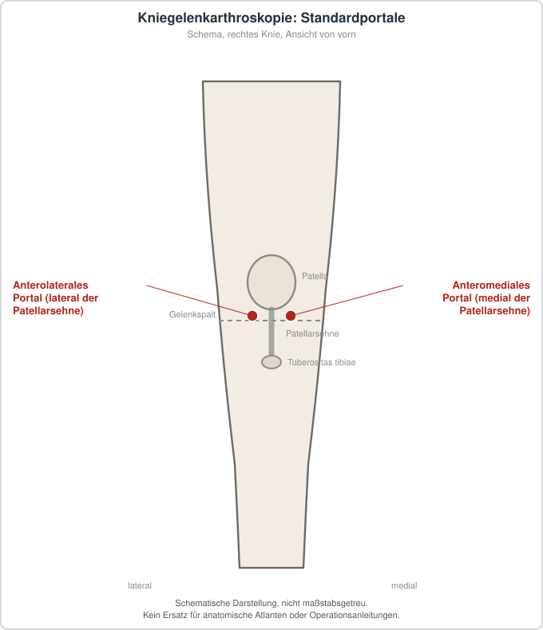

# Arthroskopie

## Übersicht

Die Arthroskopie ist ein gelenkendoskopisches Verfahren, bei dem ein Gelenk über kleine Zugänge betrachtet und bei Bedarf operativ behandelt wird.[1][2][3] Die Methode wird als minimalinvasiv beschrieben.[3] Am Knie, an der Schulter, am Sprunggelenk und am Handgelenk kommt sie für unterschiedliche Fragestellungen zum Einsatz.[1][2][4][3] Die Schulterarthroskopie gehört zu den häufig durchgeführten orthopädischen Eingriffen, bei denen jährlich mehr als eine halbe Million Operationen angegeben werden.[5] Für das Handgelenk wird eine zunehmende Anwendung beschrieben, während Nutzen und Schaden noch unklar sind.[3] Für das Knie liegen Leitlinien zu Meniskusläsionen und zu anderen intraartikulären Verletzungen vor, die für die Einordnung der Methode maßgeblich sind.[6][1][7]

## Indikationen und Kontraindikationen

Daraus leiten sich Empfehlungen für eine arthroskopische Meniskusoperation oder eine nichtoperative Behandlung ab.[6] Ein Blockieren des Kniegelenks gilt in der niederländischen Leitlinie als möglicher Grund, eine Arthroskopie ohne vorherige MRT-Untersuchung zu erwägen, sofern zuvor eine konventionelle Röntgenaufnahme unter Belastung andere Pathologien ausgeschlossen hat.[1] Bei Kniearthrose ist nach der niederländischen Leitlinie eine Arthroskopie erwägenswert, wenn wiederholt oder anhaltend eine Blockade auftritt, die auf größeren losen Fragmenten im Gelenk beruht.[7] In allen übrigen Fällen wird eine konservative Behandlung als beste erste Option eingestuft.[7] Bei reinen chondralen Frakturen wird eine Arthroskopie nicht empfohlen; bei osteochondralen Frakturen kann sie zur Refixation oder zur Entfernung größerer, eine Blockade verursachender Fragmente erwogen werden.[7] Beim patellofemoralen Schmerzsyndrom fand sich in einer randomisierten Studie kein Unterschied zwischen Arthroskopie und nichtoperativer Therapie.[7] Beim Patellaspitzensyndrom oder bei der Patellasehnentendinopathie gab es Hinweise auf einen positiven Effekt der Arthroskopie auf den Schmerz; wegen der niedrigen Evidenzstufe wird jedoch Zurückhaltung empfohlen.[7]

## Vorbereitung

Bei gleichzeitiger Bandverletzung, etwa einem vorderen Kreuzbandriss, nimmt die Aussagekraft der Meniskustests weiter ab.[1] Demografische Faktoren, Anamnese, körperliche Untersuchung und gegebenenfalls eine MRT-Untersuchung sollten die Diagnose stützen, bevor Behandlungsentscheidungen getroffen werden.[1] Vor einer Arthroskopie sollte knöcherne Pathologie wie Fraktur, Neoplasie oder infektiöse Prozesse ausgeschlossen werden.[1] Für die Beurteilung von Menisken, Bändern und Knorpel wird eine MRT-Untersuchung in mehreren Ebenen empfohlen, wobei die Befundung durch eine erfahrene muskuloskelettale Radiologin oder einen erfahrenen muskuloskelettalen Radiologen als wesentlich gilt.[1] Die Erfahrung des Befunders beeinflusst die Genauigkeit der MRT stärker als die Feldstärke des Geräts.[1] Sie gilt daher nicht als alleiniges diagnostisches Verfahren vor einer Arthroskopie und ist stark untersucherabhängig.[1] Zusätzliche Bildgebung wie eine MRT ist nach dieser Empfehlung nur erforderlich, wenn keine Arthrose nachweisbar ist.[7] Die Untersuchung ist jedoch teurer.[1] Alter, Operationszeit und Alkoholkonsum zeigten dabei keine Assoziation.[4] Die Evidenz hierzu ist jedoch unklar.[2] Die zugrunde liegende Evidenz wird dabei als überwiegend von niedriger Qualität beschrieben.[8]

## Ablauf Schritt für Schritt

1. Vor dem Eingriff werden Anamnese, körperliche Untersuchung und Bildgebung kombiniert, um die Diagnose zu sichern und knöcherne Pathologien auszuschließen.[1]
2. Anhand der klinischen Konstellation wird entschieden, ob eine Arthroskopie oder eine nichtoperative Behandlung angemessen ist.[6][7]
3. Bei Eingriffen am Sprunggelenk oder an der unteren Extremität wird häufig eine Blutsperre angelegt; die Evidenz für einen routinemäßigen Nutzen ist jedoch nicht eindeutig.[2]
4. Während der Arthroskopie werden lose Fragmente entfernt oder osteochondrale Fragmente refixiert, sofern dies anatomisch möglich ist.[7]
5. Nach Abschluss des Eingriffs erfolgt eine postoperative Schmerzbehandlung, deren Auswahl sich an der verfügbaren Evidenz orientiert.[5]

## Nachsorge

Zwischen verschiedenen Nervenblockaden fand sich dabei kein signifikanter Unterschied.[5] Zusätze zu Nervenblockaden verlängerten die Wirkdauer der Blockade und verbesserten die Schmerzkontrolle.[5] Eine präoperative Gabe verringerte postoperative Schmerzwerte signifikant.[5] Für subakromiale Infusionen fand sich kein Nutzen, und für die patientenkontrollierte Analgesie wurde keine unterstützende Evidenz gefunden.[5] Für einige orale Medikamente und neuere Verfahren wird vielversprechende Evidenz berichtet.[5] Nach Arthroskopie des Knies gibt es keine Hinweise auf eine über die konservative Behandlung hinausgehende Verbesserung bei Arthrose, sodass sich die Nachsorge an den allgemeinen Empfehlungen zur Schmerzbehandlung und Funktionsverbesserung orientieren sollte.[7]

## Komplikationen

Etwa ein Fünftel der Nervenverletzungen war dauerhaft.[9] Schwere Komplikationen traten nur in einem sehr kleinen Anteil auf; am häufigsten war eine tiefe Venenthrombose.[9] Nach anteriorer Sprunggelenkarthroskopie lag die Komplikationsrate niedriger als nach posteriorer Arthroskopie.[9] Neurologische Verletzungen traten bei anteriorer Arthroskopie mit Distraktion etwas häufiger auf als ohne Distraktion.[9] Für Schulterarthroskopien werden die oben genannten patientenbezogenen Faktoren als Risiken für postoperative Infektionen beschrieben.[4] Für die Verwendung einer Blutsperre bei Sprunggelenkarthroskopien zeigte sich in einer Übersichtsarbeit kein signifikanter Unterschied in der Komplikationsrate.[2]

## Ergebnisse und Prognose

Bei Meniskusläsionen wird die Validierung der Leitlinienempfehlungen in der klinischen Praxis als noch ausstehend beschrieben; mehrere Unsicherheiten bei der Behandlung sollen in künftigen prospektiven Studien untersucht werden.[6] Die Evidenz wird als moderat eingestuft.[7] Der Nutzen gegenüber offener oder nichtoperativer Behandlung war nach den vorliegenden Daten klinisch unbedeutend, und die Datenlage stützt derzeit keinen Vorteil gegenüber offenen oder nichtoperativen Verfahren.[3] Bei Ganglien des Handgelenks fand sich kein signifikanter Unterschied in den Rezidivraten zwischen arthroskopischer und offener Resektion.[3] Eine pauschale Aussage zur Wirksamkeit ist nach den vorliegenden Quellen nicht möglich.[6][7][3]

## Informationen für Patientinnen und Patienten

Die Entscheidung für oder gegen eine Arthroskopie berücksichtigt nach den Leitlinien neben Nutzen und Schaden auch die Werte und Präferenzen der betroffenen Personen.[1] Für viele Beschwerden kann eine nichtoperative Behandlung die erste Option sein, insbesondere bei chondralen Frakturen oder bei Patellaluxation ohne begleitende osteochondrale Fragmente.[7] Die Diagnose stützt sich in der Regel auf mehrere Untersuchungen und nicht auf einen einzelnen Test.[1] Über mögliche Komplikationen wie Nervenverletzungen oder Thrombosen sollte vor einem Eingriff informiert werden, da diese Ereignisse in den Übersichtsarbeiten beschrieben sind, wenn auch meist selten.[7][9]

## Schematische Darstellung

## Literatur

1. Van Arkel ERA, Koëter S, Rijk PC et al.. Dutch Guideline on Knee Arthroscopy Part 1, the meniscus: a multidisciplinary review by the Dutch Orthopaedic Association. Acta Orthop. 2021;92:74-80. PMID: 33228479. DOI: 10.1080/17453674.2020.1850086. https://pubmed.ncbi.nlm.nih.gov/33228479/
2. Lau B, Kothari V, Trowbridge S et al.. Tourniquet use in ankle arthroscopy: A systematic review. Foot Ankle Surg. 2024;30:50-56. PMID: 37866989. DOI: 10.1016/j.fas.2023.09.005. https://pubmed.ncbi.nlm.nih.gov/37866989/
3. Karjalainen VL, Harris IA, Räisänen M et al.. Minimal invasions: is wrist arthroscopy supported by evidence? A systematic review and meta-analysis. Acta Orthop. 2023;94:200-206. PMID: 37114362. DOI: 10.2340/17453674.2023.11957. https://pubmed.ncbi.nlm.nih.gov/37114362/
4. Lei Y, Zeng Y, Xia W et al.. Risk factors for infection in patients undergoing shoulder arthroscopy: a systematic review and meta-analysis. J Hosp Infect. 2024;150:72-82. PMID: 38782053. DOI: 10.1016/j.jhin.2024.04.025. https://pubmed.ncbi.nlm.nih.gov/38782053/
5. Hurley ET, Maye AB, Thompson K et al.. Pain Control After Shoulder Arthroscopy: A Systematic Review of Randomized Controlled Trials With a Network Meta-analysis. Am J Sports Med. 2021;49:2262-2271. PMID: 33321046. DOI: 10.1177/0363546520971757. https://pubmed.ncbi.nlm.nih.gov/33321046/
6. Abram SGF, Beard DJ, Price AJ et al.. Arthroscopic meniscal surgery: a national society treatment guideline and consensus statement. Bone Joint J. 2019;101-B:652-659. PMID: 31154847. DOI: 10.1302/0301-620X.101B6.BJJ-2019-0126.R1. https://pubmed.ncbi.nlm.nih.gov/31154847/
7. Koëter S, Van Tienen TG, Rijk PC et al.. Dutch Guideline on Knee Arthroscopy Part 2: non-meniscus intra-articular knee injury: a multidisciplinary review by the Dutch Orthopaedic Association. Acta Orthop. 2021;92:81-84. PMID: 33228429. DOI: 10.1080/17453674.2020.1850081. https://pubmed.ncbi.nlm.nih.gov/33228429/
8. van Bergen CJA, Baur OL, Murawski CD et al.. Diagnosis: History, Physical Examination, Imaging, and Arthroscopy: Proceedings of the International Consensus Meeting on Cartilage Repair of the Ankle. Foot Ankle Int. 2018;39:3S-8S. PMID: 30215306. DOI: 10.1177/1071100718779393. https://pubmed.ncbi.nlm.nih.gov/30215306/
9. Arshad Z, Aslam A, Al Shdefat S et al.. Complications following ankle arthroscopy. Bone Joint J. 2023;105-B:239-246. PMID: 36854323. DOI: 10.1302/0301-620X.105B3.BJJ-2022-0796.R1. https://pubmed.ncbi.nlm.nih.gov/36854323/
