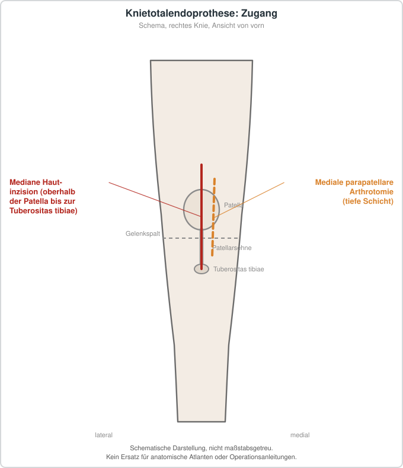

# Knietotalendoprothese

## Übersicht

Die Knietotalendoprothese ist der operative Ersatz des Kniegelenks durch eine Prothese, der bei symptomatischer Kniegelenkarthrose erwogen wird.[1][2] In den Vereinigten Staaten ist sie der am häufigsten durchgeführte Gelenkersatzeingriff.[3][4] Die Versorgung umfasst präoperative Maßnahmen, den Eingriff selbst sowie Rehabilitation und Nachsorge, wobei für jede Phase unterschiedlich gut belegte Empfehlungen vorliegen.[1][5][2] Für die Implantation werden sowohl konventionelle als auch robotergestützte Verfahren eingesetzt.[6][7] In den in einer aktuellen Metaanalyse eingeschlossenen randomisierten Studien waren alle Knietotalendoprothesen zementiert.[6] Die Auswahl des Verfahrens sollte nach Erfahrung des Operateurs und den Merkmalen der Patientin bzw. des Patienten erfolgen.[7]

## Indikationen und Kontraindikationen

Die Indikation ergibt sich in erster Linie aus einer Kniegelenkarthrose, die so ausgeprägt ist, dass ein Gelenkersatz erwogen wird.[1] Die in den Übersichtsarbeiten untersuchten Patientengruppen umfassten Personen mit elektiv durchgeführtem, einseitigem Gelenkersatz bei primärer Arthrose des Kniegelenks.[2][8] Das ACR-Vorgehen beginnt in der Regel mit konventionellen Röntgenaufnahmen, auf die bei Bedarf weiterführende Untersuchungen folgen.[3] Die Indikation zur weiteren Bildgebung richtet sich nach der klinischen Fragestellung, etwa bei Verdacht auf Infektion, Lockerung, Osteolyse, Instabilität, Fraktur, Rotationsfehler der Komponenten oder Weichteilveränderungen.[3][4]

## Vorbereitung

Für die präoperative Phase empfiehlt die aktuelle Revision der APTA-Leitlinie, präoperative Übungsprogramme zu gestalten, die Kraft, Beweglichkeit und Ausdauer verbessern sollen.[1] Auch die Vorgängerversion der Leitlinie sprach sich für präoperatives Krafttraining und Dehnungsübungen mit Anleitung aus.[5] Zur präoperativen Edukation können nach der aktuellen Leitlinie neurowissenschaftlich begründete Strategien zur Schmerzbewältigung und zur Reduktion prozedurbezogener Angst einbezogen werden.[1] Eine hochwertige Studie zeigte, dass die Kombination aus kognitiver Verhaltenstherapie, Schmerzedukation und Gelenkmobilisation Angst und Schmerz reduzieren kann.[1] Eine Festlegung auf eine bestimmte Übungsform, ein Setting oder einen Betreuungsgrad ist laut der Leitlinie nicht möglich, da keine davon sicher überlegen ist.[1] Auch die optimale Dosierung eines präoperativen Trainings ist nach derzeitigem Stand nicht ausreichend untersucht.[1] Der Umfang formaler präoperativer Programme variiert stark, was zu Unterschieden bei Kosten und Dauer führt.[1] Die präoperative Untersuchung soll die Planung der individuellen Maßnahmen leiten.[5]

## Ablauf Schritt für Schritt

1. Präoperative Untersuchung und Planung der Maßnahmen, die auf den Befund abgestimmt werden.[5]
2. Präoperatives Training mit Kräftigungs- und Dehnungsübungen sowie Anleitung zur selbständigen Durchführung.[1][5]
3. Präoperative Schmerz- und Angstedukation, gegebenenfalls ergänzt um Gelenkmobilisation.[1]
4. Implantation der Knietotalendoprothese, konventionell oder robotergestützt; in den eingeschlossenen Studien wurden alle Prothesen zementiert.[6][7]
5. Frühe postoperative Bewegungsübungen, deren Form nach der aktuellen Leitlinie differenziert zu wählen ist.[1]
6. Frühzeitige Rehabilitation mit Kraft-, Mobilitäts- und Gehtraining in der akuten Phase; die Wirkung auf die Kraft ist in dieser Phase am deutlichsten.[2]
7. Einsatz von Kälte zur Schmerzlinderung und Schwellungsreduktion in der frühen postoperativen Phase.[9]
8. Fortführung der Rehabilitation in der postakuten Phase mit Aufbau von Kraft und Funktion.[2][10]

## Nachsorge

Eine Metaanalyse fand bei Erwachsenen mit Übungsprogrammen nach Gelenkersatz eine signifikant größere Verbesserung von Mobilität, Kraft, Beweglichkeit und Schmerz gegenüber konventionellem Training unmittelbar nach der Intervention.[11] Eine andere Übersichtsarbeit kam zu dem Ergebnis, dass modifizierte Rehabilitationsprogramme gegenüber Standardprogrammen keine systematisch bessere klinische Wirkung erzielen.[10] Die verschiedenen Rehabilitationsprogramme führen nach einer weiteren Übersicht zu vergleichbaren Verbesserungen bei Schmerz, Beweglichkeit und Alltagsaktivitäten.[2] Zur Kältetherapie zeigt eine umfassende Metaanalyse, dass Kryotherapie die Schmerzen in den ersten postoperativen Tagen senken und den Blutverlust verringern kann; kontinuierliche Kaltwasserdurchflusssysteme waren gegenüber herkömmlichen Kältepacks nicht überlegen.[9] Zur Verwendung der kontinuierlichen passiven Bewegung (CPM) stellt die Leitlinie fest, dass für diese Methode kein relevanter klinischer Nutzen belegt ist und ihr Einsatz wegen Kosten, Ressourcenbedarf und möglicher Störungen der postoperativen Versorgung nicht gerechtfertigt ist.[1] Diese Einschätzung entspricht der Vorgängerversion der Leitlinie.[1] Für Kontrollen ohne Beschwerden und für Schmerzen nach Gelenkersatz sind in den ACR-Kriterien jeweils eigene Bildgebungsstrategien beschrieben.[3] Die ältere Version der ACR-Kriterien deckt den gleichen Problemkreis ab und beschreibt die Bildgebungsmodalitäten Röntgen, CT, MRT, Ultraschall und nuklearmedizinische Verfahren.[4]

## Komplikationen

Als mögliche Komplikationen nach Knietotalendoprothese nennt die Leitlinie unter anderem Wundheilungsstörungen, Thromboembolien sowie Gelenksteife bzw. Arthrofibrose, die auch Bewegungsübungen beeinflussen können.[5] Die postoperative Gelenksteife ist nach Übersichtsarbeiten eine schwer zu behandelnde Situation.[12] Patienten mit Revisionsoperation hatten schlechtere klinische Ergebnisse und benötigten häufiger weitere Behandlung (43 % gegenüber 25 % bei arthroskopischer Adhäsiolyse und 17 % bei Manipulation in Narkose).[12] Präoperative Maßnahmen sind nach Einschätzung der Leitlinie sicher; eine erhöhte Rate postoperativer Komplikationen oder unerwünschter Ereignisse wurde nicht berichtet.[1] Für die Rehabilitation in der akuten Phase nach Knietotalendoprothese wurden in einer Übersichtsarbeit keine Schäden berichtet; das Schadensrisiko verschiedener postakuter Programme erschien vergleichbar.[2]

## Ergebnisse und Prognose

Robotergestützte Implantationen führten in einer Metaanalyse randomisierter Studien zu einer signifikant besseren anatomischen und mechanischen Achsausrichtung als konventionelle Verfahren, während klinische und funktionelle Ergebnisse sowie Komplikationsraten vergleichbar waren.[6] Eine zweite Metaanalyse kam zu dem Schluss, dass robotergestützte Verfahren zwar präziser ausrichten, aber nicht zu besseren klinischen Ergebnissen führen.[7] Abweichend davon fand dieselbe Arbeit bei Nachbeobachtungszeiten über sechs Monate bessere Werte für die manuelle Technik im Knee-Society-Score und im WOMAC-Index.[7] Präoperatives Training verbessert nach der aktuellen Leitlinie vor allem die frühen postoperativen Ergebnisse in Kraft, Funktion und Schmerz; diese frühen Vorteile nehmen im Verlauf ab, und die Evidenz für langfristige Effekte ist begrenzt.[1] Eine systematische Übersicht sah für präoperatives Training eine Reduktion der Krankenhausverweildauer und eine Zunahme der Kraft, wies aber darauf hin, dass alle Ergebnisse mit niedriger Evidenzstärke belegt sind.[8] Auch in einer anderen Übersichtsarbeit wurde nur niedrige Evidenzstärke festgestellt.[2] Für die ARE-Übungen nach Gelenkersatz wurden in einer Metaanalyse Verbesserungen bei Schmerz, Kraft und Beweglichkeit berichtet; Verbesserungen bei 6-Minuten-Gehtest und Treppensteigen waren nicht signifikant.[11]

## Informationen für Patientinnen und Patienten

Vor einer Knietotalendoprothese werden Übungen und Informationen zum Umgang mit Schmerzen und Angst angeboten, die laut Leitlinie den Verlauf unterstützen können.[1] Ob und in welchem Umfang ein präoperatives Training durchgeführt wird, hängt von den Präferenzen der betroffenen Person ab, wobei auch Kosten und Begrenzungen der Kostenübernahme für Reha-Einheiten eine Rolle spielen.[1] Wünsche und Bedürfnisse sollen in die gemeinsame Entscheidung einfließen.[5] Nach dem Eingriff sind frühe Bewegung und Rehabilitation wesentliche Bestandteile der Versorgung, deren Wirkung vor allem in den ersten Wochen und Monaten beschrieben ist.[1][2] Auf mögliche Komplikationen wie Gelenksteife, Thrombose und Wundheilungsstörungen sollte geachtet werden.[5][12] Die Entscheidung über die konkrete Form der Nachbehandlung orientiert sich an den Ergebnissen der Untersuchung und sollte mit dem behandelnden Team besprochen werden.[5]

## Schematische Darstellung

## Literatur

1. Bove AM, Carroll LA, Cone S et al.. Clinical practice guideline for physical therapist management of total knee arthroplasty: revision 2026. Phys Ther. 2026;106. PMID: 42506877. DOI: 10.1093/ptj/pzag058. https://pubmed.ncbi.nlm.nih.gov/42506877/
2. Konnyu KJ, Thoma LM, Cao W et al.. Rehabilitation for Total Knee Arthroplasty: A Systematic Review. Am J Phys Med Rehabil. 2023;102:19-33. PMID: 35302953. DOI: 10.1097/PHM.0000000000002008. https://pubmed.ncbi.nlm.nih.gov/35302953/
3. Walker EA, Fox MG. ACR Appropriateness Criteria® Imaging After Total Knee Arthroplasty: 2023 Update. J Am Coll Radiol. 2023;20:S433-S454. PMID: 38040463. DOI: 10.1016/j.jacr.2023.08.014. https://pubmed.ncbi.nlm.nih.gov/38040463/
4. Hochman MG, Melenevsky YV. ACR Appropriateness Criteria® Imaging After Total Knee Arthroplasty. J Am Coll Radiol. 2017;14:S421-S448. PMID: 29101982. DOI: 10.1016/j.jacr.2017.08.036. https://pubmed.ncbi.nlm.nih.gov/29101982/
5. Jette DU, Hunter SJ, Burkett L et al.. Physical Therapist Management of Total Knee Arthroplasty. Phys Ther. 2020;100:1603-1631. PMID: 32542403. DOI: 10.1093/ptj/pzaa099. https://pubmed.ncbi.nlm.nih.gov/32542403/
6. Alrajeb R, Zarti M, Shuia Z et al.. Robotic-assisted versus conventional total knee arthroplasty: a systematic review and meta-analysis of randomized controlled trials. Eur J Orthop Surg Traumatol. 2024;34:1333-1343. PMID: 38133653. DOI: 10.1007/s00590-023-03798-2. https://pubmed.ncbi.nlm.nih.gov/38133653/
7. Fu X, She Y, Jin G et al.. Comparison of robotic-assisted total knee arthroplasty: an updated systematic review and meta-analysis. J Robot Surg. 2024;18:292. PMID: 39052153. DOI: 10.1007/s11701-024-02045-y. https://pubmed.ncbi.nlm.nih.gov/39052153/
8. Konnyu KJ, Thoma LM, Cao W et al.. Prehabilitation for Total Knee or Total Hip Arthroplasty: A Systematic Review. Am J Phys Med Rehabil. 2023;102:1-10. PMID: 35302954. DOI: 10.1097/PHM.0000000000002006. https://pubmed.ncbi.nlm.nih.gov/35302954/
9. Liang Z, Ding Z, Wang D et al.. Cryotherapy for Rehabilitation After Total Knee Arthroplasty: A Comprehensive Systematic Review and Meta-Analysis. Orthop Surg. 2024;16:2897-2915. PMID: 39402654. DOI: 10.1111/os.14266. https://pubmed.ncbi.nlm.nih.gov/39402654/
10. Alrawashdeh W, Eschweiler J, Migliorini F et al.. Effectiveness of total knee arthroplasty rehabilitation programmes: A systematic review and meta-analysis. J Rehabil Med. 2021;53:jrm00200. PMID: 33846757. DOI: 10.2340/16501977-2827. https://pubmed.ncbi.nlm.nih.gov/33846757/
11. Wei G, Shang Z, Li Y et al.. Effects of lower-limb active resistance exercise on mobility, physical function, knee strength and pain intensity in patients with total knee arthroplasty: a systematic review and meta-analysis. BMC Musculoskelet Disord. 2024;25:730. PMID: 39267026. DOI: 10.1186/s12891-024-07845-9. https://pubmed.ncbi.nlm.nih.gov/39267026/
12. Haffar A, Goh GS, Fillingham YA et al.. Treatment of arthrofibrosis and stiffness after total knee arthroplasty: an updated review of the literature. Int Orthop. 2022;46:1253-1279. PMID: 35301559. DOI: 10.1007/s00264-022-05344-x. https://pubmed.ncbi.nlm.nih.gov/35301559/
